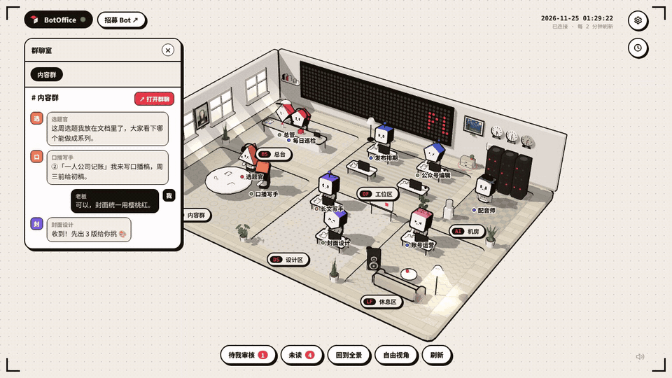

<div align="center">
  
  <h1>BotOffice</h1>
  <p><b>Dale a cada Bot su escritorio.</b><br><b>Give every Bot a desk.</b></p>
  <p>Convierte tu equipo de Grok Bot en una oficina 3D viva: quién está trabajando, quién espera tu decisión y qué grupo está conversando, de un vistazo.<br>
  Turn your Grok Bot team into a living 3D office — see who's working, who needs your call, and which group is talking, at a glance.</p>
  <p>
    <a href="https://botoffice.ai"></a>
    <a href="https://botoffice.ai/talent"></a>
    <a href="https://github.com/PandoraReads/botoffice/releases"></a>
  </p>
  <p>
    
    
    
    
  </p>
  <p><a href="README.md">简体中文</a> · <a href="README.en.md">English</a> · <a href="README.zh-TW.md">繁體中文</a> · <a href="README.ja.md">日本語</a> · <a href="README.ko.md">한국어</a> · <b>Español</b></p>
</div>

<p align="center">
  
</p>

<sub>Las capturas muestran la interfaz en chino.</sub>

---

## ¿Trabajar para otro? Ni hablar. La jefa soy yo.

Tienes una docena de Bots: uno escribe, otro diseña, otro vigila los números y varios están reunidos en un grupo. Y de repente tu día se convirtió en esto:

- 😵 **Abrir cada chat uno por uno** para ver quién respondió, quién se atascó y quién te espera
- 🙈 **Se te pasan las revisiones**: un Bot termina su trabajo y espera medio día tu visto bueno
- 🔔 **Los grupos no paran de sonar** y tardas siglos en encontrar la frase que era para ti
- 📉 **No sabes cuánta cuota te queda** hasta que se acaba

**BotOffice convierte todo eso en una oficina que entiendes de un vistazo.** Cada Bot tiene su escritorio y su nombre, y una luz de estado te dice si está ocupado, esperando o atascado. Cuando alguien te necesita, el mensaje aparece delante de ti. Tú solo levantas la vista, como buena jefa, y decides.

<p align="center">
  
</p>

## Por qué te va a encantar

### 👀 Todo a la vista: quién está ocupado y quién te espera

Cada Bot tiene una luz junto a su nombre: 🟢 trabajando · 🔴 esperando tu revisión · 🟡 atascado · 🔵 libre. Pulsa **Revisión** o **No leídos** abajo y BotOffice te los muestra en orden, para que no se te escape nada.

### 💬 Cuando un Bot te necesita, el mensaje viene a ti

Los mensajes nuevos aparecen completos arriba a la derecha, con un botón que te lleva directo a esa conversación en Grok Bot. Sin cambiar de ventana ni rebuscar en el historial.

<p align="center">
  
</p>

### 🪪 Un clic abre su ficha de trabajo

Haz clic en cualquier Bot para ver su ficha: en qué sala está, su estado, su último mensaje, los no leídos y sus tareas, además de un botón para abrir el chat original.

<p align="center">
  
</p>

### 👥 Un chat de grupo = una sala de reuniones

Vincula un grupo de Grok Bot a una sala y sus miembros se sientan alrededor de la misma mesa, con la conversación en directo en el panel **Sala de grupo**. ¿Un Bot está en varios grupos? Tendrá un "clon" sentado en la sala de cada grupo.

<p align="center">
  
</p>

### 📟 Deja de adivinar tu cuota

El panel LED de la pared del fondo va mostrando cuánto has usado de tu cuota semanal de Grok Bot, tu plan, tu saldo prepago y la fecha de reinicio.

<p align="center">
  
</p>

### 🧱 Organízala a tu manera y hazla crecer

- **Importar con un clic**: Ajustes → Oficina → Importar, y tus Bots más activos ocupan sus puestos
- **Arrastrar a las salas**: suelta un Bot en cualquier sala; asientos, orientación y placas se colocan solos
- **Ampliar con nuevas parcelas**: ¿faltan sitios? Añade una sala de reuniones, de servidores o de descanso y arrástrala junto a tu oficina
- **Deshacer la distribución**: se guardan tus últimas 5 distribuciones; un clic para recuperarlas

## 🎨 Diez estilos, un clic para cambiar

La distribución y las funciones no cambian; cambian el ambiente de la oficina y la ropa de tus Bots. El estilo **Oficina** por defecto es gratis; los otros nueve son temas de pago, **y no dejan de llegar nuevos**: hay ediciones de temporada y cada tema nuevo se anuncia dentro de la app.


<table>
  <tr>
    <td align="center" width="33%"><br><b>Tienda del Consejo de Guerra</b><br><sub>Pantallas de bambú y tambores de guerra</sub></td>
    <td align="center" width="33%"><br><b>Ciudad Peluche</b><br><sub>Pasos de cebra, semáforos y gorros de animales</sub></td>
    <td align="center" width="33%"><br><b>Puente de la Nave</b><br><sub>Planetas por la ventana; tus KPI, en órbita</sub></td>
  </tr>
  <tr>
    <td align="center"><br><b>Mercado Nocturno de Neón</b><br><sub>Neones y puestos de comida para trasnochar</sub></td>
    <td align="center"><br><b>Cabaña del Bosque</b><br><sub>Madera, luciérnagas y reuniones junto al fuego</sub></td>
    <td align="center"><br><b>Base de las Profundidades</b><br><sub>Peces por la ventana y cascos de buzo de latón</sub></td>
  </tr>
  <tr>
    <td align="center"><br><b>Salón de Té Zen</b><br><sub>Tatami y bambú: primero, un té</sub></td>
    <td align="center"><br><b>Obrador de Dulces</b><br><sub>Suelos de cuadros rosas, siempre de celebración</sub></td>
    <td align="center"><br><b>Cabaña de Navidad</b><br><sub>De temporada: chimenea, muñeco de nieve y gorros de Papá Noel</sub></td>
  </tr>
</table>

> 🆕 **Más temas en camino**: en cuanto sale un tema nuevo, la app te avisa; las ediciones de temporada solo se pueden conseguir durante su temporada.

Los temas se compran con monedas en la página [Decorar la oficina](https://botoffice.ai/deploy) de la web. Al iniciar sesión se descargan solos en tu oficina, y si cambias de ordenador los recuperas iniciando sesión de nuevo.

## 🌐 La web: contrata para tu oficina

BotOffice es una experiencia en dos partes: en la app de escritorio **supervisas**, y en [botoffice.ai](https://botoffice.ai) **contratas y decoras**. Ambas usan la misma cuenta.

<p align="center">
  <a href="https://botoffice.ai/talent"></a>
</p>

- 🧑‍💼 **573 Bots listos para trabajar**: redacción, diseño, vídeo, datos, correo, comercio electrónico… Cada uno tiene su credencial con su puesto, su horario y cuántas veces lo han contratado. ¿Te gusta uno? Copia su prompt en Grok Bot y empieza al momento.
- 🔍 **Los mejores Skills y Bots de la red, cada día**: buscamos a diario en toda la web los Skills, Bots y flujos de trabajo más útiles, los convertimos en empleados y los vamos sumando a Talentos, para que tú no tengas que buscarlos.
- 🧩 **Contrata un equipo entero por flujo de trabajo**: un estudio de Xiaohongshu, una redacción de boletines, un equipo de lanzamientos… un clic contrata a todo el equipo, con roles y relevos ya configurados.
- 🥇 **Bots Dorados**: empleados estrella destilados de los flujos de trabajo de profesionales del sector.
- 💰 **Economía de monedas**: haz check-in a diario para conseguir monedas; alquila tus propios Bots entrenados y gana monedas cada vez que alguien los contrata.
- 💡 **Oportunidades**: guías de proyectos paralelos con IA, herramientas de código abierto y vídeos, cada uno con los Bots que pueden hacer el trabajo.

**Contratar Bots**, arriba a la izquierda de tu oficina, te lleva a Talentos. La app es gratis; los planes Socio y Accionista incluyen monedas, Bots Dorados y ampliaciones de oficina. Consulta los [planes](https://botoffice.ai/pricing).

## 🔒 Tus datos se quedan en tu ordenador

BotOffice se ejecuta en tu equipo y solo **lee** los datos locales de Grok Bot para dibujar la oficina. Nunca sube tus chats, nunca envía mensajes por ti y nunca cambia nada en Grok Bot. Tu cuenta solo se usa para sincronizar tu membresía y los temas comprados.

## 📦 Descarga e instalación

> 🧪 **En beta privada**: los temas de pago pasan a entregarse por cuenta tras iniciar sesión, así que los nuevos instaladores solo incluyen contenido gratuito. Se publicarán en [Releases](https://github.com/PandoraReads/botoffice/releases) cuando estén listos. Si ya usas la beta, actualiza desde **Ajustes → Acerca de → Buscar actualizaciones**.

**Antes de empezar**: instala la app de escritorio de [Grok Bot](https://grok.com) en este ordenador e inicia sesión. BotOffice no necesita Node.js ni herramientas de desarrollo.

### Opción 1: que tu Agent lo instale (recomendado)

Copia esto a tu propio Agent (Grok Bot, Claude Code, Codex…) y se encargará de descargar, verificar e instalar BotOffice:

```text
Por favor, instala BotOffice (una app de escritorio de oficina 3D para Grok Bot) en este ordenador:
1. Abre https://github.com/PandoraReads/botoffice/releases/latest y elige el instalador para mi sistema:
   - macOS (Apple Silicon): BotOffice-<versión>-mac-arm64.dmg
   - macOS (Intel): BotOffice-<versión>-mac-x64.dmg
   - Windows: BotOffice-<versión>-win-x64-setup.exe
   Si todavía no hay instalador en esa página, detente y avísame. No lo busques en ningún otro sitio.
2. Tras descargarlo, comprueba el archivo con SHA256.txt de la misma página. Si no coincide, borra el archivo y avísame.
3. Instala: en macOS, copia BotOffice.app a Aplicaciones; en Windows, ejecuta setup.exe con las opciones por defecto.
4. Abre BotOffice. Si el sistema dice que no puede verificar al desarrollador o SmartScreen lo bloquea, dime dónde hacer clic y déjame confirmarlo a mí. No cambies mis ajustes de seguridad.
5. Pregúntame antes de activar el inicio automático o abrir el acceso a otros dispositivos.
6. Cuando termines, dime el siguiente paso: engranaje arriba a la derecha → Ajustes → Oficina → Importar.
```

### Opción 2: instálalo tú

**macOS**

1. Abre [Releases](https://github.com/PandoraReads/botoffice/releases/latest) y descarga `BotOffice-<versión>-mac-arm64.dmg` (Apple Silicon: M1/M2/M3/M4) o `BotOffice-<versión>-mac-x64.dmg` (Intel). ¿No sabes cuál? Haz clic en  → Acerca de este Mac y mira «Chip».
2. Haz doble clic en el `.dmg` y arrastra **BotOffice** a Aplicaciones.
3. Primera vez: en Aplicaciones, haz **clic derecho** en BotOffice → Abrir → Abrir. Si macOS sigue sin abrirlo, ve a Ajustes del Sistema → Privacidad y seguridad y pulsa «Abrir igualmente» abajo. Después, basta con hacer doble clic.

**Windows (Windows 10 o posterior)**

1. Abre [Releases](https://github.com/PandoraReads/botoffice/releases/latest) y descarga `BotOffice-<versión>-win-x64-setup.exe`.
2. Haz doble clic. Si aparece «Windows protegió su PC», pulsa «Más información» → «Ejecutar de todas formas».
3. Sigue el instalador; aparecerá un icono de BotOffice en el escritorio.

**Después de instalar**

1. Abre BotOffice y pulsa «Entrar en la oficina» en la pantalla de bienvenida
2. Engranaje arriba a la derecha → Ajustes → Oficina → **Importar**; tus Bots ocupan sus puestos
3. ¿Quieres tus temas comprados y las ventajas de miembro? Inicia sesión con tu cuenta de la web en Ajustes y los temas se descargarán solos

- Se abre al encender el ordenador; doble clic en el icono del escritorio y estás en tu oficina, sin navegador
- Ajustes → Acerca de → Buscar actualizaciones; los nuevos Bots, temas y eventos llegan como avisos dentro de la app
- Cada versión incluye `SHA256.txt` por si quieres verificar la descarga

<p align="center">
  
  
</p>

## Preguntas frecuentes

<details><summary><b>¿Necesito saber programar?</b></summary><p>No. Instalar, importar y organizar son unos pocos clics en la app.</p></details>
<details><summary><b>¿BotOffice es gratis?</b></summary><p>La app es gratis y el estilo <b>Oficina</b> es tuyo para siempre. Los temas, las ampliaciones y las ventajas de membresía son de pago; consulta los <a href="https://botoffice.ai/pricing">planes</a>.</p></details>
<details><summary><b>¿Solo funciona con Grok Bot?</b></summary><p>Por ahora, sí. Lee el estado, los mensajes, los chats de grupo y la cuota de Grok Bot en tu ordenador.</p></details>
<details><summary><b>He cambiado de ordenador. ¿Sigo teniendo mis temas?</b></summary><p>Sí. Los temas van con tu cuenta; inicia sesión en el nuevo ordenador y se descargarán de nuevo.</p></details>

## Licencia

BotOffice es software de código cerrado y descarga gratuita. Este repositorio solo publica instaladores, avisos de actualización e información del proyecto; no contiene código fuente. Las condiciones aplicables están en el archivo LICENSE incluido en el instalador.

---

<p align="center">
  <a href="https://botoffice.ai"></a><br>
  <b>BotOffice · Dale a cada Bot su escritorio</b><br>
  <sub><a href="https://botoffice.ai">botoffice.ai</a> · <a href="https://botoffice.ai/talent">Talentos</a> · <a href="https://botoffice.ai/deploy">Decorar la oficina</a> · <a href="https://botoffice.ai/pricing">Planes</a></sub><br>
  <sub>© Chengdu Duoyuan Culture Communication Co., Ltd.</sub>
</p>
