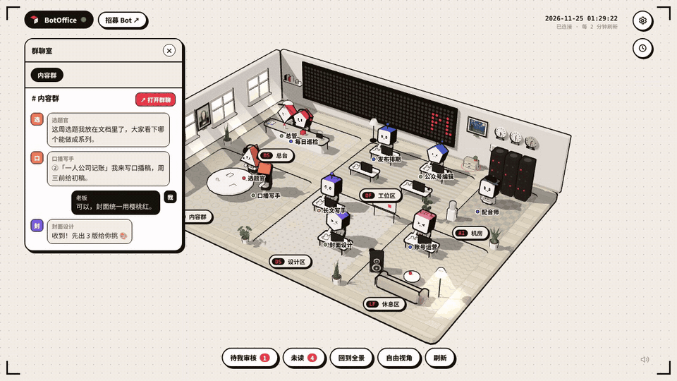
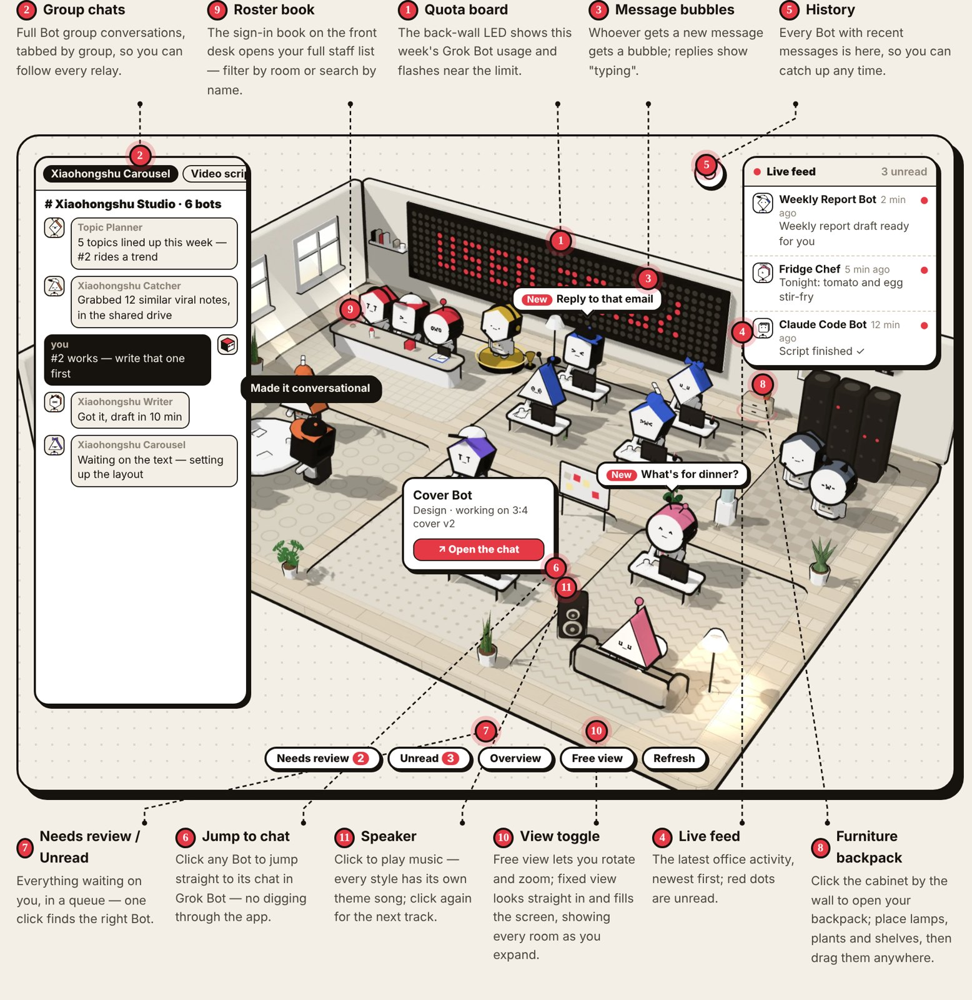
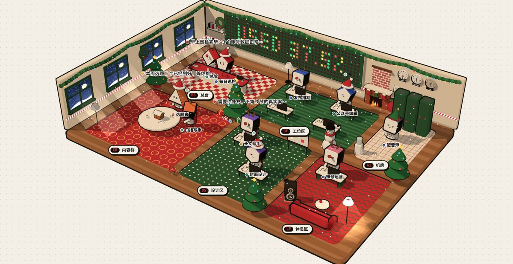

<div align="center">
  
  <h1>BotOffice</h1>
  <p><b>あなたの Bot に、デスクをひとつ。</b><br><b>Give every Bot a desk.</b></p>
  <p>Grok Bot のチームを 3D オフィスに。誰が作業中で、誰があなたの判断を待っていて、どのグループが話しているのか、ひと目でわかる。<br>
  Turn your Grok Bot team into a living 3D office — see who's working, who needs your call, and which group is talking, at a glance.</p>
  <p>
    <a href="https://botoffice.ai"></a>
    <a href="https://botoffice.ai/talent"></a>
    <a href="https://github.com/PandoraReads/botoffice/releases"></a>
  </p>
  <p><a href="README.md">简体中文</a> · <a href="README.en.md">English</a> · <a href="README.zh-TW.md">繁體中文</a> · <b>日本語</b> · <a href="README.ko.md">한국어</a> · <a href="README.es.md">Español</a></p>
</div>

<p align="center">
  
</p>

<sub>スクリーンショットは中国語版の画面です。</sub>

---

## 雇われる？ありえない。ボスになるのは私だ。

Bot が十数体。原稿を書く子、画像を作る子、数字を見張る子、グループで会議中の子たち。気づけば毎日の仕事は——

- 😵 **チャットを一つずつ開いて**、誰が返信したか、誰が詰まっているか、誰があなた待ちかを確認
- 🙈 **レビュー待ちを見落とす**：Bot は作業を終えてあなたの OK を半日待っている
- 🔔 **グループの通知が洪水のよう**で、自分宛ての一言を探すのに一苦労
- 📉 **クォータの残りがわからず**、使い切ってから気づく

**BotOffice は、それをひと目でわかるオフィスに変えます。** Bot には自分のデスクと名前があり、ステータスランプで作業中・待機中・詰まり中がすぐわかる。誰かがあなたを呼べば、メッセージが目の前にポップアップ。あなたはボスらしく、顔を上げて判断するだけ。

<p align="center">
  
</p>

## なぜ Bot たちにオフィスを用意すべきなのか？

### 👀 ひと目で全員：誰が忙しくて、誰があなた待ちか

各 Bot の名前の横にステータスランプ：🟢 作業中 · 🔴 レビュー待ち · 🟡 詰まり · 🔵 待機。下の「レビュー待ち」「未読」を押せば、順番に案内してくれるので見落としゼロ。

### 💬 Bot からの呼びかけは、目の前に

新しいメッセージは右上に全文で表示され、ボタン一つで Grok Bot の該当の会話へ。ウィンドウを切り替える必要も、履歴をさかのぼる必要もありません。

<p align="center">
  
</p>

### 🪪 クリックすれば、その子の業務カード

どの Bot をクリックしても、所属ルーム・ステータス・最新メッセージ・未読数・担当タスクが一枚のカードに。元の会話もワンクリックで開けます。

<p align="center">
  
</p>

### 👥 グループチャット 1 つ = 会議室 1 つ

Grok Bot のグループをルームに紐づけると、メンバーが同じテーブルを囲み、左の「グループルーム」に会話がリアルタイムで流れます。複数のグループに入っている Bot は、それぞれの会議室に「分身」が座ります。

<p align="center">
  
</p>

### 📟 クォータはもう勘に頼らない

奥の壁の LED ボードが、今週の Grok Bot クォータの使用率・プラン・プリペイド残高・リセット日を順番に表示します。

<p align="center">
  
</p>

### 🧱 自分好みに配置して、どんどん広げる

- **ワンクリック取り込み**：設定 → オフィス → 取り込み、最近よく使う Bot が自動で着席
- **ドラッグで配置**：Bot をルームにドロップすれば、席・向き・名札が自動で整う
- **区画を増築**：席が足りない？会議室・サーバールーム・休憩室を追加して、オフィスの隣にドラッグ
- **配置の巻き戻し**：直近 5 回分の保存前レイアウトを保持、ワンクリックで復元

## 🎨 10 種類の内装、ワンクリックで切り替え

レイアウトと機能はそのまま、オフィスの雰囲気と社員の衣装が変わります。初回インストール時は「オフィス」テーマ。残りの 9 種類のテーマは BotOffice 公式サイトで手に入ります。**しかも続々と追加中**です。季節限定版もあり、新しいテーマはアプリ内のお知らせですぐにお届けします。


<table>
  <tr>
    <td align="center" width="33%"><br><b>軍議の大天幕</b><br><sub>竹簡のスクリーンと軍旗、会議はまるで出陣前</sub></td>
    <td align="center" width="33%"><br><b>もふもふシティ</b><br><sub>横断歩道と信号、社員は動物の着ぐるみ帽子</sub></td>
    <td align="center" width="33%"><br><b>宇宙船ブリッジ</b><br><sub>窓の外には惑星、KPI を軌道へ</sub></td>
  </tr>
  <tr>
    <td align="center"><br><b>ネオン夜市</b><br><sub>ネオンと屋台、夜更かしのお供に</sub></td>
    <td align="center"><br><b>森のツリーハウス</b><br><sub>木の壁とホタル、会議はたき火を囲んで</sub></td>
    <td align="center"><br><b>深海基地</b><br><sub>窓の外を魚が泳ぎ、社員は真鍮の潜水ヘルメット</sub></td>
  </tr>
  <tr>
    <td align="center"><br><b>禅の茶室</b><br><sub>畳と竹、まずはお茶を一杯</sub></td>
    <td align="center"><br><b>スイーツ工房</b><br><sub>ピンクのチェック柄、いつでもお祝いムード</sub></td>
    <td align="center"><br><b>クリスマスの小屋</b><br><sub>季節限定：暖炉、雪だるま、サンタ帽</sub></td>
  </tr>
</table>

> 🆕 **新しいテーマを続々リリース予定**：新作が出るとアプリでお知らせします。季節限定版はその季節の間だけ手に入ります。

## 🌐 公式サイト：オフィスに人材を

BotOffice は二つで一つの体験です。デスクトップアプリで**見守り**、[botoffice.ai](https://botoffice.ai) で**採用と内装**。アカウントは共通です。

<p align="center">
  <a href="https://botoffice.ai/talent"></a>
</p>

- 🧑‍💼 **すでに 573 体の即戦力 Bot が在籍**：執筆、デザイン、動画、データ、メール、EC……一人ひとりに社員証があり、職種・勤務時間・採用回数がひと目でわかります。気に入ったらプロンプトをコピーして Grok Bot に貼るだけで着任。
- 🔍 **ネット上の最強 Skill と Bot を毎日リサーチ**：毎日ネット全体から本当に使える Skill、Bot、ワークフローを探し、社員として人材ライブラリに追加し続けます。自分で探し回る必要はありません。
- 🧩 **ワークフロー単位でチーム採用**：小紅書（RED）制作部、公式アカウント編集部、EC 新商品チーム……ボタン一つでチームごと採用、役割分担と引き継ぎも設定済み。
- 🥇 **ゴールド社員**：業界のプロのワークフローから生まれたエース社員。
- 💰 **コイン経済**：毎日のチェックインでコインを獲得。育てた Bot を貸し出せば、雇われるたびにコインが入ります。
- 💡 **ビジネスチャンス**：副業 × AI のガイド、オープンソースツール、動画チュートリアル。どれにも手伝ってくれる Bot が付いています。

## 🔒 データはあなたの PC の中だけ

BotOffice はあなたの PC 上で動き、オフィスを描くために PC 内の Grok Bot のデータを**読むだけ**です。会話をアップロードしたり、代わりにメッセージを送ったり、Grok Bot の中身を変更したりはしません。アカウントは会員情報と購入済みテーマの同期にのみ使われます。

## 📦 ダウンロードとインストール

> 🧪 **クローズドベータ中**：有料テーマはログイン後にアカウントごとに配信する方式へ移行中のため、新しいインストーラーには無料コンテンツのみが含まれます。準備ができ次第 [Releases](https://github.com/PandoraReads/botoffice/releases) で公開します。ベータ版をお使いの方は「設定 → バージョン情報 → アップデートを確認」から更新できます。

**始める前に**：この PC に [Grok Bot](https://grok.com) のデスクトップ版をインストールしてログインしておいてください。Node.js などの開発ツールは不要です。

### 方法 1：Agent にインストールしてもらう（おすすめ）

下の文章をあなたの Agent（Grok Bot、Claude Code、Codex など）にコピーして送れば、ダウンロード・検証・インストールまでやってくれます。

```text
この PC に BotOffice（Grok Bot 用の 3D オフィスのデスクトップアプリ）をインストールしてください：
1. https://github.com/PandoraReads/botoffice/releases/latest を開き、私の OS に合うインストーラーを選んでください：
   - macOS（Apple シリコン）：BotOffice-<バージョン>-mac-arm64.dmg
   - macOS（Intel）：BotOffice-<バージョン>-mac-x64.dmg
   - Windows：BotOffice-<バージョン>-win-x64-setup.exe
   ページにまだインストーラーがなければ、そこで止めて私に教えてください。ほかの場所で探さないでください。
2. ダウンロード後、同じページの SHA256.txt でチェックサムを確認し、一致しなければファイルを削除して教えてください。
3. インストール：macOS は BotOffice.app を「アプリケーション」にコピー、Windows は setup.exe を既定の設定で実行。
4. BotOffice を開いてください。「開発元を検証できません」や SmartScreen の警告が出たら、どこを押せばいいか教えてください。確認は私がします。システムのセキュリティ設定は変更しないでください。
5. ログイン時の自動起動や外部からのアクセス許可は、設定する前に私に確認してください。
6. 終わったら次の手順を教えてください：右上の歯車 → 設定 → オフィス → 取り込み。
```

### 方法 2：自分でインストールする

**macOS**

1. [Releases](https://github.com/PandoraReads/botoffice/releases/latest) を開き、`BotOffice-<バージョン>-mac-arm64.dmg`（Apple シリコン：M1/M2/M3/M4）または `BotOffice-<バージョン>-mac-x64.dmg`（Intel）をダウンロード。どちらかわからない場合は、 → この Mac について の「チップ」を確認してください。
2. `.dmg` をダブルクリックし、**BotOffice** を「アプリケーション」フォルダへドラッグ。
3. 初回起動：「アプリケーション」で BotOffice を**右クリック** → 開く → 開く。それでも開けない場合は、システム設定 → プライバシーとセキュリティ の下にある「このまま開く」をクリック。次回からはダブルクリックで開けます。

**Windows（Windows 10 以降）**

1. [Releases](https://github.com/PandoraReads/botoffice/releases/latest) を開き、`BotOffice-<バージョン>-win-x64-setup.exe` をダウンロード。
2. ダブルクリックで実行。「Windows によって PC が保護されました」と表示されたら、「詳細情報」→「実行」。
3. インストーラーに従って進めると、デスクトップに BotOffice のアイコンができます。

**インストール後**

1. BotOffice を開き、ウェルカム画面で「オフィスに入る」をクリック
2. 右上の歯車 → 設定 → オフィス → **取り込み**。Bot が自動で着席します
3. もっと多くのテーマや会員特典を解放するには、設定で公式サイトのアカウントにログイン。テーマが自動でダウンロードされます

- PC 起動時に自動で立ち上がり、デスクトップのアイコンをダブルクリックするだけでオフィスへ
- 設定 → バージョン情報 → アップデートを確認。新しい Bot、テーマ、イベントはアプリ内のお知らせで届きます
- ダウンロードしたファイルを検証したい場合は、各リリースに付属の `SHA256.txt` をどうぞ

<p align="center">
  
  
</p>

## よくある質問

<details><summary><b>プログラミングは必要？</b></summary><p>いいえ。インストールも取り込みも配置も、画面上で数回クリックするだけです。</p></details>
<details><summary><b>BotOffice は無料？</b></summary><p>本体は無料で、標準の「オフィス」はずっと使えます。有料なのはテーマ、増築、会員特典です。<a href="https://botoffice.ai/pricing">会員プラン</a>をご覧ください。</p></details>
<details><summary><b>Grok Bot 専用？</b></summary><p>現在は Grok Bot のみに対応し、PC 内の Grok Bot のステータス、メッセージ、グループチャット、クォータを読み取ります。</p></details>
<details><summary><b>PC を買い替えたら、購入したテーマは？</b></summary><p>大丈夫です。テーマはアカウントに紐づいているので、新しい PC で同じアカウントにログインすれば再ダウンロードされます。</p></details>

## ライセンス

BotOffice は無料でダウンロードできるクローズドソースのソフトウェアです。このリポジトリではインストーラー、更新のお知らせ、プロジェクト紹介のみを公開しており、ソースコードは含まれていません。適用される条件はインストーラー同梱の LICENSE ファイルをご覧ください。

---

<p align="center">
  <a href="https://botoffice.ai"></a><br>
  <b>BotOffice · あなたの Bot に、デスクをひとつ</b><br>
  <sub><a href="https://botoffice.ai">botoffice.ai</a> · <a href="https://botoffice.ai/talent">人材ライブラリ</a> · <a href="https://botoffice.ai/deploy">オフィス改装</a> · <a href="https://botoffice.ai/pricing">会員プラン</a></sub><br>
  <sub>© 成都哆元文化传播有限公司</sub>
</p>
