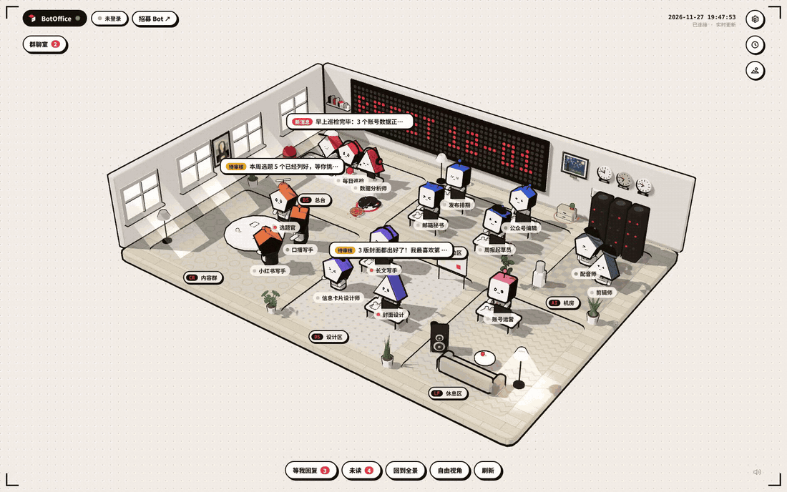
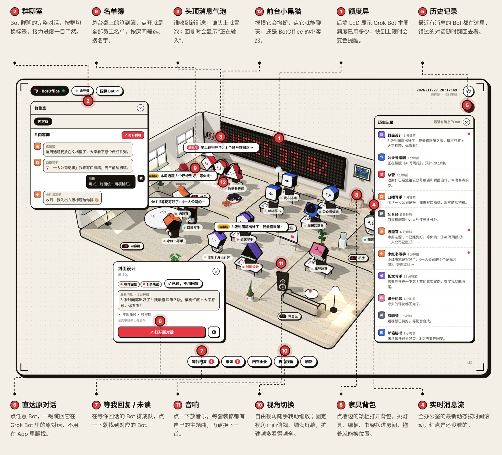
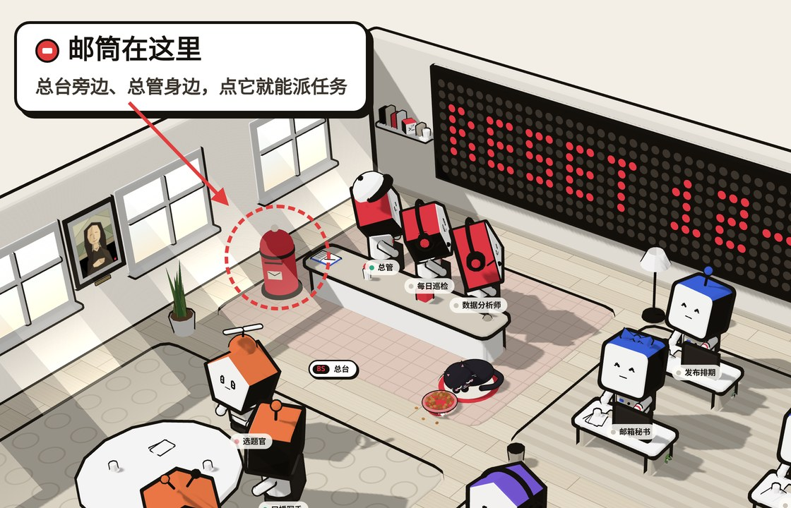
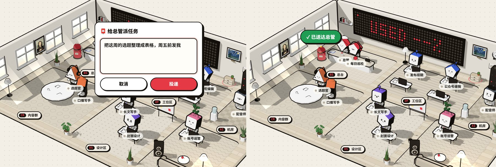
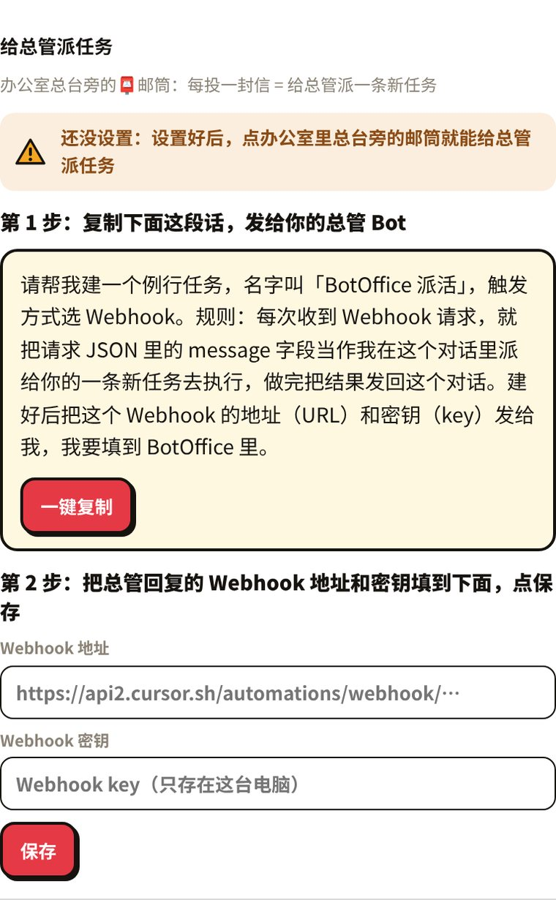
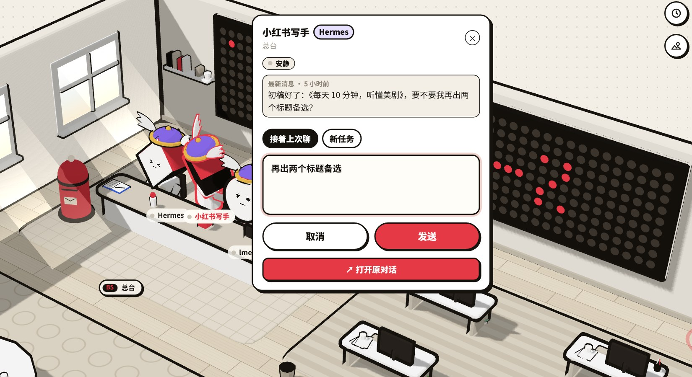
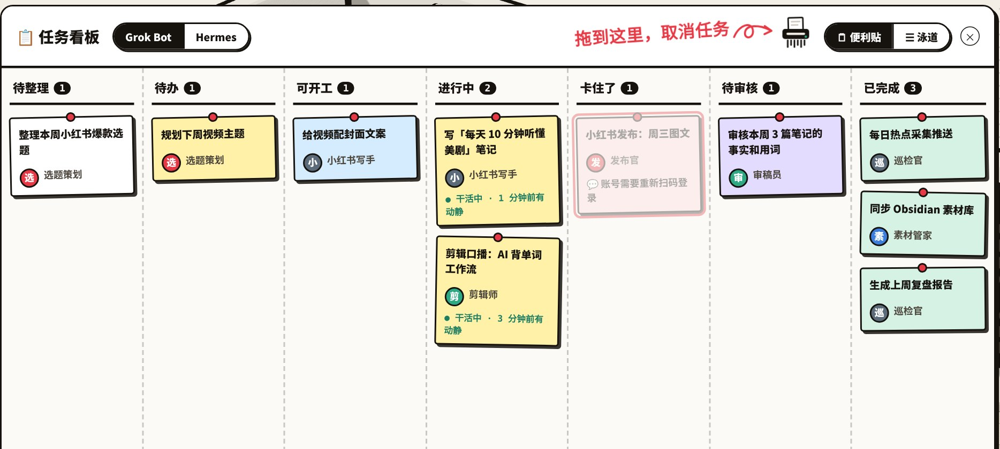
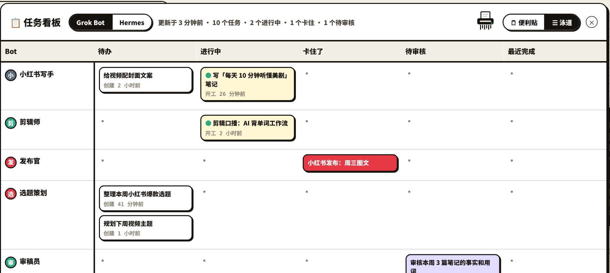
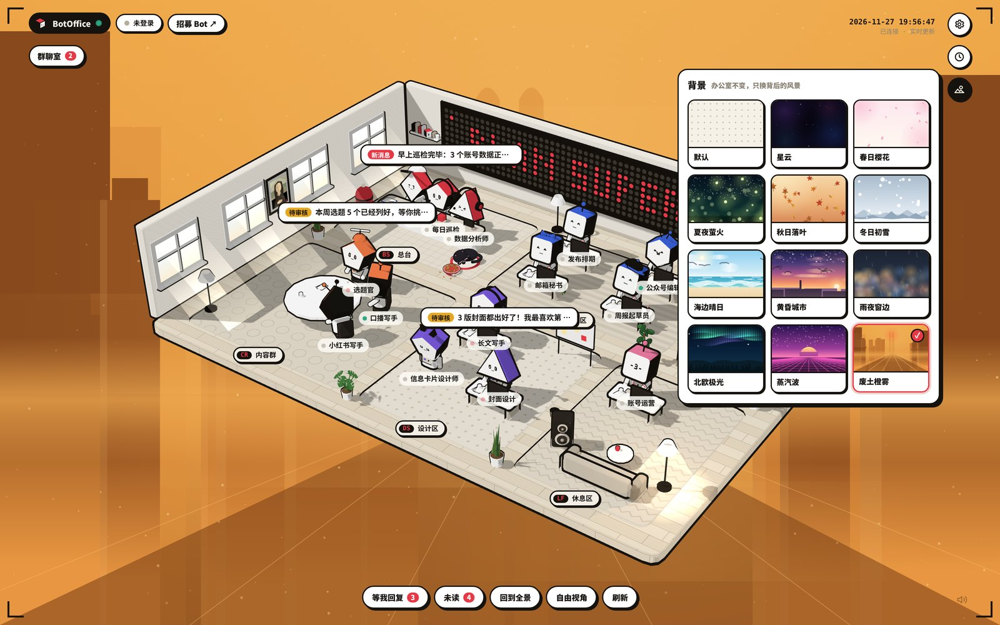

<div align="center">
  
  <h1>BotOffice</h1>
  <p>把你的 Grok Bot 和 Hermes Bot 机器人团队装进一间 3D 办公室：谁在干活、谁在等你拍板、哪个群在聊，一目了然。<br>
  Turn your Grok Bot & Hermes Bot team into a cozy 3D office — see who's working, who needs your call, and which group is talking, at a glance.</p>
  <p>
    <a href="https://botoffice.ai"></a>
    <a href="https://botoffice.ai/talent"></a>
    <a href="https://github.com/PandoraReads/botoffice/releases"></a>
  </p>
  <p><b>简体中文</b> · <a href="docs/README.en.md">English</a> · <a href="docs/README.zh-TW.md">繁體中文</a> · <a href="docs/README.ja.md">日本語</a> · <a href="docs/README.ko.md">한국어</a> · <a href="docs/README.es.md">Español</a></p>
</div>

<p align="center">
  
</p>

---

## 打工？不可能。我要当老板。

你养了几十个Bot：有的写稿，有的做图，有的盯数据，还有几个在群里开会。然后你发现，为什么自己越来越忙，越来越憔悴——

- 😵 **挨个点开对话**，看谁回了、谁卡住了、谁在等你确认，心累😩
- 🙈 **待审核总是漏**：Bot 干完活等你点头，一等就是半天，无奈 ╮(╯▽╰)╭
- 🔔 **群聊消息刷屏**，翻半天才找到重要信息，烦燥😡
- 📉 **额度用了多少心里没底**，用到见底才发现没得蹬了｡°(°¯᷄◠¯᷅°)°｡

**BotOffice 把这一切繁琐日常变成一间充满情绪价值的你一眼就能看懂的温馨办公室。** 每个 Bot 有自己的工位和名字，状态灯告诉你谁在等你回话、谁刚刚活跃；有人找你，消息直接弹到你面前。你只需要像老板一样，抬头看一眼，然后做决定。

<p align="center">
  
</p>

## 为什么你应该给Bot们一间办公室？

### 💬 Bot 找你，消息直接弹到你面前

Bot 说了新话，右上角弹出全文，旁边一个按钮直达 Grok Bot 或 Hermes 桌面端里的那段对话。不用切窗口、不用翻记录，看完点一下就能回复。

<p align="center">
  
</p>

### 🪪 点一下，就是它的工作档案

点任何一位员工，弹出它的工作卡：在哪个房间、现在什么状态、最新一条消息、几条未读、手上的任务，一键打开原对话。Bot 只是说了句话、你看过不打算回？点「✓ 已读，不用回复」，它就不再算在「等我回复」里。

<p align="center">
  
</p>

### 👥 一个群 = 一间会议室

把 Grok Bot 的群绑定到一个房间，群成员自动围桌而坐，左边的「群聊室」实时显示对话。同一个 Bot 在好几个群里？它会在每个群的房间里各坐一个「分身」。

<p align="center">
  
</p>

### 📟 额度不再靠猜

后墙那块 LED 点阵屏轮播你这周 Grok Bot 额度用了多少、套餐、预付余额和重置日期，也能显示 Hermes 本周 / 今天用了多少 token（设置里选只看 Grok、只看 Hermes、一屏都显示或轮流显示）。抬头就知道还能放开用多少。

<p align="center">
  
</p>

### 🧱 自己布置，做大做强

- **一键导入**：设置 → 办公室 → 一键导入，最近活跃的 Bot 自动入座
- **拖进房间**：把 Bot 拖到想要的房间，座位、朝向、名牌自动排好
- **扩建地块**：人坐不下？加一块会议室、机房或休息室，在场景里拖到办公室旁边拼上
- **拖动排序**：房间里的成员拖一拖就能换顺序，座位跟着变
- **布置后悔药**：最近 5 次保存前的布置都留着，点一下就能找回

## 📮 邮筒：不离开办公室，直接给总管派任务

总台旁边有一个邮筒。点开它，写下要做的事，按「投递」——信封被塞进邮筒，任务就直接发到你的总管 Bot 那里。**每投一封信 = 派一条新任务**；总管做完会在 Grok Bot 原来的对话里回复，办公室会实时弹出新消息。

邮筒就在**总台旁边、总管身边**，第一次找它看这张图就行。每套主题的邮筒造型和投递动作都不一样，比如军议大帐的信鸽会把信叼在嘴上，萌兽都市的路边信箱送达后会竖起小红旗。

<p align="center">
  
</p>

<p align="center">
  
</p>

### 第一次使用：3 分钟设置好

邮筒要先和你自己的总管 Bot 接上（每个人的总管不一样，所以这一步要你自己做一次）：

1. **点击📮邮筒**：在办公室里点总台旁边的邮筒。还没设置时，卡片顶部会有黄色提示，点里面的「去设置」，会直接打开系统设置的「给总管派任务」这一栏。
2. **一键复制提示词**：在设置面板里点「一键复制」，按钮变绿就是复制好了。复制的是这段话：
   ```text
   请帮我建一个例行任务，名字叫「BotOffice 派活」，触发方式选 Webhook。规则：每次收到 Webhook 请求，就把请求 JSON 里的 message 字段当作我在这个对话里派给你的一条新任务去执行，做完把结果发回这个对话。建好后把这个 Webhook 的地址（URL）和密钥（key）发给我，我要填到 BotOffice 里。
   ```
3. **发给总管 Bot**：打开 Grok Bot，进入你置顶的总管 Bot 的对话，粘贴发送。总管会自己建好一个用 Webhook 触发的例行任务。
4. **复制 Webhook 地址和密钥**：总管会回复一个 **Webhook 地址**（通常以 `https://api2.cursor.sh/automations/webhook/` 开头）和一把**密钥**，把它们复制下来。
5. **填进 BotOffice 系统设置**：回到 BotOffice 系统设置的「给总管派任务」，把地址和密钥分别粘贴到下方的「Webhook 地址」「Webhook 密钥」里，点「保存」。状态变成绿色「已设置」就好了。
6. **重新点击📮邮筒试一下**：写一件小事（比如「帮我查一下今天的待办」），点「投递」或按 ⌘ / Ctrl + Enter。看到绿色的「✓ 已送达总管」就说明送到了，总管的回复会在办公室里弹出来。

<p align="center">
  
</p>

> 💡 **小贴士**
> - 地址和密钥只保存在你自己的电脑上，不会上传；但谁拿到它们都能给你的总管派活，所以别发给别人。
> - 没送出去时，卡片里会用红色写明原因。最常见的是密钥失效（比如在 Grok Bot 里重新生成过）：让总管把新的地址和密钥发给你，再到设置里重填一次。
> - 每次投递都会让总管运行一次，计入 Grok Bot 的周额度；Grok Bot 对每个例行任务每小时最多触发 200 次。
> - 用 Hermes？邮筒里把收件人选成「Hermes 总管」就行，不用设置 Webhook；想给某个 Hermes Bot 单独派活，直接在它的工作卡里发消息。

## 🪽 Hermes Bot 也来上班了

装了 [Hermes Agent](https://hermes-agent.nousresearch.com)？它的每个 Bot（profile）都能坐进办公室，和 Grok Bot 混坐。Hermes 的员工戴着带翅膀的紫色信使帽，一眼就能认出来。

- **消息和状态灯**：自动读取 Hermes 的最新回复，等你回复、刚刚活跃、安静一看便知，新消息实时弹出
- **直接发消息**：点开 Hermes Bot 的工作卡就能给它发消息，可以「接着上次聊」，也可以开「新任务」，不用设置 Webhook
- **打开原对话**：装了 Hermes 桌面端，一键跳到桌面端里那段对话；没装就在终端里接着聊（带历史回顾）
- **用量**：后墙的点阵屏能显示 Hermes 本周 / 今天用了多少 token

<p align="center">
  
</p>

## 📋 任务看板：谁在做什么，一块白板看清

点办公室工位区的**白板**，打开任务看板。

- **Grok Bot 看板**：让你的巡检 Bot 用定时任务把团队任务写到本机，看板就会自动出现、每 10 秒刷新。第一次用，看板里有「一键复制提示词」，发给巡检 Bot 就行
- **Hermes 看板**：直接读取 Hermes 自带的任务看板（Kanban），多个看板合在一起显示
- **两种视图**：便利贴（按状态分列：待整理、待办、可开工、进行中、卡住了、待审核、已完成）和泳道（每个 Bot 一行，谁忙谁闲一目了然）
- **点员工跳对话**：点卡片上的员工名，直接打开和它的对话
- **🗑 碎纸机**：任务不要了？把卡片拖进右上角的碎纸机，5 秒内可以撤销。Grok Bot 的任务会通过总管通知负责的 Bot 停手；Hermes 的任务会归档（还能找回）并告诉负责的 Bot
- 已完成只显示最近 7 项；关掉再打开，停在你上次看的地方

<p align="center">
  
</p>
<p align="center">
  
</p>

## 🐈‍⬛ 前台多了一只小黑猫：会撒娇，也会帮你答疑

总台右下角住着「小黑」，一只戴红围巾的黑色小奶猫，坐垫前那碗猫粮堆得冒了尖（碗的颜色会跟着主题变）。

- 🐾 **摸摸它**：鼠标放上去变成手掌，小黑会撅屁股、翻肚皮、冒爱心；闲着时打盹、四脚朝天，头上冒出小鱼、蝴蝶、主人和讨厌的狗狗
- 💬 **点它聊天**：接上你自己的对话模型（DeepSeek、Kimi、通义千问、智谱、OpenAI、Gemini、Claude 或自定义），它就能陪你聊天、出主意，也是 BotOffice 的小客服，怎么装、怎么用都能问
- 🔁 **多个模型互为备用**：排第一的是主模型，连不上时自动换下一个
- 📒 **小本本记忆**：它会记住你说过的重要事情，记错了可以划掉，也能直接告诉它
- 🌐 **联网搜索**：打开后能上网查新鲜事，回答附出处链接。主模型是 DeepSeek 时不用另外填 Key
- 💕 **亲密度**：常摸摸、常聊天会越来越黏你；太久不理它会蔫，甚至想你想得生病

API Key 只存在你自己的电脑上。

<p align="center">
  
</p>

## 🌄 12 款背景，换一换心情

右侧的「背景」按钮里有 12 款背景：**默认、星云、春日樱花、夏夜萤火、秋日落叶、冬日初雪、海边晴日、黄昏城市、雨夜窗边、北欧极光、蒸汽波、废土橙雾**。办公室本身不变，只换背后的风景；每款都有轻柔的动效（飘落的樱花、闪烁的萤火、流动的极光……），深色背景下角落的取景框和时间会自动变成浅色。全部免费，选好的背景会记在本机。

<p align="center">
  
</p>

## 🎨 丰富主题，一键切换换装修风格

布局和功能完全一样，变的是整间办公室的氛围和员工的打扮。第一次安装使用「办公室」主题，另外九套办公室主题在BotOffice官网置办。**而且还在持续上新**：每个季节都有限定款，新主题会通过应用内公告第一时间通知你。

<table>
  <tr>
    <td align="center" width="33%"><br><b>军议大帐</b><br><sub>竹简大屏、令旗战鼓，开会像点将</sub></td>
    <td align="center" width="33%"><br><b>萌兽都市</b><br><sub>斑马线、红绿灯，员工戴动物玩偶帽</sub></td>
    <td align="center" width="33%"><br><b>星际舰桥</b><br><sub>舷窗外是行星，把 KPI 送上轨道</sub></td>
  </tr>
  <tr>
    <td align="center"><br><b>霓虹夜市</b><br><sub>霓虹灯和烤串摊，陪你改完最后一版</sub></td>
    <td align="center"><br><b>森林树屋</b><br><sub>木头墙、萤火虫，会议区有篝火</sub></td>
    <td align="center"><br><b>深海基地</b><br><sub>小鱼游过舷窗，员工戴黄铜潜水盔</sub></td>
  </tr>
  <tr>
    <td align="center"><br><b>禅意茶室</b><br><sub>草席竹影，事情再多也先喝口茶</sub></td>
    <td align="center"><br><b>甜品工坊</b><br><sub>粉白格子地板，随时准备庆祝</sub></td>
    <td align="center"><br><b>圣诞小屋</b><br><sub>季节限定：大月亮、雪橇飞过窗前、壁炉烛光</sub></td>
  </tr>
</table>

> 🆕 **更多主题风格持续推出中**：新主题一上架，应用里就会弹公告通知你；季节限定款只在当季开放收藏。


## 🌐 官网：给你的办公室招人

BotOffice 是一整套体验：桌面应用负责「看」，[botoffice.ai](https://botoffice.ai) 负责「招人和装修」，两边用同一个账号。

<p align="center">
  <a href="https://botoffice.ai/talent"></a>
</p>

- 🧑‍💼 **已入驻573 位现成的 Bot 员工**：写稿、做图、剪视频、盯数据、管邮箱、跑电商……每一位都有自己的工牌：职位、上班时间、被雇佣次数一目了然。挑中了，复制提示词粘贴进 Grok Bot 或 Hermes，马上上岗。
- 🔍 **每天搜罗全网最强的 Skill 和 Bot**：我们每天在全网找最好用的 Skill、Bot 和工作流，整理成员工，持续上新到人才库，你不用自己到处找。
- 🧩 **按工作流整组招**：小红书图文部、公众号编辑部、电商上新组……一个按钮招来一整组，分工和交接都已经配好。
- 🥇 **黄金雇员**：行业高手的工作流提炼出来的王牌员工。
- 💰 **金币经济**：每天打卡领金币；把你调教好的 Bot 挂到工牌墙上出租，别人每雇一次，你就分到金币。
- 💡 **发掘商机**：副业 + AI 的学习手册、开源工具和视频教程，每份都配好了能帮你干活的 Bot。

## 🔒 你的数据，只留在你的电脑上

BotOffice 在你本机运行，**读取**你电脑上 Grok Bot 和 Hermes 的数据来画出办公室：不会上传你的对话；只有你亲手点了「投递」「发送」或把卡片拖进碎纸机，才会替你发出消息，其余时候不会改动 Grok Bot 和 Hermes 里的任何东西。登录账号只用来同步会员身份和已购装修。

## 📦 下载与安装

> 🆕 **最新版本在 [Releases](https://github.com/PandoraReads/botoffice/releases/latest) 下载**：安装包只内置免费内容，登录官网账号后，你买过的装修会自动下载。已经装过的用户，在「设置 → 关于 → 检查更新」里就能一键升级。

**安装前**：先在这台电脑上装好 [Grok Bot](https://grok.com) 桌面版并登录，或者装好 [Hermes Agent](https://hermes-agent.nousresearch.com)（两个都装也行）。BotOffice 不需要另外装 Node.js 或任何开发工具。

### 方式一：让你的 Agent 帮你装（推荐）

把下面这段话复制给你自己的 Agent（Grok Bot、Hermes、Claude Code、Codex 都可以），它会帮你下载、核对、安装：

```text
请帮我在这台电脑上安装 BotOffice（Grok Bot 和 Hermes Bot 的 3D 办公室桌面应用）：
1. 打开 https://github.com/PandoraReads/botoffice/releases/latest ，按我的系统选安装包：
   - macOS（Apple 芯片）：BotOffice-<版本>-mac-arm64.dmg
   - macOS（Intel 芯片）：BotOffice-<版本>-mac-x64.dmg
   - Windows：BotOffice-<版本>-win-x64-setup.exe
   如果页面上还没有安装包，就停下来告诉我，不要去别的地方找。
2. 下载后，用同一页的 SHA256.txt 核对校验值；对不上就删掉文件并告诉我。
3. 安装：macOS 把 BotOffice.app 拷进「应用程序」；Windows 运行 setup.exe，按默认选项装完。
4. 打开 BotOffice。如果系统提示「无法验证开发者」或 SmartScreen 拦截，告诉我该点哪里，由我自己确认，不要替我修改系统安全设置。
5. 开机自启、对外开放访问这类设置，先问我再动。
6. 装好后告诉我下一步：在办公室右上角齿轮 → 设置 → 办公室 → 一键导入。
```

### 方式二：自己动手装

**macOS**

1. 打开 [Releases](https://github.com/PandoraReads/botoffice/releases/latest)，下载 `BotOffice-<版本>-mac-arm64.dmg`（Apple 芯片：M1 / M2 / M3 / M4）或 `BotOffice-<版本>-mac-x64.dmg`（Intel 芯片）。不确定是哪种？点屏幕左上角  → 关于本机，看「芯片」那一行。
2. 双击 `.dmg`，把 **BotOffice** 拖进「应用程序」文件夹。
3. 第一次打开：在「应用程序」里**右键** BotOffice → 打开 → 再点「打开」。如果提示无法打开，去「系统设置 → 隐私与安全性」，在页面下方点「仍要打开」。之后双击就能直接打开。

**Windows（Windows 10 及以上）**

1. 打开 [Releases](https://github.com/PandoraReads/botoffice/releases/latest)，下载 `BotOffice-<版本>-win-x64-setup.exe`。
2. 双击运行。如果出现「Windows 已保护你的电脑」，点「更多信息」→「仍要运行」。
3. 按安装向导点「下一步」装完，桌面会出现 BotOffice 图标。

**装好以后**

1. 打开 BotOffice，欢迎页点「进入办公室」
2. 右上角齿轮 → 设置 → 办公室 → **一键导入**，你的 Bot 自动入座
3. 想解锁更多装修主题和会员权益？在设置里登录官网账号，装修会自动下载

- 开机自动启动，双击桌面图标直接进办公室，不用先开浏览器
- 设置 → 关于 → 检查更新，一键升级；新员工上架、新装修、新活动会通过应用内公告推送
- 想核对安装包是否完整：每个版本都附带 `SHA256.txt`

<p align="center">
  
  
</p>

## 常见问题

<details><summary><b>需要会写代码吗？</b></summary><p>不需要。安装、导入、布置都在界面里点几下完成。</p></details>
<details><summary><b>BotOffice 收费吗？</b></summary><p>本体免费，默认装修「办公室」永久可用。付费的是装修主题、扩容和会员权益，详见 <a href="https://botoffice.ai/pricing">会员方案</a>。</p></details>
<details><summary><b>支持哪些 Bot？</b></summary><p>Grok Bot 和 Hermes Bot（Hermes Agent 的每个 profile）。Grok Bot 读状态、消息、群聊和额度；Hermes 读状态、消息、任务看板和 token 用量。两边的 Bot 可以坐在同一间办公室。</p></details>
<details><summary><b>换电脑了，买过的装修还在吗？</b></summary><p>在。装修跟着账号走，在新电脑上登录同一个账号就会自动重新下载。</p></details>
<details><summary><b>邮筒点了没反应 / 显示没送出去？</b></summary><p>先看系统设置里「给总管派任务」是不是绿色「已设置」。如果卡片里提示密钥失效，让总管把最新的 Webhook 地址和密钥发给你，重新填一次；如果提示连不上，检查网络后点「重试」。</p></details>

## 致谢

- [Grok Bot](https://grok.com)：BotOffice 从 Grok Bot 起步，办公室里的员工来自你的 Grok Bot。
- [Hermes Agent](https://hermes-agent.nousresearch.com)（Nous Research）：Hermes 的每个 Bot 都能坐进办公室，任务看板也来自 Hermes 自带的 Kanban。
- [Pixabay](https://pixabay.com)：应用里的部分音乐和音效来自 Pixabay 的免版税素材库，感谢创作者们。
- [麦当的 Bot 小镇](https://www.mdldm.club/grok-bots)：部分 Bot 员工的提示词参考了 Bot 小镇，感谢麦当的分享。

## 许可

BotOffice 是免费下载的闭源软件。本仓库只发布安装包、更新公告和项目介绍，不包含源代码；安装包内附带的 LICENSE 文件包含适用的许可声明。

---

<p align="center">
  <a href="https://botoffice.ai"></a><br>
  <b>BotOffice · 给你的 Bot 一个工位</b><br>
  <sub><a href="https://botoffice.ai">botoffice.ai</a> · <a href="https://botoffice.ai/talent">人才库</a> · <a href="https://botoffice.ai/deploy">装修办公室</a> · <a href="https://botoffice.ai/pricing">会员方案</a></sub><br>
  <sub>© 成都哆元文化传播有限公司</sub>
</p>
