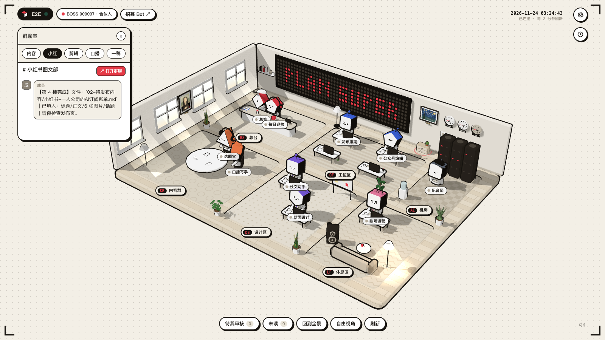
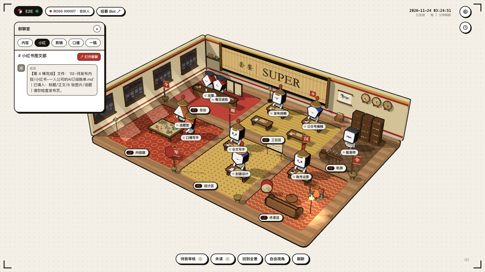
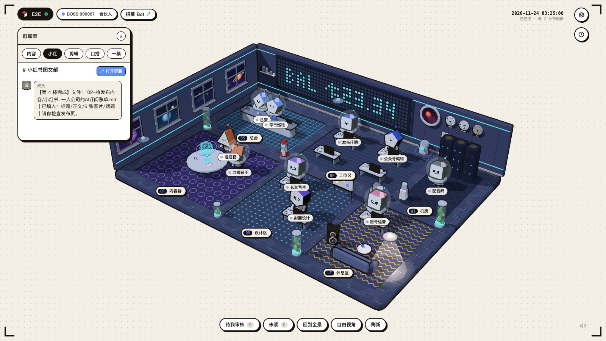
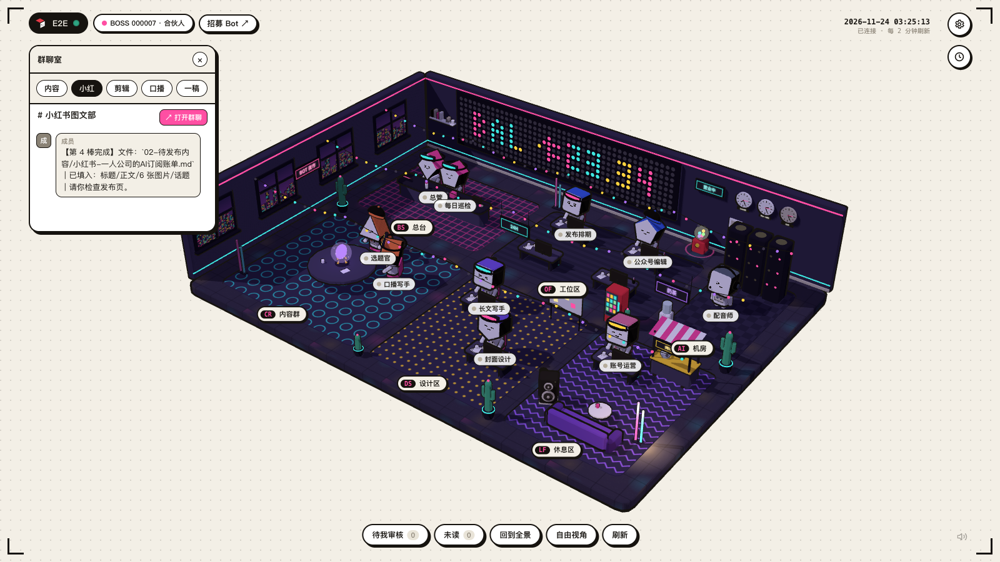
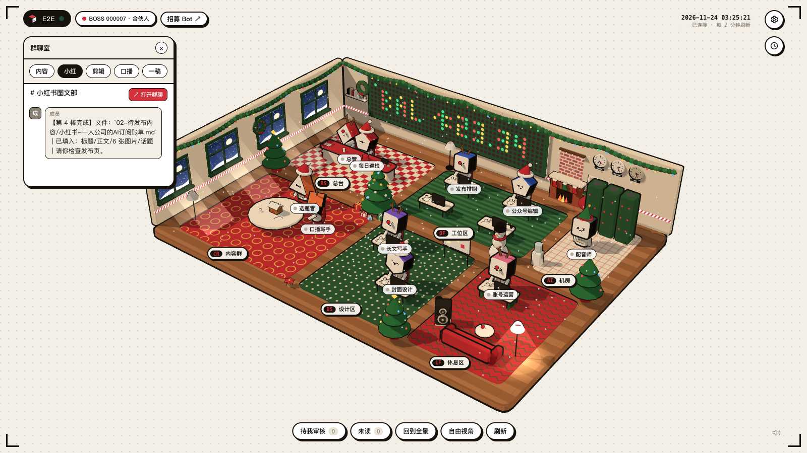
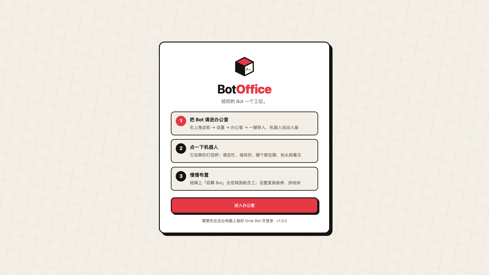

  
  <h1>BotOffice</h1>
  
<b>给你的 Bot 一个工位。</b>

  
把 Grok Bot 机器人团队装进一间 3D 办公室：谁在线、谁找你、哪个群在聊，抬头就看见。

  

    <a href="https://www.botoffice.ai">官网</a> ·
    <a href="https://github.com/PandoraReads/botoffice/releases/latest">下载安装包</a> ·
    <a href="https://www.botoffice.ai/#pricing">会员与定价</a>
  

---

  

  军议大帐 · 星际舰桥  
  
  

  霓虹夜市 · 圣诞小屋  
  
  

## 这是什么

BotOffice 是一个桌面应用。它在本机跑一个你的专属办公室网页，直连你的 **Grok Bot** 数据——

- 🏢 **一间 3D 办公室**：总台、圆桌、工位、休息室、机房，机器人在各自岗位上办公
- 👥 **群聊 = 房间**：一个 Grok 群一间办公室，成员围桌而坐；同时在几个群里的机器人自动「分身」
- 📬 **新消息弹窗**：Bot 找你时逐条弹出全文，一键跳回 Grok Bot 里的对话；待审核、未读数都在底部
- 📊 **Grok 周额度电子屏**：办公室顶上的 LED 屏实时轮播剩余额度、会员与金币
- 🧱 **扩容与装修**：办公室不够坐？拖一块新地块拼上去（会议室 / 机房 / 休息室任选）；九套主题装修一键切换，军议大帐到星际舰桥
- 🪑 **家具与主题收藏**：官网会员中心买的主题家具、收藏的季节限定，登录后自动摆进办公室
- 📣 **公告推送**：新 Bot 员工上架、新主题、新商机，应用联网自动弹给你
- 🔄 **一键更新**：设置里点一下，自动下载安装最新版
- 🪟 **Windows / macOS**：开机自启，双击桌面图标直接进办公室，不用先开浏览器

## 安装

安装包暂未开放下载（内测中）。主题装修正在改为登录后按账号下发，新的安装包会在 [Releases](https://github.com/PandoraReads/botoffice/releases) 发布，届时 macOS / Windows 双平台都有；已装内测版的应用会在「设置 → 关于 → 检查更新」里自动提示。

## 用起来

1. 装好 Grok Bot 并登录
2. 打开 BotOffice → 右上角齿轮 → 设置 → 办公室 → **一键导入**，机器人自动入座
3. 左上角「招募 Bot」去官网人才库挑新员工，复制提示词或一键上岗

  第一次打开的欢迎页  
  

## 会员

BotOffice 本体免费。会员（[官网定价](https://www.botoffice.ai/#pricing)）解锁更多工位、扩容地块和付费装修；账号在官网和应用间通用，登录即载入已购内容。

## 更新与公告

- 应用内「设置 → 关于 → 检查更新」一键升级
- 更新日志见 [Releases](https://github.com/PandoraReads/botoffice/releases)
- 新员工上架、新主题、新商机会通过应用内公告推送

## 许可

BotOffice 为闭源分发软件，本仓库仅发布安装包与项目介绍；安装包内附带的 LICENSE 文件包含适用的许可声明。

---

© BotOffice · <a href="https://www.botoffice.ai">www.botoffice.ai</a>

