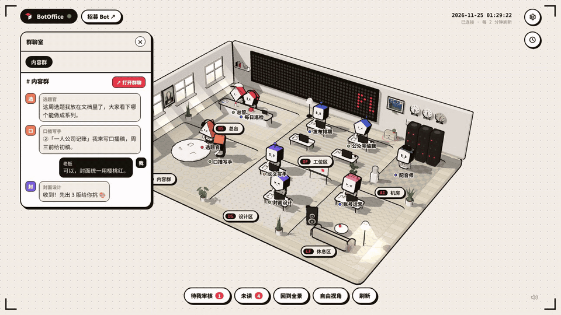
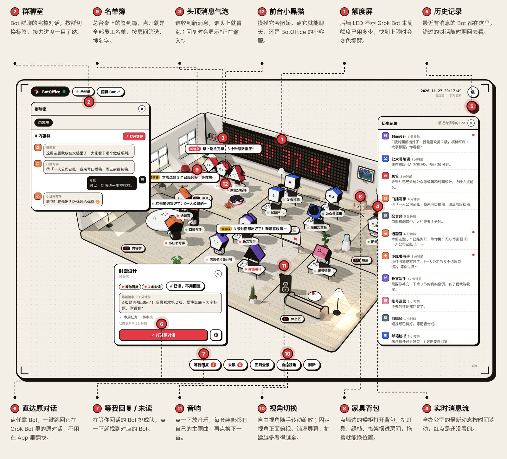
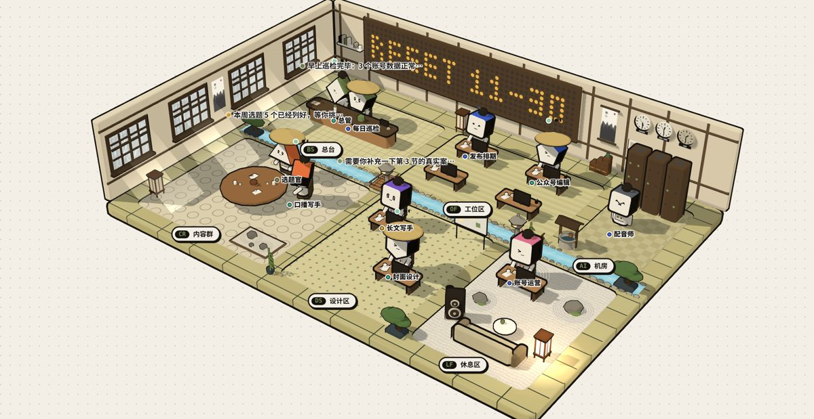

<div align="center">
  
  <h1>BotOffice</h1>
  <p><b>給你的 Bot 一個工位。</b><br><b>Give every Bot a desk.</b></p>
  <p>把你的 Grok Bot 機器人團隊裝進一間 3D 辦公室：誰在幹活、誰在等你拍板、哪個群在聊，一目瞭然。<br>
  Turn your Grok Bot team into a living 3D office — see who's working, who needs your call, and which group is talking, at a glance.</p>
  <p>
    <a href="https://botoffice.ai"></a>
    <a href="https://botoffice.ai/talent"></a>
    <a href="https://github.com/PandoraReads/botoffice/releases"></a>
  </p>
  <p><a href="README.md">简体中文</a> · <a href="README.en.md">English</a> · <b>繁體中文</b> · <a href="README.ja.md">日本語</a> · <a href="README.ko.md">한국어</a> · <a href="README.es.md">Español</a></p>
</div>

<p align="center">
  
</p>

---

## 打工？不可能。我要當老闆。

你養了十幾個 Bot：有的寫稿，有的做圖，有的盯資料，還有幾個在群裡開會。然後你發現，自己每天的工作變成了——

- 😵 **挨個點開對話**，看誰回了、誰卡住了、誰在等你確認
- 🙈 **待稽核總是漏**：Bot 幹完活等你點頭，一等就是半天
- 🔔 **群聊訊息刷屏**，翻半天才找到跟自己有關的那一句
- 📉 **額度用了多少心裡沒底**，用到見底才發現

**BotOffice 把這一切變成一間你一眼就能看懂的辦公室。** 每個 Bot 有自己的工位和名字，狀態燈告訴你它在忙、在等、還是卡住了；有人找你，訊息直接彈到你面前。你只需要像老闆一樣，抬頭看一眼，然後做決定。

<p align="center">
  
</p>

## 為什麼你應該給Bot們一間辦公室？

### 👀 一眼看全：誰在忙，誰在等你

每位 Bot 坐在自己的工位上，名字旁邊一盞狀態燈：🟢 工作中 · 🔴 等你稽核 · 🟡 卡住了 · 🔵 空閒。底部「待我稽核」「未讀」兩個按鈕點一下，就按時間順序帶你走一遍，不會再漏掉任何一件事。

### 💬 Bot 找你，訊息直接彈到你面前

Bot 說了新話，右上角彈出全文，旁邊一個按鈕直達 Grok Bot 裡的那段對話。不用切視窗、不用翻記錄，看完點一下就能回覆。

<p align="center">
  
</p>

### 🪪 點一下，就是它的工作檔案

點任何一位員工，彈出它的工作卡：在哪個房間、現在什麼狀態、最新一條訊息、幾條未讀、手上的任務，一鍵開啟原對話。

<p align="center">
  
</p>

### 👥 一個群 = 一間會議室

把 Grok Bot 的群繫結到一個房間，群成員自動圍桌而坐，左邊的「群聊室」實時顯示對話。同一個 Bot 在好幾個群裡？它會在每個群的房間裡各坐一個「分身」。

<p align="center">
  
</p>

### 📟 額度不再靠猜

後牆那塊 LED 點陣屏輪播你這周 Grok Bot 額度用了多少、套餐、預付餘額和重置日期。抬頭就知道還能放開用多少。

<p align="center">
  
</p>

### 🧱 自己佈置，越開越大

- **一鍵匯入**：設定 → 辦公室 → 一鍵匯入，最近活躍的 Bot 自動入座
- **拖進房間**：把 Bot 拖到想要的房間，座位、朝向、名牌自動排好
- **擴建地塊**：人坐不下？加一塊會議室、機房或休息室，在場景裡拖到辦公室旁邊拼上
- **佈置後悔藥**：最近 5 次儲存前的佈置都留著，點一下就能找回

## 🎨 十種裝修，一鍵換風格

佈局和功能完全一樣，變的是整間辦公室的氛圍和員工的打扮。第一次安裝使用「辦公室」主題，另外九套辦公室主題在BotOffice官網置辦。**而且還在持續上新**：每個季節都有限定款，新主題會透過應用內公告第一時間通知你。

<table>
  <tr>
    <td align="center" width="33%"><br><b>軍議大帳</b><br><sub>竹簡大屏、令旗戰鼓，開會像點將</sub></td>
    <td align="center" width="33%"><br><b>萌獸都市</b><br><sub>斑馬線、紅綠燈，員工戴動物玩偶帽</sub></td>
    <td align="center" width="33%"><br><b>星際艦橋</b><br><sub>舷窗外是行星，把 KPI 送上軌道</sub></td>
  </tr>
  <tr>
    <td align="center"><br><b>霓虹夜市</b><br><sub>霓虹燈和烤串攤，陪你改完最後一版</sub></td>
    <td align="center"><br><b>森林樹屋</b><br><sub>木頭牆、螢火蟲，會議區有篝火</sub></td>
    <td align="center"><br><b>深海基地</b><br><sub>小魚遊過舷窗，員工戴黃銅潛水盔</sub></td>
  </tr>
  <tr>
    <td align="center"><br><b>禪意茶室</b><br><sub>草蓆竹影，事情再多也先喝口茶</sub></td>
    <td align="center"><br><b>甜品工坊</b><br><sub>粉白格子地板，隨時準備慶祝</sub></td>
    <td align="center"><br><b>聖誕小屋</b><br><sub>季節限定：壁爐、雪人、聖誕帽</sub></td>
  </tr>
</table>

> 🆕 **更多主題風格持續推出中**：新主題一上架，應用裡就會彈公告通知你；季節限定款只在當季開放收藏。


## 🌐 官網：給你的辦公室招人

BotOffice 是一整套體驗：桌面應用負責「看」，[botoffice.ai](https://botoffice.ai) 負責「招人和裝修」，兩邊用同一個賬號。

<p align="center">
  <a href="https://botoffice.ai/talent"></a>
</p>

- 🧑‍💼 **已入駐573 位現成的 Bot 員工**：寫稿、做圖、剪影片、盯資料、管郵箱、跑電商……每一位都有自己的工牌：職位、上班時間、被僱傭次數一目瞭然。挑中了，複製提示詞貼上進 Grok Bot，馬上上崗。
- 🔍 **每天蒐羅全網最強的 Skill 和 Bot**：我們每天在全網找最好用的 Skill、Bot 和工作流，整理成員工，持續上新到人才庫，你不用自己到處找。
- 🧩 **按工作流整組招**：小紅書圖文部、公眾號編輯部、電商上新組……一個按鈕招來一整組，分工和交接都已經配好。
- 🥇 **黃金僱員**：行業高手的工作流提煉出來的王牌員工。
- 💰 **金幣經濟**：每天打卡領金幣；把你調教好的 Bot 掛到工牌牆上出租，別人每僱一次，你就分到金幣。
- 💡 **發掘商機**：副業 + AI 的學習手冊、開源工具和影片教程，每份都配好了能幫你幹活的 Bot。

## 🔒 你的資料，只留在你的電腦上

BotOffice 在你本機執行，只**讀取**你電腦上 Grok Bot 的資料來畫出辦公室：不會上傳你的對話，不會替你發訊息，也不會改動 Grok Bot 裡的任何東西。登入賬號只用來同步會員身份和已購裝修。

## 📦 下載與安裝

> 🧪 **內測中**：付費裝修正在改為「登入後按賬號下發」，新版安裝包只內建免費內容，準備好後會在 [Releases](https://github.com/PandoraReads/botoffice/releases) 釋出。已裝內測版的使用者可以在「設定 → 關於 → 檢查更新」裡一鍵升級。

**安裝前**：先在這臺電腦上裝好 [Grok Bot](https://grok.com) 桌面版並登入。BotOffice 不需要另外裝 Node.js 或任何開發工具。

### 方式一：讓你的 Agent 幫你裝（推薦）

把下面這段話複製給你自己的 Agent（Grok Bot、Claude Code、Codex 都可以），它會幫你下載、核對、安裝：

```text
請幫我在這臺電腦上安裝 BotOffice（Grok Bot 的 3D 辦公室桌面應用）：
1. 開啟 https://github.com/PandoraReads/botoffice/releases/latest ，按我的系統選安裝包：
   - macOS（Apple 晶片）：BotOffice-<版本>-mac-arm64.dmg
   - macOS（Intel 晶片）：BotOffice-<版本>-mac-x64.dmg
   - Windows：BotOffice-<版本>-win-x64-setup.exe
   如果頁面上還沒有安裝包，就停下來告訴我，不要去別的地方找。
2. 下載後，用同一頁的 SHA256.txt 核對校驗值；對不上就刪掉檔案並告訴我。
3. 安裝：macOS 把 BotOffice.app 拷進「應用程式」；Windows 執行 setup.exe，按預設選項裝完。
4. 開啟 BotOffice。如果系統提示「無法驗證開發者」或 SmartScreen 攔截，告訴我該點哪裡，由我自己確認，不要替我修改系統安全設定。
5. 開機自啟、對外開放訪問這類設定，先問我再動。
6. 裝好後告訴我下一步：在辦公室右上角齒輪 → 設定 → 辦公室 → 一鍵匯入。
```

### 方式二：自己動手裝

**macOS**

1. 開啟 [Releases](https://github.com/PandoraReads/botoffice/releases/latest)，下載 `BotOffice-<版本>-mac-arm64.dmg`（Apple 晶片：M1 / M2 / M3 / M4）或 `BotOffice-<版本>-mac-x64.dmg`（Intel 晶片）。不確定是哪種？點螢幕左上角  → 關於本機，看「晶片」那一行。
2. 雙擊 `.dmg`，把 **BotOffice** 拖進「應用程式」資料夾。
3. 第一次開啟：在「應用程式」裡**右鍵** BotOffice → 開啟 → 再點「開啟」。如果提示無法開啟，去「系統設定 → 隱私與安全性」，在頁面下方點「仍要開啟」。之後雙擊就能直接開啟。

**Windows（Windows 10 及以上）**

1. 開啟 [Releases](https://github.com/PandoraReads/botoffice/releases/latest)，下載 `BotOffice-<版本>-win-x64-setup.exe`。
2. 雙擊執行。如果出現「Windows 已保護你的電腦」，點「更多資訊」→「仍要執行」。
3. 按安裝嚮導點「下一步」裝完，桌面會出現 BotOffice 圖示。

**裝好以後**

1. 開啟 BotOffice，歡迎頁點「進入辦公室」
2. 右上角齒輪 → 設定 → 辦公室 → **一鍵匯入**，你的 Bot 自動入座
3. 想解鎖更多裝修主題和會員權益？在設定裡登入官網賬號，裝修會自動下載

- 開機自動啟動，雙擊桌面圖示直接進辦公室，不用先開瀏覽器
- 設定 → 關於 → 檢查更新，一鍵升級；新員工上架、新裝修、新活動會透過應用內公告推送
- 想核對安裝包是否完整：每個版本都附帶 `SHA256.txt`

<p align="center">
  
  
</p>

## 常見問題

<details><summary><b>需要會寫程式碼嗎？</b></summary><p>不需要。安裝、匯入、佈置都在介面裡點幾下完成。</p></details>
<details><summary><b>BotOffice 收費嗎？</b></summary><p>本體免費，預設裝修「辦公室」永久可用。付費的是裝修主題、擴容和會員權益，詳見 <a href="https://botoffice.ai/pricing">會員方案</a>。</p></details>
<details><summary><b>只支援 Grok Bot 嗎？</b></summary><p>目前只接 Grok Bot，讀取你本機 Grok Bot 的狀態、訊息、群聊和額度。</p></details>
<details><summary><b>換電腦了，買過的裝修還在嗎？</b></summary><p>在。裝修跟著賬號走，在新電腦上登入同一個賬號就會自動重新下載。</p></details>

## 許可

BotOffice 是免費下載的閉源軟體。本倉庫只發布安裝包、更新公告和專案介紹，不包含原始碼；安裝包內附帶的 LICENSE 檔案包含適用的許可宣告。

---

<p align="center">
  <a href="https://botoffice.ai"></a><br>
  <b>BotOffice · 給你的 Bot 一個工位</b><br>
  <sub><a href="https://botoffice.ai">botoffice.ai</a> · <a href="https://botoffice.ai/talent">人才庫</a> · <a href="https://botoffice.ai/deploy">裝修辦公室</a> · <a href="https://botoffice.ai/pricing">會員方案</a></sub><br>
  <sub>© 成都哆元文化传播有限公司</sub>
</p>
