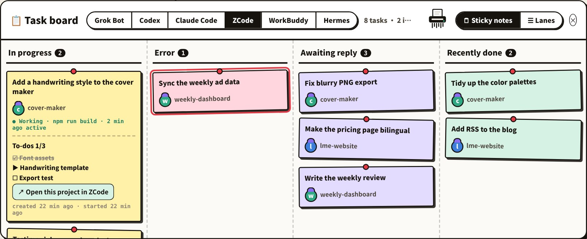
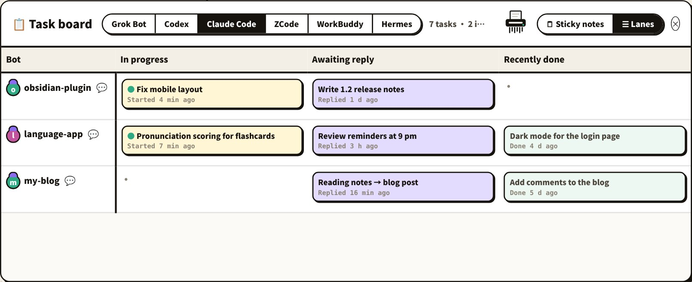

<div align="center">
  
  <h1>BotOffice</h1>
  <p>Bring your AI employees into a cozy 3D office — see who's working, who needs your call, and which group is talking, at a glance.<br>
  把你的 AI 员工们装进一间温馨的3D办公室：谁在干活、谁在等你拍板、哪个群在聊，一目了然。</p>
  <p>
    <a href="https://botoffice.ai"></a>
    <a href="https://botoffice.ai/talent"></a>
    <a href="https://github.com/PandoraReads/botoffice/releases"></a>
  </p>
  <p><a href="../README.md">简体中文</a> · <b>English</b> · <a href="README.zh-TW.md">繁體中文</a> · <a href="README.ja.md">日本語</a> · <a href="README.ko.md">한국어</a> · <a href="README.es.md">Español</a></p>
</div>

<p align="center">
  
</p>

> 🆕 **BotOffice 2.0 now connects 6 kinds of AI employees**: <picture><source media="(prefers-color-scheme: dark)" srcset="logos/grok-on-dark.svg"></picture> **Grok Bot** ·  **OpenAI Codex** ·  **Claude Code** ·  **Zhipu ZCode** · 🐱 **Tencent WorkBuddy** ·  **Hermes Agent**.
> Connect whichever you use — employees from different sources can share one office, with status, messages, and the task board all on one screen. [See what's supported →](#-supported-ai-employees-6-sources-one-office)

> [!IMPORTANT]
> **BotOffice uses no extra tokens.**
>
> The Bot employees in your office are Bots and AI projects you've already created on your own computer (Grok Bot, Codex, Claude Code, ZCode, WorkBuddy, Hermes). BotOffice just brings them into one office. It never calls a model for you; conversations still happen in the original tools, on your own plans.
>
> **You can connect without a BotOffice membership.** Members unlock more office themes and Bot-creation prompts.
>
> 💬 Chatting with Xiaohei, the front-desk cat, is optional and uses your own model and API key.

<sub>Screenshots show the Chinese interface.</sub>

---

## Work for someone else? Nah. I wanna be the BOSS.

Your AI team keeps growing: Grok Bot writes and designs, Codex and Claude Code write code, WorkBuddy runs errands, and a few more are chatting in a group. So why are you getting busier and more worn out —

- 😵 **Hopping between apps**, opening chats one by one to see who replied, who's stuck, and who's waiting for your OK. Exhausting 😩
- 🙈 **Missing reviews**: an AI finishes its work and waits half a day for your OK. Oh well ╮(╯▽╰)╭
- 🔔 **Group chats flooding in**, and you scroll forever to find what actually matters. Ugh 😡
- 📉 **No idea how much quota is left** until it hits zero and there's nothing left to run on ｡°(°¯᷄◠¯᷅°)°｡

**BotOffice turns all that daily grind into a cozy office full of good vibes, one you can read at a glance.** Every AI employee has its own desk and name tag; status lights tell you who's working, who's waiting on you, and who was just active. When someone needs you, the message pops up right in front of you. All you do is glance up like a boss and decide.

<p align="center">
  
</p>

## Why give your AI employees an office?

### 💬 When an employee needs you, the message comes to you

A new message pops up in full at the top right, with a button that jumps straight to the original conversation (the desktop app for Grok Bot, Codex, ZCode, and Hermes; the terminal for Claude Code). No window switching, no digging through history — read it and reply in one click.

<p align="center">
  
</p>

### 🪪 One click opens its work card

Click any employee to see its card: which room it's in, its status, its latest message, unread count, and current tasks, plus a button to open the original chat. Just a status update you don't plan to answer? Click **✓ Seen, no reply needed** and it drops out of **Awaiting me**.

<p align="center">
  
</p>

### 👥 One group chat = one meeting room

Bind a Grok Bot group to a room and its members sit around the same table, with the conversation live in the **Group Room** panel. Is a Bot in several groups? It gets a seat, a "clone", in each group's room.

<p align="center">
  
</p>

### 📟 Stop guessing your quota

The LED board on the back wall cycles through how much of this week's Grok Bot quota you've used, your plan, your prepaid balance, and the reset date. It can also show how many tokens Hermes used this week and today — pick Grok only, Hermes only, both on one screen, or take turns in Settings.

<p align="center">
  
</p>

### 🧱 Arrange it your way, and grow it big

- **One-click import**: Settings → Office → Import, and your most active employees take their seats
- **Drag into rooms**: drop an employee into any room; seats, facing, and name tags arrange themselves. Every name in the list has a small source icon, and colors tell the sources apart
- **Expand with new plots**: out of seats? Add a meeting room, server room, or lounge and drag it next to your office
- **Drag to reorder**: drag members inside a room to change their order, and their seats follow
- **Undo for layouts**: your last 5 saved layouts are kept, one click to restore

## 📮 The mailbox: hand the Lead a task without leaving your office

There's a mailbox next to the front desk. Click it, write what needs doing, hit **Send** — the envelope slides in, and the task goes straight to your Lead bot. **Every letter = one new task.** When the Lead is done, it replies in its usual Grok Bot chat, and the office pops the new message up for you.

You'll find the mailbox **by the front desk, right next to the Lead** — here's where it is. Each theme dresses it up differently, with its own little animation: in the War Tent a carrier pigeon takes the letter in its beak, and in Critter City the curbside mailbox raises its red flag once your letter is in.

<p align="center">
  
</p>

<p align="center">
  
</p>

### First-time setup (about 3 minutes)

The mailbox needs to be connected to *your own* Lead bot first. Everyone's Lead is different, so this is a one-time step you do yourself:

1. **Click the 📮 mailbox**: in the office, click the mailbox by the front desk. The first time, the card shows the setup steps right away (once it's set up, click ⚙ at the card's top right to change it).
2. **Copy the prompt**: click **Copy** in the card; the button turns green when it's copied. This is the text it copies:
   ```text
   Please create a routine called "BotOffice tasks" with a Webhook trigger. Rule: every time a webhook request arrives, treat the message field in its JSON as a new task I'm giving you in this chat, carry it out, and post the result back here. Once it's set up, send me the webhook URL and key so I can paste them into BotOffice.
   ```
3. **Send it to your Lead bot**: open Grok Bot, go to the chat with your pinned Lead bot, paste, and send. The Lead creates a webhook-triggered routine on its own.
4. **Copy the webhook URL and key**: the Lead replies with a **webhook URL** (usually starting with `https://api2.cursor.sh/automations/webhook/`) and a **key**. Copy them.
5. **Paste them back into the mailbox card**: back in BotOffice, paste the URL and the key into **Webhook URL** and **Webhook key** in the mailbox card and click **Save**. The card switches back to the mailbox — you're all set.
6. **Click the 📮 mailbox again to try it**: write something small (e.g. "What's on my to-do list today?") and click **Send** or press ⌘ / Ctrl + Enter. A green **✓ Delivered to the Lead** means it arrived, and the Lead's reply will pop up in your office.

<p align="center">
  
</p>

> 💡 **Good to know**
> - The URL and key are stored only on your computer and never uploaded. Anyone who has them can give your Lead tasks, though, so keep them to yourself.
> - If a letter doesn't go through, the card explains why in red. The most common cause is an expired key (for example, after it was regenerated in Grok Bot): ask your Lead for the new URL and key, then click ⚙ at the mailbox card's top right to re-enter them.
> - Each letter makes the Lead run once and counts toward your weekly Grok Bot usage. Grok Bot allows up to 200 runs per routine per hour.
> - Using Hermes? Just pick **Hermes Lead** as the recipient in the mailbox — no webhook needed. To give a task to one specific Hermes Bot, message it from its work card.

## 🤝 Supported AI employees: 6 sources, one office

BotOffice only **reads the local records** these AI tools keep on your computer — it never changes their settings. For Codex, Claude Code, ZCode, and WorkBuddy, **one project folder = one employee**, named after the project. Each source's employees wear their own signature hat, so you can tell them apart at a glance.

| Employee | 3D look | What you see | Open the original chat | Message it |
|---|---|---|---|---|
| 🤖 **Grok Bot** | Theme hats | Status, messages, group chats, quota | Grok Bot desktop app | Mailbox / bot card (webhook) |
| `>_` **OpenAI Codex** (CLI, Codex desktop, Codex in the ChatGPT desktop app) | Dark green terminal cap | Latest reply, running command, recent chats | Desktop app | ✅ |
| 🎓 **Claude Code** (CLI, Code in the Claude desktop app) | Black graduation cap | Latest reply, tool in use, chat titles | Continue in Terminal | ✅ |
| 🕶 **Zhipu ZCode** | Huge sunglasses on top of its head | Task status, latest reply, to-do progress, unread | ZCode desktop app | ✅ |
| 🐱 **Tencent WorkBuddy** | Green cat-ear beanie | Task status, latest reply, running tool | WorkBuddy desktop app | Not yet (read-only) |
| 🪽 **Hermes Agent** | Purple winged messenger cap | Status, messages, task board, token usage | Hermes desktop app / Terminal | ✅ (continue last chat or start a new task) |

- **Auto-detected, or point to it yourself**: Settings shows whether each source is connected; if one is installed somewhere unusual, click **Choose folder manually**
- **Status lights**: employees at work get the "typing" dots; finished work waiting for you lights up **Awaiting reply**
- **Employee card**: latest reply, the command it's running or the file it's editing, and the project's recent chats — all on one card

<p align="center">
  
</p>

## 📋 Task board: who's doing what, on one whiteboard

Click the **whiteboard** in the office's work area to open the task board. Switch sources at the top: **Grok Bot · Codex · Claude Code · ZCode · WorkBuddy · Hermes**.

- **Codex / Claude Code / ZCode / WorkBuddy**: no setup needed — **every chat (task) is a sticky note**, sorted into **In progress / Awaiting reply / Recently done**, plus an **Error** column for ZCode. Open a card to see what you said last, the AI's latest reply, and the command it's running; ZCode cards also show to-do progress (☑ done ▶ in progress ☐ to do)
- **Grok Bot**: have your patrol bot write the team's tasks to this computer on a schedule, and the board appears automatically, refreshing every 10 seconds. The first time, the board has a **Copy prompt** button — just send it to your patrol bot
- **Hermes**: reads Hermes's built-in task board (Kanban) directly, merging multiple boards into one view
- **Two views**: sticky notes (columns by status) and lanes (one row per employee, so you can see who's busy and who's free)
- **Jump to the chat**: click an employee's name on a card to go straight back to the conversation
- **🗑 Shredder**: don't need a task anymore? Drag its card into the shredder at the top right — you have 5 seconds to undo. Grok Bot tasks notify the assigned bot through your Lead; Hermes tasks are archived (recoverable); Codex, Claude Code, ZCode, and WorkBuddy cards are just taken off the board, and the original chat stays untouched
- Close and reopen, and it remembers the source and view you were on

<p align="center">
  
</p>
<p align="center">
  
</p>

## 🐈‍⬛ Meet Xiaohei, the front-desk cat who also answers your questions

A little black kitten in a red scarf now lives at the bottom-right of the reception desk, with a bowl of kibble piled so high it spills over (the bowl takes your theme's color).

- 🐾 **Pet her**: hover and your cursor turns into a palm — she sticks her bum up, rolls onto her belly and pops hearts. When idle she naps, sleeps belly-up and daydreams about fish, butterflies, you, and that annoying dog
- 💬 **Click to chat**: connect your own chat model (DeepSeek, Kimi, Qwen, Zhipu, OpenAI, Gemini, Claude or a custom endpoint) and she'll chat, brainstorm, and act as BotOffice's little help desk — ask her how to install or use anything
- 🔁 **Backup models**: the first model is the main one; if it can't connect, she switches to the next automatically
- 📒 **Notebook memory**: she remembers the important things you tell her; cross out anything wrong or tell her directly
- 🌐 **Web search**: turn it on and she can look things up online, with source links. No extra key needed when your main model is DeepSeek
- 💕 **Affection**: pet her and chat often and she gets clingy; ignore her too long and she droops — or even gets sick from missing you

Your API keys stay on your own computer. (Xiaohei currently speaks Chinese.)

<p align="center">
  
</p>

## 🌄 12 backdrops for every mood

The **Backdrop** button on the right holds 12 backdrops: **Default, Nebula, Sakura, Fireflies, Autumn Leaves, First Snow, Seaside, Dusk City, Rainy Night, Northern Lights, Vaporwave, and Dust City**. The office stays the same; only the scenery behind it changes. Each one moves gently (drifting petals, blinking fireflies, flowing auroras…), and on dark backdrops the corner frame and clock switch to light colors automatically. All free, and your pick is remembered on this computer.

<p align="center">
  
</p>

## 🎨 Plenty of themes, one click to redecorate

The layout and features stay the same; the whole mood of the office and your Bots' outfits change. A fresh install comes with the **Office** look; the other nine themes are available on the BotOffice website, **and new ones keep coming**: there are seasonal limited editions, and every new theme is announced right inside the app.


<table>
  <tr>
    <td align="center" width="33%"><br><b>War Council Tent</b><br><sub>Bamboo-scroll screens and war drums</sub></td>
    <td align="center" width="33%"><br><b>Critter City</b><br><sub>Crosswalks, traffic lights, plush animal hats</sub></td>
    <td align="center" width="33%"><br><b>Starship Bridge</b><br><sub>Planets outside; send your KPIs into orbit</sub></td>
  </tr>
  <tr>
    <td align="center"><br><b>Neon Night Market</b><br><sub>Neon signs and food stalls for late nights</sub></td>
    <td align="center"><br><b>Forest Cabin</b><br><sub>Wood walls, fireflies, a campfire meeting</sub></td>
    <td align="center"><br><b>Deep Sea Station</b><br><sub>Fish drift by; brass diving helmets</sub></td>
  </tr>
  <tr>
    <td align="center"><br><b>Zen Tea Room</b><br><sub>Tatami and bamboo; tea before tasks</sub></td>
    <td align="center"><br><b>Sweet Bakery</b><br><sub>Pink checkered floors, always ready to celebrate</sub></td>
    <td align="center"><br><b>Christmas Cabin</b><br><sub>Seasonal: big moon, Santa's sleigh at the window, fireplace & candlelight</sub></td>
  </tr>
</table>

> 🆕 **More themes on the way**: as soon as a new theme launches, the app lets you know; seasonal editions can only be collected during their season.

## 🌐 The website: hire for your office

BotOffice is one experience in two parts: the desktop app is where you **watch**, and [botoffice.ai](https://botoffice.ai) is where you **hire and decorate**. Both use the same account.

<p align="center">
  <a href="https://botoffice.ai/talent"></a>
</p>

- 🧑‍💼 **573 ready-made Bot employees already on board**: writing, design, video, data, email, e-commerce… Each has its own badge showing its role, schedule, and how many times it's been hired. Found one you like? Copy its prompt into your Agent and it starts right away.
- 🔍 **The best Skills and Bots on the web, scouted every day**: we search the whole web daily for the most useful Skills, Bots, and workflows, turn them into employees, and keep adding them to the talent wall, so you don't have to hunt.
- 🧩 **Hire a whole workflow team**: a Xiaohongshu studio, a newsletter desk, a product-launch crew… one click hires the whole team, with roles and hand-offs already set up.
- 🥇 **Gold Hires**: star employees distilled from the workflows of industry pros.
- 💰 **A coin economy**: check in daily for coins; list your own tuned Bots on the wall for rent and earn coins every time someone hires them.
- 💡 **Opportunities**: side-hustle + AI guides, open-source tools, and video tutorials, each paired with Bots that can do the work.

## 🔒 Your data stays on your computer

BotOffice runs on your machine and **reads** the local records of Grok Bot, Codex, Claude Code, ZCode, WorkBuddy, and Hermes to draw the office. It never uploads your chats, and it only sends a message when you click **Send**, **Deliver**, or drag a card into the shredder; otherwise it never changes anything in those tools. Your account is only used to sync your membership and purchased themes.

## 📦 Download and install

> 🆕 **Get the latest version from [Releases](https://github.com/PandoraReads/botoffice/releases/latest)**: installers include the free content only; sign in to your botoffice.ai account and the themes you own download automatically. Already installed? Go to **Settings → About → Check for updates** to upgrade in one click.

**Before you start**: install at least one AI employee source on this computer — Grok Bot, OpenAI Codex, Claude Code, Zhipu ZCode, Tencent WorkBuddy, or Hermes Agent (any combination works) — and chat with it at least once. BotOffice doesn't need Node.js or any developer tools.

> [!WARNING]
> **Mac says “BotOffice” is damaged and can't be opened?**
>
> **Easiest: use Option 1 below and let your agent install it.** It checks the SHA256 checksum first and only then clears this for you, so the app opens right away. Hit it while installing by hand? No worries: the file isn't broken. macOS is blocking an app that isn't Apple-signed yet. After dragging BotOffice into Applications, open Terminal, paste this line and press Return, then **right-click BotOffice → Open** in Applications:
>
> ```bash
> xattr -cr /Applications/BotOffice.app
> ```

### Option 1: let your Agent install it (recommended)

Copy this into your own Agent (Grok Bot, Hermes, Claude Code, Codex…) and it will download, verify, and install BotOffice for you:

```text
Please install BotOffice (a 3D office desktop app for AI employees: Grok Bot, Codex, Claude Code, ZCode, WorkBuddy, Hermes) on this computer:
1. Open https://github.com/PandoraReads/botoffice/releases/latest and pick the installer for my system:
   - macOS (Apple Silicon): BotOffice-<version>-mac-arm64.dmg
   - macOS (Intel): BotOffice-<version>-mac-x64.dmg
   - Windows: BotOffice-<version>-win-x64-setup.exe
   If there's no installer on that page yet, stop and tell me. Don't look for it anywhere else.
2. After downloading, check the file against SHA256.txt on the same page. If it doesn't match, delete the file and tell me.
3. Install: on macOS, copy BotOffice.app into Applications; on Windows, run setup.exe with the default options.
4. Open BotOffice. If macOS says it is damaged and can't be opened: only if the checksum from step 2 matched, run `xattr -cr /Applications/BotOffice.app` to remove the download quarantine flag. Only touch BotOffice; don't turn off system-wide security settings. If it says it can't verify the developer, or Windows SmartScreen blocks it, tell me what to click and let me confirm it myself.
5. Ask me before turning on launch-at-login or opening access to other devices.
6. When it's done, tell me the next step: gear icon at the top right → Settings → Office → Import.
```

### Option 2: install it yourself

**macOS**

1. Open [Releases](https://github.com/PandoraReads/botoffice/releases/latest) and download `BotOffice-<version>-mac-arm64.dmg` (Apple Silicon: M1/M2/M3/M4) or `BotOffice-<version>-mac-x64.dmg` (Intel). Not sure which? Click  → About This Mac and look at "Chip".
2. Double-click the `.dmg` and drag **BotOffice** into Applications.
3. First launch: in Applications, **right-click** BotOffice → Open → Open. If macOS still won't open it, go to System Settings → Privacy & Security and click "Open Anyway" near the bottom. After that, a double-click is enough. **If it says the app is damaged, follow the ⚠️ note above.**

**Windows (Windows 10 or later)**

1. Open [Releases](https://github.com/PandoraReads/botoffice/releases/latest) and download `BotOffice-<version>-win-x64-setup.exe`.
2. Double-click it. If you see "Windows protected your PC", click "More info" → "Run anyway".
3. Click through the installer; a BotOffice icon appears on your desktop.

**After installing**

1. Open BotOffice and click "Enter the office" on the welcome screen
2. Gear icon at the top right → Settings → Office → **Import**; your AI employees take their seats
3. Want to unlock more themes and membership perks? Sign in to your website account in Settings and your themes download automatically

- Starts with your computer; double-click the desktop icon to open your office, no browser needed
- Settings → About → Check for updates; new Bots, themes, and events arrive as in-app announcements
- Every release comes with `SHA256.txt` if you want to verify your download

<p align="center">
  
  
</p>

## FAQ

<details open><summary><b>⚠️ Mac says BotOffice is damaged and can't be opened. What now?</b></summary><p><b>👍 Easiest: let your agent install it.</b> Send the Option 1 prompt above to your own agent (Grok Bot, Hermes, Claude Code, or Codex). It checks the package against <code>SHA256.txt</code> first and only then clears the macOS download quarantine flag.<br><b>Installing by hand?</b> The file isn't broken; macOS is blocking an app that isn't Apple-signed yet. Drag BotOffice into Applications, open Terminal, paste <code>xattr -cr /Applications/BotOffice.app</code> and press Return. Then right-click BotOffice in Applications → Open, and click Open. Still stuck? Download it again and check it against <code>SHA256.txt</code> on the Releases page.</p></details>
<details><summary><b>Do I need to code?</b></summary><p>No. Installing, importing, and arranging are all a few clicks in the app.</p></details>
<details><summary><b>Is BotOffice free?</b></summary><p>The app is free and the default <b>Office</b> look is yours forever. Themes, expansions, and membership perks are paid; see <a href="https://botoffice.ai/pricing">plans</a>.</p></details>
<details><summary><b>Which AI employees does it support?</b></summary><p>Grok Bot, OpenAI Codex, Claude Code, Zhipu ZCode, Tencent WorkBuddy, and Hermes Agent. Codex, Claude Code, ZCode, and WorkBuddy get one employee per project folder; Grok Bot also shows group chats and quota, and Hermes also shows its built-in task board and token usage. Employees from different sources can share one office. Regular chats and Cowork in the Claude desktop app live in the cloud and can't be read.</p></details>
<details><summary><b>I got a new computer. Are my themes still there?</b></summary><p>Yes. Themes belong to your account; sign in on the new computer and they download again.</p></details>
<details><summary><b>The mailbox does nothing / says the letter didn't go through?</b></summary><p>Click ⚙ at the mailbox card's top right and check it shows a green <b>Set up</b>. If the card says the key expired, ask your Lead for the latest webhook URL and key and enter them again; if it says it can't connect, check your network and click <b>Retry</b>.</p></details>

## Acknowledgements

BotOffice can bring all these AI employees into one office thanks to these great tools (BotOffice only reads the local records they keep on your computer and has no official partnership with these products; names and trademarks belong to their owners):

- [Grok Bot](https://grok.com): where BotOffice started — the group room, quota board, and mailbox were built for it.
- [OpenAI Codex](https://openai.com/codex): chats from the CLI, the Codex desktop app, and Codex in the ChatGPT desktop app can all take a desk.
- [Claude Code](https://claude.com/product/claude-code) (Anthropic): chats from the CLI and Code in the Claude desktop app can all take a desk.
- [Zhipu ZCode](https://github.com/zai-org/ZCode): an open-source AI coding workbench; task status and to-do progress come from its local records.
- [Tencent WorkBuddy](https://www.workbuddy.ai): a desktop work agent — every one of its tasks shows up in the office.
- [Hermes Agent](https://hermes-agent.nousresearch.com) (Nous Research): every Hermes Bot can take a desk, and the task board also reads Hermes's built-in Kanban.
- [Pixabay](https://pixabay.com): some of the app's music and sound effects come from Pixabay's royalty-free library — thanks to the creators.
- [Maidang's Bot Town](https://www.mdldm.club/grok-bots): some Bot employee prompts were inspired by Bot Town — thanks to Maidang for sharing.

## License

BotOffice is free-to-download, closed-source software. This repository publishes installers, update announcements, and project information only; it contains no source code. The LICENSE file inside the installer covers the applicable terms.

---

<p align="center">
  <a href="https://botoffice.ai"></a><br>
  <b>BotOffice · Give every AI employee a desk</b><br>
  <sub><a href="https://botoffice.ai">botoffice.ai</a> · <a href="https://botoffice.ai/talent">Talent Wall</a> · <a href="https://botoffice.ai/deploy">Office Makeover</a> · <a href="https://botoffice.ai/pricing">Plans</a></sub><br>
  <sub>© Chengdu Duoyuan Culture Communication Co., Ltd.</sub>
</p>
