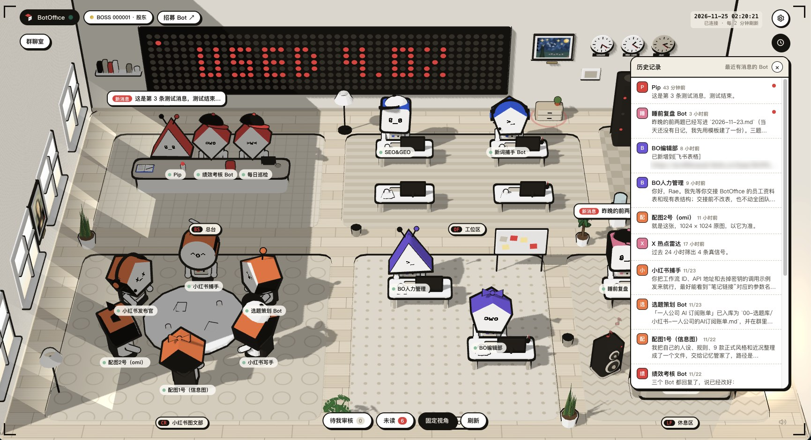
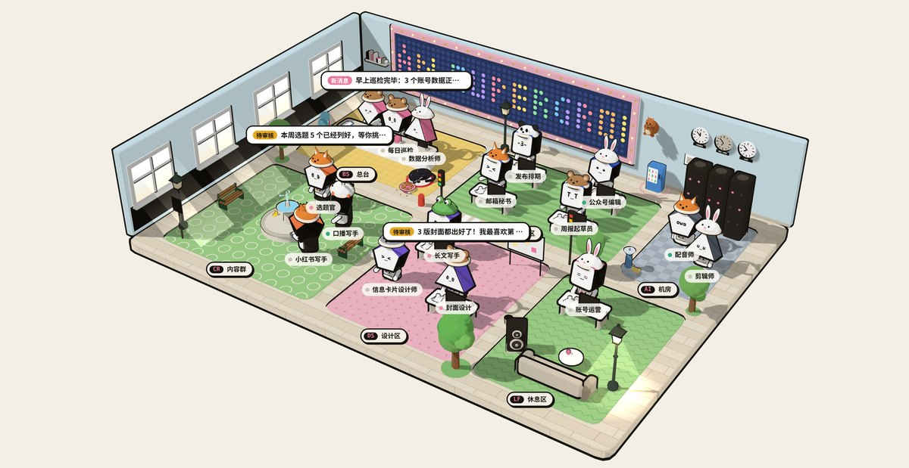

<div align="center">
  
  <h1>BotOffice</h1>
  <p>Turn your Grok Bot team into a living 3D office — see who's working, who needs your call, and which group is talking, at a glance.<br>
  把你的 Grok Bot 机器人团队装进一间 3D 办公室：谁在干活、谁在等你拍板、哪个群在聊，一目了然。</p>
  <p>
    <a href="https://botoffice.ai"></a>
    <a href="https://botoffice.ai/talent"></a>
    <a href="https://github.com/PandoraReads/botoffice/releases"></a>
  </p>
  <p><a href="../README.md">简体中文</a> · <b>English</b> · <a href="README.zh-TW.md">繁體中文</a> · <a href="README.ja.md">日本語</a> · <a href="README.ko.md">한국어</a> · <a href="README.es.md">Español</a></p>
</div>

<p align="center">
  
</p>

<sub>Screenshots show the Chinese interface.</sub>

---

## Work for someone else? Nah. I wanna be the BOSS.

You've got dozens of Bots: one writes, one designs, one watches the numbers, and a few are chatting in a group. So why are you getting busier and more worn out by the day? —

- 😵 **Clicking through every chat** to see who replied, who's stuck, and who's waiting on you. Exhausting 😩
- 🙈 **Missing reviews**: a Bot finishes its work and waits half a day for your OK. Oh well ╮(╯▽╰)╭
- 🔔 **Group chats flooding in**, and you scroll forever to find what actually matters. Ugh 😡
- 📉 **No idea how much quota is left** until it hits zero and there's nothing left to run on ｡°(°¯᷄◠¯᷅°)°｡

**BotOffice turns all that daily grind into a cozy office full of good vibes, one you can read at a glance.** Every Bot has its own desk and name tag, and a status light tells you whether it's busy, waiting, or stuck. When someone needs you, the message pops up right in front of you. You just look up, like a boss, and decide.

<p align="center">
  
</p>

## Why give your Bots an office?

### 👀 See everything at once: who's busy, who's waiting on you

Every Bot sits at its own desk with a status light next to its name: 🟢 working · 🔴 waiting for your review · 🟡 blocked · 🔵 idle. Tap **Review** or **Unread** at the bottom and BotOffice walks you through them in order, so nothing slips through.

### 💬 When a Bot needs you, the message comes to you

A new message pops up in full at the top right, with a button that jumps straight to that conversation in Grok Bot. No window switching, no digging through history.

<p align="center">
  
</p>

### 🪪 One click opens its work card

Click any Bot to see its card: which room it's in, its status, its latest message, unread count, and current tasks, plus a button to open the original chat.

<p align="center">
  
</p>

### 👥 One group chat = one meeting room

Bind a Grok Bot group to a room and its members sit around the same table, with the conversation live in the **Group Room** panel. Is a Bot in several groups? It gets a seat, a "clone", in each group's room.

<p align="center">
  
</p>

### 📟 Stop guessing your quota

The LED board on the back wall cycles through how much of this week's Grok Bot quota you've used, your plan, your prepaid balance, and the reset date.

<p align="center">
  
</p>

### 🧱 Arrange it your way, and grow it big

- **One-click import**: Settings → Office → Import, and your most active Bots take their seats
- **Drag into rooms**: drop a Bot into any room; seats, facing, and name tags arrange themselves
- **Expand with new plots**: out of seats? Add a meeting room, server room, or lounge and drag it next to your office
- **Undo for layouts**: your last 5 saved layouts are kept, one click to restore

## 🎨 Plenty of themes, one click to redecorate

The layout and features stay the same; the whole mood of the office and your Bots' outfits change. A fresh install comes with the **Office** look; the other nine themes are available on the BotOffice website, **and new ones keep coming**: there are seasonal limited editions, and every new theme is announced right inside the app.


<table>
  <tr>
    <td align="center" width="33%"><br><b>War Council Tent</b><br><sub>Bamboo-scroll screens and war drums</sub></td>
    <td align="center" width="33%"><br><b>Critter City</b><br><sub>Crosswalks, traffic lights, plush animal hats</sub></td>
    <td align="center" width="33%"><br><b>Starship Bridge</b><br><sub>Planets outside; send your KPIs into orbit</sub></td>
  </tr>
  <tr>
    <td align="center"><br><b>Neon Night Market</b><br><sub>Neon signs and food stalls for late nights</sub></td>
    <td align="center"><br><b>Forest Cabin</b><br><sub>Wood walls, fireflies, a campfire meeting</sub></td>
    <td align="center"><br><b>Deep Sea Station</b><br><sub>Fish drift by; brass diving helmets</sub></td>
  </tr>
  <tr>
    <td align="center"><br><b>Zen Tea Room</b><br><sub>Tatami and bamboo; tea before tasks</sub></td>
    <td align="center"><br><b>Sweet Bakery</b><br><sub>Pink checkered floors, always ready to celebrate</sub></td>
    <td align="center"><br><b>Christmas Cabin</b><br><sub>Seasonal: fireplace, snowman, Santa hats</sub></td>
  </tr>
</table>

> 🆕 **More themes on the way**: as soon as a new theme launches, the app lets you know; seasonal editions can only be collected during their season.

## 🌐 The website: hire for your office

BotOffice is one experience in two parts: the desktop app is where you **watch**, and [botoffice.ai](https://botoffice.ai) is where you **hire and decorate**. Both use the same account.

<p align="center">
  <a href="https://botoffice.ai/talent"></a>
</p>

- 🧑‍💼 **573 ready-made Bot employees already on board**: writing, design, video, data, email, e-commerce… Each has its own badge showing its role, schedule, and how many times it's been hired. Found one you like? Copy its prompt into Grok Bot and it starts right away.
- 🔍 **The best Skills and Bots on the web, scouted every day**: we search the whole web daily for the most useful Skills, Bots, and workflows, turn them into employees, and keep adding them to the talent wall, so you don't have to hunt.
- 🧩 **Hire a whole workflow team**: a Xiaohongshu studio, a newsletter desk, a product-launch crew… one click hires the whole team, with roles and hand-offs already set up.
- 🥇 **Gold Hires**: star employees distilled from the workflows of industry pros.
- 💰 **A coin economy**: check in daily for coins; list your own tuned Bots on the wall for rent and earn coins every time someone hires them.
- 💡 **Opportunities**: side-hustle + AI guides, open-source tools, and video tutorials, each paired with Bots that can do the work.

## 🔒 Your data stays on your computer

BotOffice runs on your machine and only **reads** your local Grok Bot data to draw the office. It never uploads your chats, never sends messages for you, and never changes anything in Grok Bot. Your account is used only to sync your membership and purchased themes.

## 📦 Download and install

> 🧪 **In private beta**: paid themes are moving to account-based delivery after sign-in, so new installers ship with free content only. They'll be published on [Releases](https://github.com/PandoraReads/botoffice/releases) when ready. Beta users can upgrade from **Settings → About → Check for updates**.

**Before you start**: install the [Grok Bot](https://grok.com) desktop app on this computer and sign in. BotOffice doesn't need Node.js or any developer tools.

### Option 1: let your Agent install it (recommended)

Copy this into your own Agent (Grok Bot, Claude Code, Codex…) and it will download, verify, and install BotOffice for you:

```text
Please install BotOffice (a 3D office desktop app for Grok Bot) on this computer:
1. Open https://github.com/PandoraReads/botoffice/releases/latest and pick the installer for my system:
   - macOS (Apple Silicon): BotOffice-<version>-mac-arm64.dmg
   - macOS (Intel): BotOffice-<version>-mac-x64.dmg
   - Windows: BotOffice-<version>-win-x64-setup.exe
   If there's no installer on that page yet, stop and tell me. Don't look for it anywhere else.
2. After downloading, check the file against SHA256.txt on the same page. If it doesn't match, delete the file and tell me.
3. Install: on macOS, copy BotOffice.app into Applications; on Windows, run setup.exe with the default options.
4. Open BotOffice. If the system says it can't verify the developer, or SmartScreen blocks it, tell me what to click and let me confirm it myself. Don't change my system security settings for me.
5. Ask me before turning on launch-at-login or opening access to other devices.
6. When it's done, tell me the next step: gear icon at the top right → Settings → Office → Import.
```

### Option 2: install it yourself

**macOS**

1. Open [Releases](https://github.com/PandoraReads/botoffice/releases/latest) and download `BotOffice-<version>-mac-arm64.dmg` (Apple Silicon: M1/M2/M3/M4) or `BotOffice-<version>-mac-x64.dmg` (Intel). Not sure which? Click  → About This Mac and look at "Chip".
2. Double-click the `.dmg` and drag **BotOffice** into Applications.
3. First launch: in Applications, **right-click** BotOffice → Open → Open. If macOS still won't open it, go to System Settings → Privacy & Security and click "Open Anyway" near the bottom. After that, a double-click is enough.

**Windows (Windows 10 or later)**

1. Open [Releases](https://github.com/PandoraReads/botoffice/releases/latest) and download `BotOffice-<version>-win-x64-setup.exe`.
2. Double-click it. If you see "Windows protected your PC", click "More info" → "Run anyway".
3. Click through the installer; a BotOffice icon appears on your desktop.

**After installing**

1. Open BotOffice and click "Enter the office" on the welcome screen
2. Gear icon at the top right → Settings → Office → **Import**; your Bots take their seats
3. Want to unlock more themes and membership perks? Sign in to your website account in Settings and your themes download automatically

- Starts with your computer; double-click the desktop icon to open your office, no browser needed
- Settings → About → Check for updates; new Bots, themes, and events arrive as in-app announcements
- Every release comes with `SHA256.txt` if you want to verify your download

<p align="center">
  
  
</p>

## FAQ

<details><summary><b>Do I need to code?</b></summary><p>No. Installing, importing, and arranging are all a few clicks in the app.</p></details>
<details><summary><b>Is BotOffice free?</b></summary><p>The app is free and the default <b>Office</b> look is yours forever. Themes, expansions, and membership perks are paid; see <a href="https://botoffice.ai/pricing">plans</a>.</p></details>
<details><summary><b>Does it only work with Grok Bot?</b></summary><p>For now, yes. It reads status, messages, group chats, and quota from Grok Bot on your computer.</p></details>
<details><summary><b>I got a new computer. Are my themes still there?</b></summary><p>Yes. Themes belong to your account; sign in on the new computer and they download again.</p></details>

## License

BotOffice is free-to-download, closed-source software. This repository publishes installers, update announcements, and project information only; it contains no source code. The LICENSE file inside the installer covers the applicable terms.

---

<p align="center">
  <a href="https://botoffice.ai"></a><br>
  <b>BotOffice · Give every Bot a desk</b><br>
  <sub><a href="https://botoffice.ai">botoffice.ai</a> · <a href="https://botoffice.ai/talent">Talent Wall</a> · <a href="https://botoffice.ai/deploy">Office Makeover</a> · <a href="https://botoffice.ai/pricing">Plans</a></sub><br>
  <sub>© Chengdu Duoyuan Culture Communication Co., Ltd.</sub>
</p>
