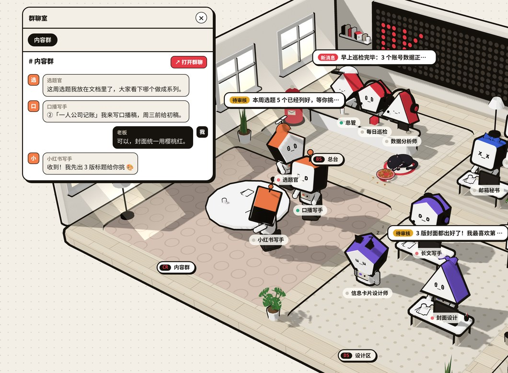
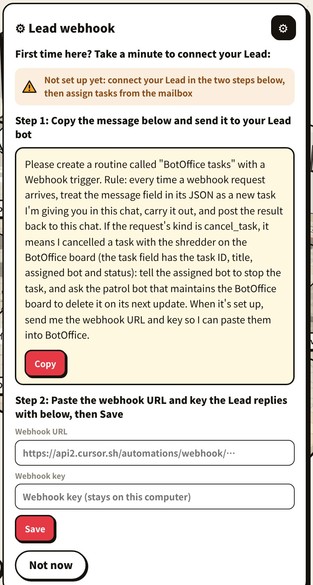
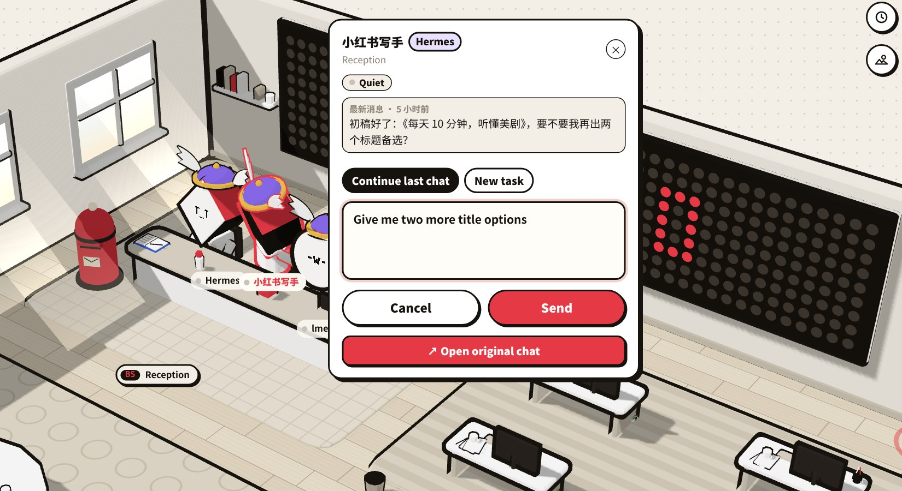
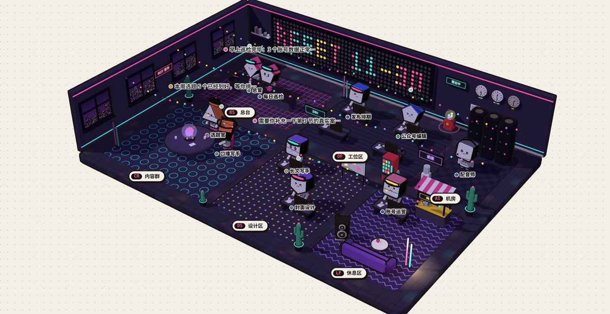

<div align="center">
  
  <h1>BotOffice</h1>
  <p>Turn your Grok & Hermes Bot team into a cozy 3D office — new messages, group chats and Kanban tasks all in one place.</p>
  <p>
    <a href="https://botoffice.ai"></a>
    <a href="https://botoffice.ai/talent"></a>
    <a href="https://github.com/PandoraReads/botoffice/releases"></a>
  </p>
  <p><a href="../README.md">简体中文</a> · <b>English</b> · <a href="README.zh-TW.md">繁體中文</a> · <a href="README.ja.md">日本語</a> · <a href="README.ko.md">한국어</a> · <a href="README.es.md">Español</a></p>
</div>

<p align="center">
  
</p>

<sub>Screenshots show the Chinese interface.</sub>

---

## Work for someone else? Nah. I wanna be the BOSS.

You've got dozens of Bots: one writes, one designs, one watches data, and a few are chatting in a group. So why are you getting busier and more worn out by the day? —

- 😵 **Clicking through every chat** to see who replied, who's stuck, and who's waiting on you. Exhausting 😩
- 🙈 **Missing reviews**: a Bot finishes its work and waits half a day for your OK. Oh well ╮(╯▽╰)╭
- 🔔 **Group chats flooding in**, and you scroll forever to find what actually matters. Ugh 😡
- 📉 **No idea how much quota is left** until it hits zero and there's nothing left to run on ｡°(°¯᷄◠¯᷅°)°｡

**BotOffice turns all that daily grind into a cozy office full of good vibes, one you can read at a glance.** Every Bot has its own desk and name tag, and a status light tells you who's waiting for your reply and who was just active. When someone needs you, the message pops up right in front of you. You just look up, like a boss, and decide.

<p align="center">
  
</p>

## Why give your Bots an office?

### 💬 When a Bot needs you, the message comes to you

A new message pops up in full at the top right, with a button that jumps straight to that conversation in Grok Bot or the Hermes desktop app. No window switching, no digging through history.

<p align="center">
  
</p>

### 🪪 One click opens its work card

Click any Bot to see its card: which room it's in, its status, its latest message, unread count, and current tasks, plus a button to open the original chat. A Bot just said something and you've read it but won't reply? Click **✓ Seen, no reply needed** and it stops counting as waiting for you.

<p align="center">
  
</p>

### 👥 One group chat = one meeting room

Bind a Grok Bot group to a room and its members sit around the same table, with the conversation live in the **Group Room** panel. Is a Bot in several groups? It gets a seat, a "clone", in each group's room.

<p align="center">
  
</p>

### 📟 Stop guessing your quota

The LED board on the back wall cycles through how much of this week's Grok Bot quota you've used, your plan, your prepaid balance, and the reset date. It can also show how many tokens Hermes used this week and today — pick Grok only, Hermes only, both on one screen, or take turns in Settings.

<p align="center">
  
</p>

### 🧱 Arrange it your way, and grow it big

- **One-click import**: Settings → Office → Import, and your most active Bots take their seats
- **Drag into rooms**: drop a Bot into any room; seats, facing, and name tags arrange themselves
- **Expand with new plots**: out of seats? Add a meeting room, server room, or lounge and drag it next to your office
- **Drag to reorder**: drag members inside a room to change their order, and their seats follow
- **Undo for layouts**: your last 5 saved layouts are kept, one click to restore

## 📮 The mailbox: hand the Lead a task without leaving your office

There's a mailbox next to the front desk. Click it, write what needs doing, hit **Send** — the envelope slides in, and the task goes straight to your Lead bot. **Every letter = one new task.** When the Lead is done, it replies in its usual Grok Bot chat, and the office pops the new message up for you.

You'll find the mailbox **by the front desk, right next to the Lead** — here's where it is. Each theme dresses it up differently, with its own little animation: in the War Tent a carrier pigeon takes the letter in its beak, and in Critter City the curbside mailbox raises its red flag once your letter is in.

<p align="center">
  
</p>

<p align="center">
  
</p>

### First-time setup (about 3 minutes)

The mailbox needs to be connected to *your own* Lead bot first. Everyone's Lead is different, so this is a one-time step you do yourself:

1. **Click the 📮 mailbox**: in the office, click the mailbox by the front desk. If it isn't set up yet, the card shows a yellow banner — click **Set up** in it, and Settings opens right at **Assign a task to the Lead**.
2. **Copy the message**: click **Copy** in the settings panel — the button turns green when it's copied. This is what gets copied:
   ```text
   Please create a routine called "BotOffice tasks" with a Webhook trigger. Rule: every time a webhook request arrives, treat the message field in its JSON as a new task I'm giving you in this chat, carry it out, and post the result back here. Once it's set up, send me the webhook URL and key so I can paste them into BotOffice.
   ```
3. **Send it to your Lead bot**: open Grok Bot, go to the chat with your pinned Lead bot, paste, and send. The Lead creates a webhook-triggered routine on its own.
4. **Copy the webhook URL and key**: the Lead replies with a **webhook URL** (usually starting with `https://api2.cursor.sh/automations/webhook/`) and a **key**. Copy them.
5. **Paste them into BotOffice Settings**: back in **Assign a task to the Lead**, paste the URL and the key into **Webhook URL** and **Webhook key** below it, then click **Save**. When the status turns green ("Set up"), you're done.
6. **Click the 📮 mailbox again to try it**: write something small (e.g. "What's on my to-do list today?") and click **Send** or press ⌘ / Ctrl + Enter. A green **✓ Delivered to the Lead** means it arrived, and the Lead's reply will pop up in your office.

<p align="center">
  
</p>

> 💡 **Good to know**
> - The URL and key are stored only on your computer and never uploaded. Anyone who has them can give your Lead tasks, though, so keep them to yourself.
> - If a letter doesn't go through, the card explains why in red. The most common cause is an expired key (for example, after it was regenerated in Grok Bot): ask the Lead for the new URL and key and paste them into Settings again.
> - Each letter makes the Lead run once and counts toward your weekly Grok Bot usage. Grok Bot allows up to 200 runs per routine per hour.
> - Using Hermes? Just pick **Hermes Lead** as the recipient in the mailbox — no webhook needed. To give a task to one specific Hermes Bot, message it from its work card.

## 🪽 Hermes Bots come to work too

Using [Hermes Agent](https://hermes-agent.nousresearch.com)? Every Hermes Bot (profile) can take a desk and sit alongside your Grok Bots. Hermes employees wear a purple messenger cap with little wings, so you can spot them at a glance.

- **Messages and status lights**: BotOffice reads Hermes's latest replies, shows who's waiting for you, active, or quiet, and pops new messages up in real time
- **Message it directly**: open a Hermes Bot's work card to send it a message — **Continue last chat** or start a **New task**, no webhook needed
- **Open the original chat**: with the Hermes desktop app installed, one click jumps to that conversation there; without it, the chat resumes in Terminal with a recap
- **Usage**: the LED board on the back wall can show how many tokens Hermes used this week and today

<p align="center">
  
</p>

## 📋 Task board: who's doing what, on one whiteboard

Click the **whiteboard** in the work area to open the task board.

- **Grok Bot board**: have your patrol bot write the team's tasks to your computer on a schedule, and the board shows up and refreshes every 10 seconds. The first time, the board gives you a prompt to copy and send to your patrol bot
- **Hermes board**: reads Hermes's built-in task board (Kanban); several boards are shown together
- **Two views**: sticky notes (columns by status: Triage, To do, Ready, In progress, Blocked, In review, Done) and lanes (one row per Bot, so you see who's busy)
- **Click a name to chat**: click the employee on a card to open your conversation with it
- **🗑 Shredder**: don't need a task anymore? Drag its card into the shredder at the top right; you can undo within 5 seconds. For Grok Bot, the Lead tells the responsible Bot to stop; for Hermes, the task is archived (recoverable) and the responsible Bot is told
- Only the 7 most recent done tasks are shown, and the board reopens where you left it

<p align="center">
  
</p>
<p align="center">
  
</p>

## 🌄 12 backdrops for every mood

The **Backdrop** button on the right holds 12 backdrops: **Default, Nebula, Sakura, Fireflies, Autumn Leaves, First Snow, Seaside, Dusk City, Rainy Night, Northern Lights, Vaporwave, and Dust City**. The office stays the same; only the scenery behind it changes. Each one moves gently (drifting petals, blinking fireflies, flowing auroras…), and on dark backdrops the corner frame and clock switch to light colors automatically. All free, and your pick is remembered on this computer.

<p align="center">
  
</p>

## 🎨 Plenty of themes, one click to redecorate

The layout and features stay the same; the whole mood of the office and your Bots' outfits change. A fresh install comes with the **Office** look; the other nine themes are available on the BotOffice website, **and new ones keep coming**: there are seasonal limited editions, and every new theme is announced right inside the app.


<table>
  <tr>
    <td align="center" width="33%"><br><b>War Council Tent</b><br><sub>Bamboo-scroll screens and war drums</sub></td>
    <td align="center" width="33%"><br><b>Critter City</b><br><sub>Crosswalks, traffic lights, plush animal hats</sub></td>
    <td align="center" width="33%"><br><b>Starship Bridge</b><br><sub>Planets outside; send your KPIs into orbit</sub></td>
  </tr>
  <tr>
    <td align="center"><br><b>Neon Night Market</b><br><sub>Neon signs and food stalls for late nights</sub></td>
    <td align="center"><br><b>Forest Cabin</b><br><sub>Wood walls, fireflies, a campfire meeting</sub></td>
    <td align="center"><br><b>Deep Sea Station</b><br><sub>Fish drift by; brass diving helmets</sub></td>
  </tr>
  <tr>
    <td align="center"><br><b>Zen Tea Room</b><br><sub>Tatami and bamboo; tea before tasks</sub></td>
    <td align="center"><br><b>Sweet Bakery</b><br><sub>Pink checkered floors, always ready to celebrate</sub></td>
    <td align="center"><br><b>Christmas Cabin</b><br><sub>Seasonal: fireplace, snowman, Santa hats</sub></td>
  </tr>
</table>

> 🆕 **More themes on the way**: as soon as a new theme launches, the app lets you know; seasonal editions can only be collected during their season.

## 🌐 The website: hire for your office

BotOffice is one experience in two parts: the desktop app is where you **watch**, and [botoffice.ai](https://botoffice.ai) is where you **hire and decorate**. Both use the same account.

<p align="center">
  <a href="https://botoffice.ai/talent"></a>
</p>

- 🧑‍💼 **573 ready-made Bot employees already on board**: writing, design, video, data, email, e-commerce… Each has its own badge showing its role, schedule, and how many times it's been hired. Found one you like? Copy its prompt into Grok Bot or Hermes and it starts right away.
- 🔍 **The best Skills and Bots on the web, scouted every day**: we search the whole web daily for the most useful Skills, Bots, and workflows, turn them into employees, and keep adding them to the talent wall, so you don't have to hunt.
- 🧩 **Hire a whole workflow team**: a Xiaohongshu studio, a newsletter desk, a product-launch crew… one click hires the whole team, with roles and hand-offs already set up.
- 🥇 **Gold Hires**: star employees distilled from the workflows of industry pros.
- 💰 **A coin economy**: check in daily for coins; list your own tuned Bots on the wall for rent and earn coins every time someone hires them.
- 💡 **Opportunities**: side-hustle + AI guides, open-source tools, and video tutorials, each paired with Bots that can do the work.

## 🔒 Your data stays on your computer

BotOffice runs on your machine and **reads** your local Grok Bot and Hermes data to draw the office. It never uploads your chats, and it only sends a message when you click **Send** yourself or drag a card into the shredder; otherwise it never changes anything in Grok Bot or Hermes. Your account is used only to sync your membership and purchased themes.

## 📦 Download and install

> 🆕 **Get the latest version from [Releases](https://github.com/PandoraReads/botoffice/releases/latest)**: installers include the free content only; sign in to your botoffice.ai account and the themes you own download automatically. Already installed? Go to **Settings → About → Check for updates** to upgrade in one click.

**Before you start**: install the [Grok Bot](https://grok.com) desktop app on this computer and sign in, or install [Hermes Agent](https://hermes-agent.nousresearch.com) (or both). BotOffice doesn't need Node.js or any developer tools.

### Option 1: let your Agent install it (recommended)

Copy this into your own Agent (Grok Bot, Hermes, Claude Code, Codex…) and it will download, verify, and install BotOffice for you:

```text
Please install BotOffice (a 3D office desktop app for Grok Bot and Hermes Bot) on this computer:
1. Open https://github.com/PandoraReads/botoffice/releases/latest and pick the installer for my system:
   - macOS (Apple Silicon): BotOffice-<version>-mac-arm64.dmg
   - macOS (Intel): BotOffice-<version>-mac-x64.dmg
   - Windows: BotOffice-<version>-win-x64-setup.exe
   If there's no installer on that page yet, stop and tell me. Don't look for it anywhere else.
2. After downloading, check the file against SHA256.txt on the same page. If it doesn't match, delete the file and tell me.
3. Install: on macOS, copy BotOffice.app into Applications; on Windows, run setup.exe with the default options.
4. Open BotOffice. If the system says it can't verify the developer, or SmartScreen blocks it, tell me what to click and let me confirm it myself. Don't change my system security settings for me.
5. Ask me before turning on launch-at-login or opening access to other devices.
6. When it's done, tell me the next step: gear icon at the top right → Settings → Office → Import.
```

### Option 2: install it yourself

**macOS**

1. Open [Releases](https://github.com/PandoraReads/botoffice/releases/latest) and download `BotOffice-<version>-mac-arm64.dmg` (Apple Silicon: M1/M2/M3/M4) or `BotOffice-<version>-mac-x64.dmg` (Intel). Not sure which? Click  → About This Mac and look at "Chip".
2. Double-click the `.dmg` and drag **BotOffice** into Applications.
3. First launch: in Applications, **right-click** BotOffice → Open → Open. If macOS still won't open it, go to System Settings → Privacy & Security and click "Open Anyway" near the bottom. After that, a double-click is enough.

**Windows (Windows 10 or later)**

1. Open [Releases](https://github.com/PandoraReads/botoffice/releases/latest) and download `BotOffice-<version>-win-x64-setup.exe`.
2. Double-click it. If you see "Windows protected your PC", click "More info" → "Run anyway".
3. Click through the installer; a BotOffice icon appears on your desktop.

**After installing**

1. Open BotOffice and click "Enter the office" on the welcome screen
2. Gear icon at the top right → Settings → Office → **Import**; your Bots take their seats
3. Want to unlock more themes and membership perks? Sign in to your website account in Settings and your themes download automatically

- Starts with your computer; double-click the desktop icon to open your office, no browser needed
- Settings → About → Check for updates; new Bots, themes, and events arrive as in-app announcements
- Every release comes with `SHA256.txt` if you want to verify your download

<p align="center">
  
  
</p>

## FAQ

<details><summary><b>Do I need to code?</b></summary><p>No. Installing, importing, and arranging are all a few clicks in the app.</p></details>
<details><summary><b>Is BotOffice free?</b></summary><p>The app is free and the default <b>Office</b> look is yours forever. Themes, expansions, and membership perks are paid; see <a href="https://botoffice.ai/pricing">plans</a>.</p></details>
<details><summary><b>Which bots does it support?</b></summary><p>Grok Bot and Hermes Bot (every Hermes Agent profile). For Grok Bot it reads status, messages, group chats, and quota; for Hermes it reads status, messages, the task board, and token usage. Bots from both can share the same office.</p></details>
<details><summary><b>I got a new computer. Are my themes still there?</b></summary><p>Yes. Themes belong to your account; sign in on the new computer and they download again.</p></details>
<details><summary><b>The mailbox does nothing / says the letter didn't go through?</b></summary><p>First check that <b>Assign a task to the Lead</b> in Settings shows a green "Set up". If the card says the key is invalid, ask the Lead for its latest webhook URL and key and paste them in again. If it can't connect, check your network and click <b>Retry</b>.</p></details>

## Acknowledgements

- [Grok Bot](https://grok.com): BotOffice started on Grok Bot — the employees in your office come from your Grok Bot.
- [Hermes Agent](https://hermes-agent.nousresearch.com) (Nous Research): every Hermes Bot can take a desk, and the task board reads Hermes's own Kanban.
- [Pixabay](https://pixabay.com): some of the music and sound effects in the app come from Pixabay's royalty-free library. Thanks to its creators.
- [Maidang's Bot Town (麦当的 Bot 小镇)](https://www.mdldm.club/grok-bots): some of our Bot employees' prompts were inspired by Bot Town. Thanks to Maidang for sharing.

## License

BotOffice is free-to-download, closed-source software. This repository publishes installers, update announcements, and project information only; it contains no source code. The LICENSE file inside the installer covers the applicable terms.

---

<p align="center">
  <a href="https://botoffice.ai"></a><br>
  <b>BotOffice · Give every Bot a desk</b><br>
  <sub><a href="https://botoffice.ai">botoffice.ai</a> · <a href="https://botoffice.ai/talent">Talent Wall</a> · <a href="https://botoffice.ai/deploy">Office Makeover</a> · <a href="https://botoffice.ai/pricing">Plans</a></sub><br>
  <sub>© Chengdu Duoyuan Culture Communication Co., Ltd.</sub>
</p>
