<div align="center">
  
  <h1>BotOffice</h1>
  <p>Lleva a tus empleados de IA a una acogedora oficina 3D: quién está trabajando, quién espera tu decisión y qué grupo está conversando, de un vistazo.<br>
  Bring your AI employees into a cozy 3D office — see who's working, who needs your call, and which group is talking, at a glance.</p>
  <p>
    <a href="https://botoffice.ai"></a>
    <a href="https://botoffice.ai/talent"></a>
    <a href="https://github.com/PandoraReads/botoffice/releases"></a>
  </p>
  <p><a href="../README.md">简体中文</a> · <a href="README.en.md">English</a> · <a href="README.zh-TW.md">繁體中文</a> · <a href="README.ja.md">日本語</a> · <a href="README.ko.md">한국어</a> · <b>Español</b></p>
</div>

<p align="center">
  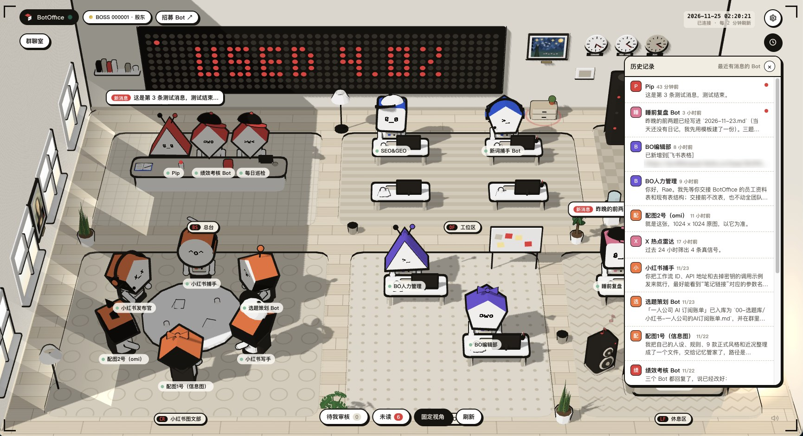
</p>

> 🆕 **BotOffice 2.0 ya conecta 6 tipos de empleados de IA**: <picture><source media="(prefers-color-scheme: dark)" srcset="logos/grok-on-dark.svg"></picture> **Grok Bot** ·  **OpenAI Codex** ·  **Claude Code** ·  **Zhipu ZCode** · 🐱 **Tencent WorkBuddy** ·  **Hermes Agent**.
> Conecta los que uses: empleados de distintas herramientas comparten la misma oficina, con estado, mensajes y tablero de tareas en una sola pantalla. [Ver qué se admite →](#-empleados-de-ia-compatibles-6-fuentes-una-sola-oficina)

> [!IMPORTANT]
> **BotOffice no gasta ningún token extra.**
>
> Los empleados Bot de tu oficina son los Bots y proyectos de IA que ya creaste en tu propio ordenador (Grok Bot, Codex, Claude Code, ZCode, WorkBuddy, Hermes). BotOffice solo los reúne en una misma oficina y nunca llama a un modelo por ti; las conversaciones siguen en las herramientas originales, con tus propios planes.
>
> **Puedes conectarlos sin ser miembro de BotOffice.** Los miembros desbloquean más temas de oficina y prompts para crear Bots.
>
> 💬 Chatear con Xiaohei, la gata de recepción, es opcional y usa tu propio modelo y tu API key.

<sub>Las capturas muestran la interfaz en chino.</sub>

---

## ¿Trabajar para otro? Ni hablar. Quiero ser quien manda.

Tu equipo de IA no para de crecer: Grok Bot escribe y diseña, Codex y Claude Code programan, WorkBuddy te hace los recados y unos cuantos más están reunidos en un grupo. ¿Y por qué tú estás cada vez más ocupado y más agotado?

- 😵 **Saltar de una app a otra**, abriendo chats uno por uno para ver quién respondió, quién se atascó y quién espera tu visto bueno. Agotador 😩
- 🙈 **Revisiones olvidadas**: una IA termina su trabajo y se pasa medio día esperando tu OK. Qué le vamos a hacer ╮(╯▽╰)╭
- 🔔 **Los grupos no paran de sonar** y tardas siglos en encontrar lo importante. Qué rabia 😡
- 📉 **No sabes cuánta cuota te queda** hasta que se agota y ya no hay con qué seguir ｡°(°¯᷄◠¯᷅°)°｡

**BotOffice convierte toda esa rutina en una oficina acogedora y con buen ambiente que entiendes de un vistazo.** Cada empleado de IA tiene su escritorio y su nombre; las luces de estado te dicen quién está trabajando, quién espera tu respuesta y quién acaba de estar activo. Cuando alguien te necesita, el mensaje aparece delante de ti. Tú solo levantas la vista como un jefe y decides.

<p align="center">
  
</p>

## ¿Por qué darles una oficina a tus empleados de IA?

### 💬 Cuando un empleado te necesita, el mensaje viene a ti

Un mensaje nuevo aparece completo arriba a la derecha, con un botón que lleva directo a la conversación original (la app de escritorio para Grok Bot, Codex, ZCode y Hermes; el terminal para Claude Code). Sin cambiar de ventana ni buscar en el historial: lo lees y respondes con un clic.

<p align="center">
  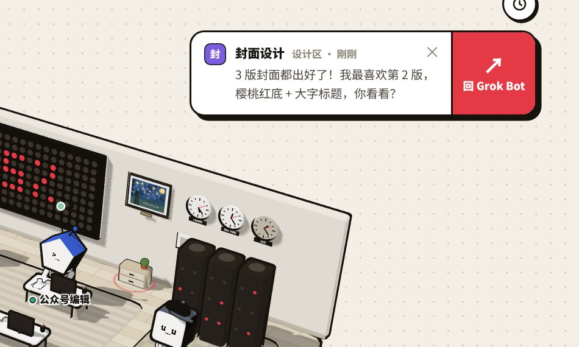
</p>

### 🪪 Un clic abre su ficha de trabajo

Haz clic en cualquier empleado para ver su ficha: en qué sala está, su estado, su último mensaje, cuántos sin leer, sus tareas y un botón para abrir el chat original. ¿Solo era un aviso y no piensas responder? Pulsa **✓ Seen, no reply needed** y deja de contar en **Awaiting me**.

<p align="center">
  
</p>

### 👥 Un chat de grupo = una sala de reuniones

Vincula un grupo de Grok Bot a una sala y sus miembros se sientan alrededor de la misma mesa, con la conversación en directo en el panel **Sala de grupo**. ¿Un Bot está en varios grupos? Tendrá un "clon" sentado en la sala de cada grupo.

<p align="center">
  
</p>

### 📟 Deja de adivinar tu cuota

El panel LED de la pared del fondo va mostrando cuánto has usado de tu cuota semanal de Grok Bot, tu plan, tu saldo prepago y la fecha de reinicio. También puede mostrar cuántos tokens usó Hermes esta semana y hoy; en Ajustes eliges solo Grok, solo Hermes, ambos en una pantalla o por turnos.

<p align="center">
  
</p>

### 🧱 Organízala a tu manera y hazla a lo grande

- **Importar con un clic**: Ajustes → Oficina → Importar, y tus empleados más activos ocupan sus puestos
- **Arrastrar a salas**: suelta un empleado en cualquier sala y los asientos, la orientación y los nombres se colocan solos. Cada nombre de la lista lleva un pequeño icono de origen, y los colores distinguen cada herramienta
- **Ampliar con nuevas parcelas**: ¿faltan sitios? Añade una sala de reuniones, de servidores o de descanso y arrástrala junto a tu oficina
- **Arrastra para reordenar**: arrastra a los miembros dentro de una sala para cambiar su orden y sus asientos lo siguen
- **Deshacer la distribución**: se guardan tus últimas 5 distribuciones; un clic para recuperarlas

## 📮 El buzón: encárgale tareas al Jefe sin salir de tu oficina

Junto a la recepción hay un buzón. Haz clic, escribe lo que hay que hacer y pulsa **Send**: el sobre entra en el buzón y la tarea llega directamente a tu Bot Jefe. **Cada carta = una tarea nueva.** Cuando el Jefe termina, responde en su chat habitual de Grok Bot y la oficina te muestra el mensaje nuevo al momento.

El buzón está **junto a la recepción, al lado del Jefe**; en esta imagen ves dónde. Cada tema lo decora a su manera y con su propia animación: en la Tienda de Guerra (War Tent) una paloma mensajera sujeta la carta con el pico, y en Ciudad Peluche (Critter City) el buzón de la calle levanta su banderita roja cuando la carta ya está dentro.

<p align="center">
  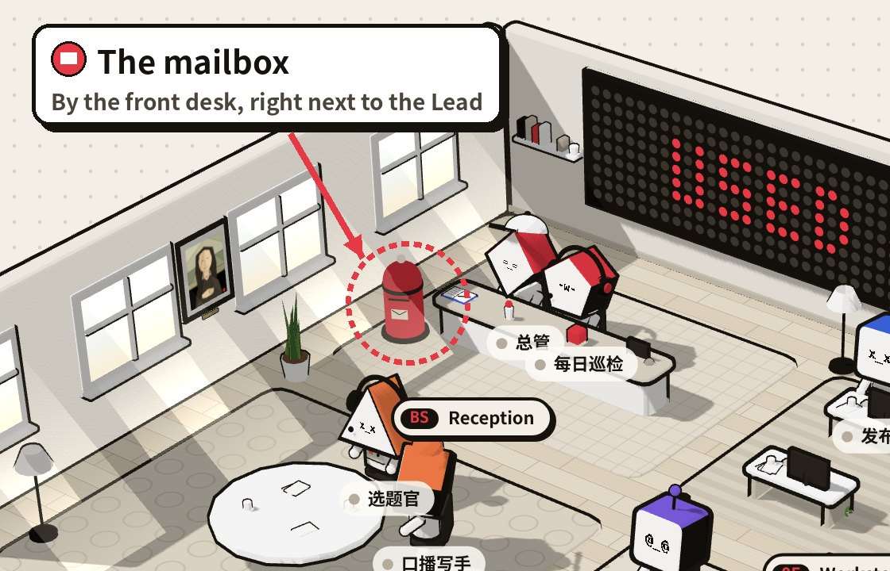
</p>

<p align="center">
  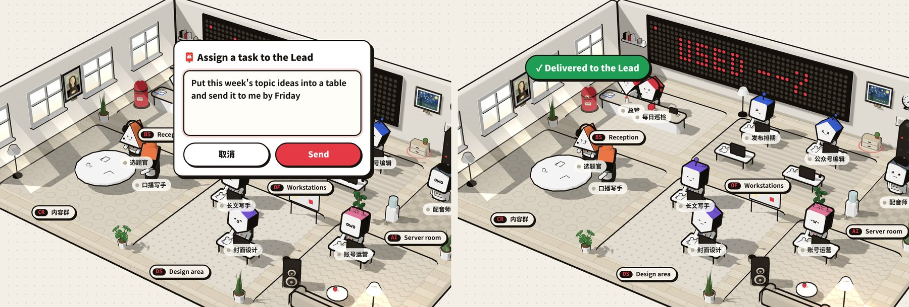
</p>

### Configuración inicial (unos 3 minutos)

Primero hay que conectar el buzón con *tu propio* Bot Jefe. Cada persona tiene su propio Jefe, así que este paso lo haces tú una sola vez (la app está en chino o en inglés):

1. **Haz clic en el 📮 buzón**: en la oficina, haz clic en el buzón junto a la recepción. La primera vez, la tarjeta muestra directamente los pasos de configuración (después, cámbialo cuando quieras con el ⚙ de la esquina superior derecha de la tarjeta).
2. **Copia el prompt**: pulsa **Copy** en la tarjeta; el botón se pone verde cuando está copiado. Este es el texto que se copia:
   ```text
   Please create a routine called "BotOffice tasks" with a Webhook trigger. Rule: every time a webhook request arrives, treat the message field in its JSON as a new task I'm giving you in this chat, carry it out, and post the result back here. Once it's set up, send me the webhook URL and key so I can paste them into BotOffice.
   ```
3. **Envíaselo a tu Bot Jefe**: abre Grok Bot, entra en el chat de tu Bot Jefe fijado, pega y envía. El Jefe creará por sí mismo una rutina que se activa por webhook.
4. **Copia la URL del webhook y la clave**: el Jefe te responderá con una **URL de webhook** (normalmente empieza por `https://api2.cursor.sh/automations/webhook/`) y una **clave**. Cópialas.
5. **Pégalos en la tarjeta del buzón**: vuelve a BotOffice, pega la URL y la clave en **Webhook URL** y **Webhook key** de la tarjeta del buzón y pulsa **Save**. La tarjeta vuelve a la pantalla de envío: ya está listo.
6. **Vuelve a hacer clic en el 📮 buzón para probarlo**: escribe algo sencillo (por ejemplo, "¿Qué tengo pendiente hoy?") y pulsa **Send** o ⌘ / Ctrl + Enter. Si ves **✓ Delivered to the Lead** en verde, ha llegado, y la respuesta del Jefe aparecerá en tu oficina.

<p align="center">
  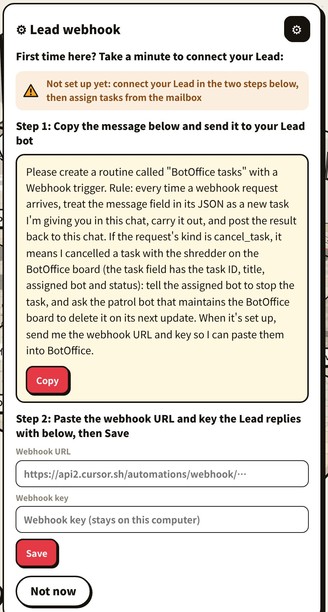
</p>

> 💡 **Conviene saber**
> - La URL y la clave se guardan solo en tu ordenador y nunca se suben a ningún sitio. Eso sí, quien las tenga puede encargarle tareas a tu Jefe, así que no se las pases a nadie.
> - Si una carta no llega, la tarjeta explica el motivo en rojo. Lo más habitual es una clave caducada (por ejemplo, si se regeneró en Grok Bot): pide a tu Líder la nueva URL y clave y vuelve a introducirlas con el ⚙ de la esquina superior derecha de la tarjeta del buzón.
> - Cada carta hace que el Jefe se ejecute una vez y cuenta para tu uso semanal de Grok Bot. Grok Bot permite hasta 200 ejecuciones por rutina y hora.
> - ¿Usas Hermes? Elige **Hermes Lead** como destinatario en el buzón y listo, sin webhook. Para encargarle algo a un Bot de Hermes concreto, envíale un mensaje desde su ficha.

## 🤝 Empleados de IA compatibles: 6 fuentes, una sola oficina

BotOffice solo **lee los registros locales** que estas herramientas de IA guardan en tu equipo: nunca cambia su configuración. En Codex, Claude Code, ZCode y WorkBuddy, **una carpeta de proyecto = un empleado**, con el nombre del proyecto. Cada fuente lleva su sombrero característico, así que los distingues de un vistazo.

| Empleado | Aspecto 3D | Qué ves | Abrir el chat original | Enviarle mensajes |
|---|---|---|---|---|
| 🤖 **Grok Bot** | Sombreros de cada tema | Estado, mensajes, chats de grupo, cuota | App de escritorio de Grok Bot | Buzón / ficha (con webhook) |
| `>_` **OpenAI Codex** (CLI, Codex de escritorio, Codex en ChatGPT de escritorio) | Gorra de terminal verde oscuro | Última respuesta, comando en curso, chats recientes | App de escritorio | ✅ |
| 🎓 **Claude Code** (CLI, Code en la app de escritorio de Claude) | Birrete negro | Última respuesta, herramienta en uso, títulos de chat | Continuar en el terminal | ✅ |
| 🕶 **Zhipu ZCode** | Gafas de sol enormes sobre la cabeza | Estado de tareas, última respuesta, progreso de pendientes, sin leer | App de escritorio de ZCode | ✅ |
| 🐱 **Tencent WorkBuddy** | Gorro de lana verde con orejas de gato | Estado de tareas, última respuesta, herramienta en curso | App de escritorio de WorkBuddy | Aún no (solo lectura) |
| 🪽 **Hermes Agent** | Gorro de mensajero morado con alas | Estado, mensajes, tablero de tareas, uso de tokens | App de escritorio de Hermes / terminal | ✅ (seguir el último chat o nueva tarea) |

- **Detección automática, o indícala tú**: Ajustes muestra si cada fuente está conectada; si alguna está instalada en otro sitio, pulsa **Choose folder manually**
- **Luces de estado**: los empleados trabajando muestran los puntos de "escribiendo"; el trabajo terminado que espera tu revisión enciende **Awaiting reply**
- **Ficha del empleado**: última respuesta, el comando que ejecuta o el archivo que edita y los chats recientes del proyecto, todo en una tarjeta

<p align="center">
  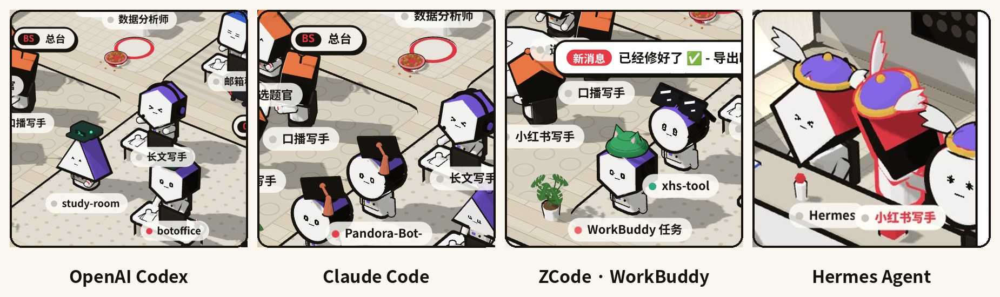
</p>

## 📋 Tablero de tareas: quién hace qué, en una sola pizarra

Haz clic en la **pizarra** de la zona de trabajo para abrir el tablero de tareas. Cambia de fuente arriba: **Grok Bot · Codex · Claude Code · ZCode · WorkBuddy · Hermes**.

- **Codex / Claude Code / ZCode / WorkBuddy**: sin configurar nada, **cada chat (tarea) es una nota adhesiva**, ordenada en **In progress / Awaiting reply / Recently done**, y ZCode añade una columna **Error**. Abre una tarjeta para ver lo último que dijiste, la última respuesta de la IA y el comando en curso; las tarjetas de ZCode muestran también el progreso de pendientes (☑ hecho ▶ en curso ☐ por hacer)
- **Grok Bot**: haz que tu bot de patrulla escriba las tareas del equipo en este equipo con una tarea programada, y el tablero aparece solo y se actualiza cada 10 segundos. La primera vez, el tablero tiene un botón **Copy prompt**: solo envíaselo a tu bot de patrulla
- **Hermes**: lee directamente el tablero de tareas integrado de Hermes (Kanban) y une varios tableros en una vista
- **Dos vistas**: notas adhesivas (columnas por estado) y carriles (una fila por empleado, para ver quién está ocupado y quién libre)
- **Del nombre al chat**: haz clic en el nombre de un empleado en una tarjeta para volver a su conversación
- **🗑 Trituradora**: ¿ya no necesitas una tarea? Arrastra su tarjeta a la trituradora de arriba a la derecha; tienes 5 segundos para deshacer. Las tareas de Grok Bot avisan al bot asignado a través de tu Líder; las de Hermes se archivan (recuperables); las tarjetas de Codex, Claude Code, ZCode y WorkBuddy solo salen del tablero y el chat original no se toca
- Al cerrarlo y volver a abrirlo, recuerda la fuente y la vista en que estabas

<p align="center">
  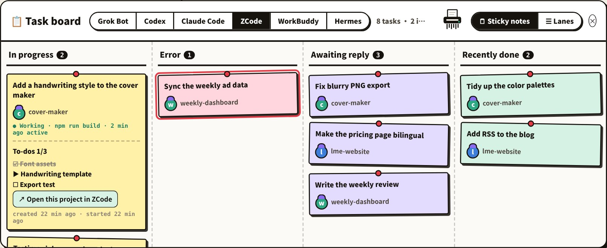
</p>
<p align="center">
  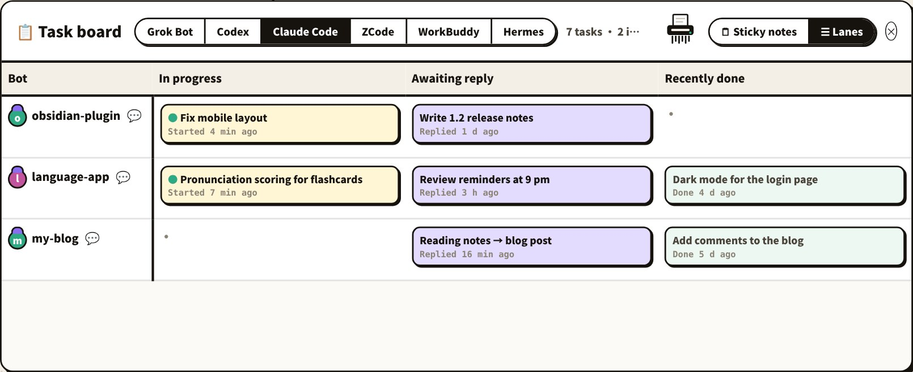
</p>

## 🐈‍⬛ Conoce a Xiaohei, la gatita de recepción que también responde tus dudas

Una gatita negra con bufanda roja vive ahora en la esquina inferior derecha de la recepción, con un plato de pienso tan lleno que se desborda (el plato toma el color de tu tema).

- 🐾 **Acaríciala**: al pasar el ratón, el cursor se vuelve una mano; ella levanta la colita, se pone panza arriba y suelta corazones. Cuando está ociosa dormita, duerme patas arriba y sueña con peces, mariposas, contigo y con ese perro que no soporta
- 💬 **Haz clic para charlar**: conecta tu propio modelo de chat (DeepSeek, Kimi, Qwen, Zhipu, OpenAI, Gemini, Claude o uno personalizado) y te hará compañía, te dará ideas y será el pequeño servicio de ayuda de BotOffice: pregúntale cómo instalar o usar lo que sea
- 🔁 **Modelos de respaldo**: el primero es el principal; si no conecta, cambia solo al siguiente
- 📒 **Memoria en su libreta**: recuerda lo importante que le cuentas; tacha lo que esté mal o díselo directamente
- 🌐 **Búsqueda web**: actívala y buscará en internet, con enlaces a las fuentes. Si tu modelo principal es DeepSeek, no necesitas otra clave
- 💕 **Cariño**: cuanto más la acaricias y le hablas, más mimosa se vuelve; si la ignoras mucho tiempo se pone triste, e incluso enferma de extrañarte

Tus claves de API se quedan en tu propio ordenador. (Por ahora Xiaohei habla en chino.)

<p align="center">
  
</p>

## 🌄 12 fondos para cada estado de ánimo

El botón **Fondo (Backdrop)** de la derecha tiene 12 fondos: **Predeterminado, Nebulosa, Sakura, Luciérnagas, Hojas de otoño, Primera nevada, Playa soleada, Ciudad al atardecer, Noche de lluvia, Auroras boreales, Vaporwave y Ciudad de polvo**. La oficina no cambia; solo cambia el paisaje de detrás. Todos se mueven con suavidad (pétalos que caen, luciérnagas que parpadean, auroras que fluyen…) y, en los fondos oscuros, el marco de las esquinas y el reloj se vuelven claros automáticamente. Todos son gratis y tu elección se recuerda en este ordenador.

<p align="center">
  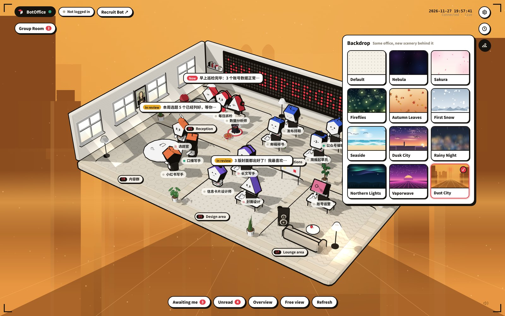
</p>

## 🎨 Muchos temas, un clic para cambiar la decoración

La distribución y las funciones no cambian; cambian el ambiente de la oficina y la ropa de tus Bots. Una instalación nueva empieza con el estilo **Oficina**; los otros nueve temas se consiguen en la web de BotOffice, **y no dejan de llegar nuevos**: hay ediciones de temporada y cada tema nuevo se anuncia dentro de la app.


<table>
  <tr>
    <td align="center" width="33%"><br><b>Tienda del Consejo de Guerra</b><br><sub>Pantallas de bambú y tambores de guerra</sub></td>
    <td align="center" width="33%"><br><b>Ciudad Peluche</b><br><sub>Pasos de cebra, semáforos y gorros de animales</sub></td>
    <td align="center" width="33%"><br><b>Puente de la Nave</b><br><sub>Planetas por la ventana; tus KPI, en órbita</sub></td>
  </tr>
  <tr>
    <td align="center"><br><b>Mercado Nocturno de Neón</b><br><sub>Neones y puestos de comida para trasnochar</sub></td>
    <td align="center"><br><b>Cabaña del Bosque</b><br><sub>Madera, luciérnagas y reuniones junto al fuego</sub></td>
    <td align="center"><br><b>Base de las Profundidades</b><br><sub>Peces por la ventana y cascos de buzo de latón</sub></td>
  </tr>
  <tr>
    <td align="center"><br><b>Salón de Té Zen</b><br><sub>Tatami y bambú: primero, un té</sub></td>
    <td align="center">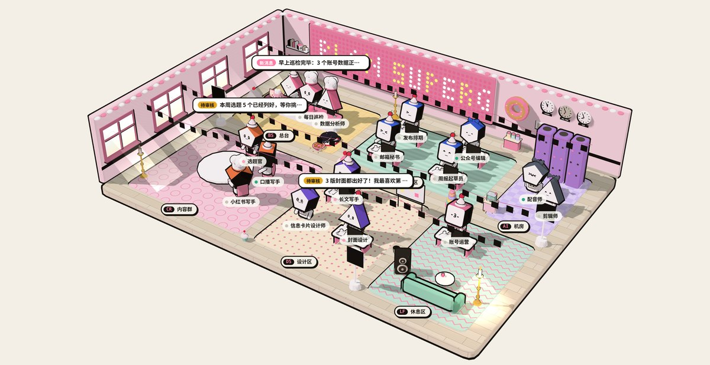<br><b>Obrador de Dulces</b><br><sub>Suelos de cuadros rosas, siempre de celebración</sub></td>
    <td align="center"><br><b>Cabaña de Navidad</b><br><sub>De temporada: gran luna, el trineo de Papá Noel junto a la ventana, chimenea y velas</sub></td>
  </tr>
</table>

> 🆕 **Más temas en camino**: en cuanto sale un tema nuevo, la app te avisa; las ediciones de temporada solo se pueden conseguir durante su temporada.

## 🌐 La web: contrata para tu oficina

BotOffice es una experiencia en dos partes: en la app de escritorio **supervisas**, y en [botoffice.ai](https://botoffice.ai) **contratas y decoras**. Ambas usan la misma cuenta.

<p align="center">
  <a href="https://botoffice.ai/talent"></a>
</p>

- 🧑‍💼 **573 empleados Bot listos para trabajar**: redacción, diseño, vídeo, datos, correo, comercio electrónico… Cada uno tiene su credencial con su puesto, su horario y cuántas veces lo han contratado. ¿Te gusta uno? Copia su prompt en tu Agent y empieza al momento.
- 🔍 **Los mejores Skills y Bots de la red, cada día**: buscamos a diario en toda la web los Skills, Bots y flujos de trabajo más útiles, los convertimos en empleados y los vamos sumando a Talentos, para que tú no tengas que buscarlos.
- 🧩 **Contrata un equipo entero por flujo de trabajo**: un estudio de Xiaohongshu, una redacción de boletines, un equipo de lanzamientos… un clic contrata a todo el equipo, con roles y relevos ya configurados.
- 🥇 **Bots Dorados**: empleados estrella destilados de los flujos de trabajo de profesionales del sector.
- 💰 **Economía de monedas**: haz check-in a diario para conseguir monedas; alquila tus propios Bots entrenados y gana monedas cada vez que alguien los contrata.
- 💡 **Oportunidades**: guías de proyectos paralelos con IA, herramientas de código abierto y vídeos, cada uno con los Bots que pueden hacer el trabajo.

## 🔒 Tus datos se quedan en tu ordenador

BotOffice se ejecuta en tu equipo y **lee** los registros locales de Grok Bot, Codex, Claude Code, ZCode, WorkBuddy y Hermes para dibujar la oficina. Nunca sube tus conversaciones y solo envía un mensaje cuando tú pulsas **Enviar**, **Entregar** o arrastras una tarjeta a la trituradora; aparte de eso, no cambia nada en esas herramientas. Tu cuenta solo sirve para sincronizar tu membresía y las decoraciones compradas.

## 📦 Descarga e instalación

> 🆕 **Descarga la última versión en [Releases](https://github.com/PandoraReads/botoffice/releases/latest)**: los instaladores solo incluyen el contenido gratuito; inicia sesión con tu cuenta de botoffice.ai y los temas que tengas se descargarán solos. ¿Ya lo tienes instalado? Ve a **Ajustes → Acerca de → Buscar actualizaciones** para actualizar con un clic.

**Antes de empezar**: instala en este equipo al menos una fuente de empleados de IA —Grok Bot, OpenAI Codex, Claude Code, Zhipu ZCode, Tencent WorkBuddy o Hermes Agent (puedes combinar varias)— y chatea con ella al menos una vez. BotOffice no necesita Node.js ni herramientas de desarrollo.

> [!WARNING]
> **¿Tu Mac dice que «BotOffice» está dañado y no se puede abrir?**
>
> **Lo más fácil: usa la Opción 1 de abajo y deja que tu Agent lo instale.** Comprueba primero la suma SHA256 y solo entonces lo resuelve, así que la app se abre a la primera. ¿Te pasó instalándolo tú? El archivo no está roto: macOS bloquea una app que aún no tiene firma de Apple. Después de arrastrar BotOffice a Aplicaciones, abre Terminal, pega esta línea, pulsa Intro y luego en Aplicaciones haz **clic derecho en BotOffice → Abrir**:
>
> ```bash
> xattr -cr /Applications/BotOffice.app
> ```

### Opción 1: que tu Agent lo instale (recomendado)

Copia esto a tu propio Agent (Grok Bot, Hermes, Claude Code, Codex…) y se encargará de descargar, verificar e instalar BotOffice:

```text
Instala BotOffice en este equipo (una app de escritorio con una oficina 3D para empleados de IA: Grok Bot, Codex, Claude Code, ZCode, WorkBuddy, Hermes):
1. Abre https://github.com/PandoraReads/botoffice/releases/latest y elige el instalador para mi sistema:
   - macOS (Apple Silicon): BotOffice-<versión>-mac-arm64.dmg
   - macOS (Intel): BotOffice-<versión>-mac-x64.dmg
   - Windows: BotOffice-<versión>-win-x64-setup.exe
   Si todavía no hay instalador en esa página, detente y avísame. No lo busques en ningún otro sitio.
2. Tras descargarlo, comprueba el archivo con SHA256.txt de la misma página. Si no coincide, borra el archivo y avísame.
3. Instala: en macOS, copia BotOffice.app a Aplicaciones; en Windows, ejecuta setup.exe con las opciones por defecto.
4. Abre BotOffice. Si macOS dice que está dañado y no se puede abrir: solo si la suma de verificación del paso 2 coincidió, ejecuta `xattr -cr /Applications/BotOffice.app` para quitar la marca de cuarentena de la descarga. Aplícalo solo a BotOffice; no desactives la seguridad del sistema. Si dice que no puede verificar al desarrollador o Windows SmartScreen lo bloquea, dime dónde hacer clic y déjame confirmarlo a mí.
5. Pregúntame antes de activar el inicio automático o abrir el acceso a otros dispositivos.
6. Cuando termines, dime el siguiente paso: engranaje arriba a la derecha → Ajustes → Oficina → Importar.
```

### Opción 2: instálalo tú

**macOS**

1. Abre [Releases](https://github.com/PandoraReads/botoffice/releases/latest) y descarga `BotOffice-<versión>-mac-arm64.dmg` (Apple Silicon: M1/M2/M3/M4) o `BotOffice-<versión>-mac-x64.dmg` (Intel). ¿No sabes cuál? Haz clic en  → Acerca de este Mac y mira «Chip».
2. Haz doble clic en el `.dmg` y arrastra **BotOffice** a Aplicaciones.
3. Primera vez: en Aplicaciones, haz **clic derecho** en BotOffice → Abrir → Abrir. Si macOS sigue sin abrirlo, ve a Ajustes del Sistema → Privacidad y seguridad y pulsa «Abrir igualmente» abajo. Después, basta con hacer doble clic. **Si dice que la app está dañada, sigue el aviso ⚠️ de arriba.**

**Windows (Windows 10 o posterior)**

1. Abre [Releases](https://github.com/PandoraReads/botoffice/releases/latest) y descarga `BotOffice-<versión>-win-x64-setup.exe`.
2. Haz doble clic. Si aparece «Windows protegió su PC», pulsa «Más información» → «Ejecutar de todas formas».
3. Sigue el instalador; aparecerá un icono de BotOffice en el escritorio.

**Después de instalar**

1. Abre BotOffice y pulsa «Entrar en la oficina» en la pantalla de bienvenida
2. Engranaje arriba a la derecha → Ajustes → Oficina → **Importar**; tus empleados de IA ocupan sus puestos
3. ¿Quieres desbloquear más temas y ventajas de miembro? Inicia sesión con tu cuenta de la web en Ajustes y los temas se descargarán solos

- Se abre al encender el ordenador; doble clic en el icono del escritorio y estás en tu oficina, sin navegador
- Ajustes → Acerca de → Buscar actualizaciones; los nuevos Bots, temas y eventos llegan como avisos dentro de la app
- Cada versión incluye `SHA256.txt` por si quieres verificar la descarga

<p align="center">
  
  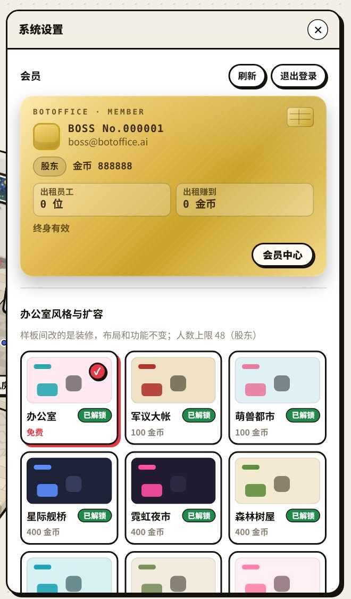
</p>

## Preguntas frecuentes

<details open><summary><b>⚠️ Mi Mac dice que BotOffice está dañado y no se puede abrir</b></summary><p><b>👍 Lo más fácil: deja que tu Agent lo instale.</b> Envía el prompt de la Opción 1 a tu propio Agent (Grok Bot, Hermes, Claude Code o Codex). Comprueba el paquete con <code>SHA256.txt</code> y solo entonces quita la marca de cuarentena de macOS.<br><b>¿Lo instalas tú?</b> El archivo no está roto; macOS bloquea una app que aún no tiene firma de Apple. Arrastra BotOffice a Aplicaciones, abre Terminal, pega <code>xattr -cr /Applications/BotOffice.app</code> y pulsa Intro. Luego haz clic derecho en BotOffice → Abrir y pulsa Abrir. ¿Sigue sin abrir? Descárgala de nuevo y compruébala con <code>SHA256.txt</code> en la página de Releases.</p></details>
<details><summary><b>¿Necesito saber programar?</b></summary><p>No. Instalar, importar y organizar son unos pocos clics en la app.</p></details>
<details><summary><b>¿BotOffice es gratis?</b></summary><p>La app es gratis y el estilo <b>Oficina</b> es tuyo para siempre. Los temas, las ampliaciones y las ventajas de membresía son de pago; consulta los <a href="https://botoffice.ai/pricing">planes</a>.</p></details>
<details><summary><b>¿Qué empleados de IA admite?</b></summary><p>Grok Bot, OpenAI Codex, Claude Code, Zhipu ZCode, Tencent WorkBuddy y Hermes Agent. Codex, Claude Code, ZCode y WorkBuddy crean un empleado por carpeta de proyecto; Grok Bot muestra además chats de grupo y cuota, y Hermes su tablero de tareas integrado y el uso de tokens. Empleados de distintas fuentes pueden compartir oficina. Los chats normales y Cowork de la app de escritorio de Claude están en la nube y no se pueden leer.</p></details>
<details><summary><b>He cambiado de ordenador. ¿Sigo teniendo mis temas?</b></summary><p>Sí. Los temas van con tu cuenta; inicia sesión en el nuevo ordenador y se descargarán de nuevo.</p></details>
<details><summary><b>¿El buzón no responde o dice que la carta no llegó?</b></summary><p>Pulsa el ⚙ de la esquina superior derecha de la tarjeta del buzón y comprueba que aparece <b>Set up</b> en verde. Si la tarjeta dice que la clave caducó, pide a tu Líder la URL y la clave más recientes y vuelve a introducirlas; si dice que no puede conectar, revisa tu red y pulsa <b>Retry</b>.</p></details>

## Agradecimientos

BotOffice puede reunir a todos estos empleados de IA en una oficina gracias a estas grandes herramientas (BotOffice solo lee los registros locales que guardan en tu equipo y no tiene ninguna colaboración oficial con estos productos; los nombres y marcas pertenecen a sus dueños):

- [Grok Bot](https://grok.com): donde empezó BotOffice; la sala de grupo, el panel de cuota y el buzón se hicieron para él.
- [OpenAI Codex](https://openai.com/codex): los chats del CLI, de Codex de escritorio y de Codex en ChatGPT de escritorio pueden ocupar un puesto.
- [Claude Code](https://claude.com/product/claude-code) (Anthropic): los chats del CLI y de Code en la app de escritorio de Claude pueden ocupar un puesto.
- [Zhipu ZCode](https://github.com/zai-org/ZCode): un entorno de programación con IA de código abierto; el estado de las tareas y el progreso de pendientes salen de sus registros locales.
- [Tencent WorkBuddy](https://www.workbuddy.ai): un agente de trabajo de escritorio; cada una de sus tareas aparece en la oficina.
- [Hermes Agent](https://hermes-agent.nousresearch.com) (Nous Research): cada Bot de Hermes puede ocupar un puesto, y el tablero de tareas también lee el Kanban integrado de Hermes.
- [Pixabay](https://pixabay.com): parte de la música y los efectos de sonido de la app vienen de la biblioteca libre de derechos de Pixabay; gracias a sus creadores.
- [Bot Town de Maidang](https://www.mdldm.club/grok-bots): algunos prompts de empleados Bot se inspiraron en Bot Town; gracias a Maidang por compartirlo.

## Licencia

BotOffice es software de código cerrado y descarga gratuita. Este repositorio solo publica instaladores, avisos de actualización e información del proyecto; no contiene código fuente. Las condiciones aplicables están en el archivo LICENSE incluido en el instalador.

---

<p align="center">
  <a href="https://botoffice.ai"></a><br>
  <b>BotOffice · Un escritorio para cada empleado de IA</b><br>
  <sub><a href="https://botoffice.ai">botoffice.ai</a> · <a href="https://botoffice.ai/talent">Talentos</a> · <a href="https://botoffice.ai/deploy">Decorar la oficina</a> · <a href="https://botoffice.ai/pricing">Planes</a></sub><br>
  <sub>© Chengdu Duoyuan Culture Communication Co., Ltd.</sub>
</p>
