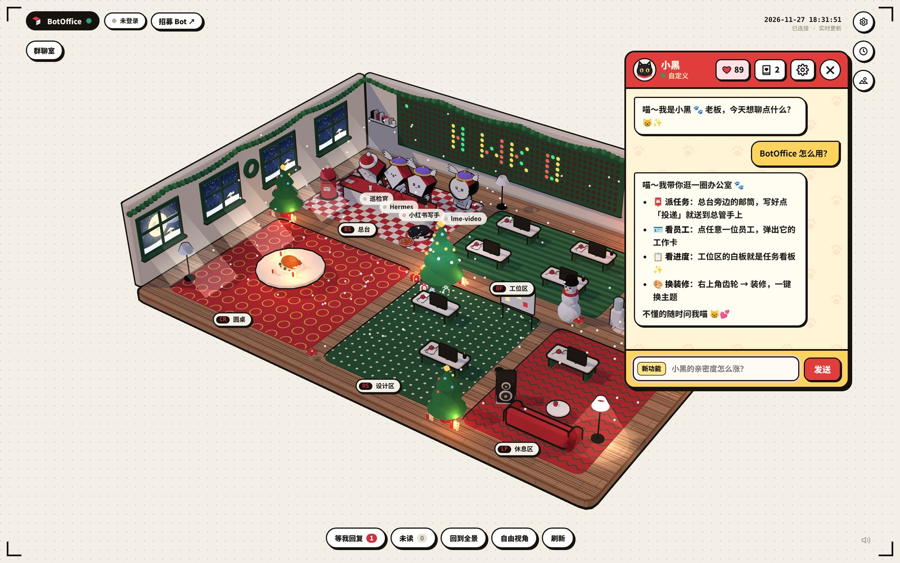
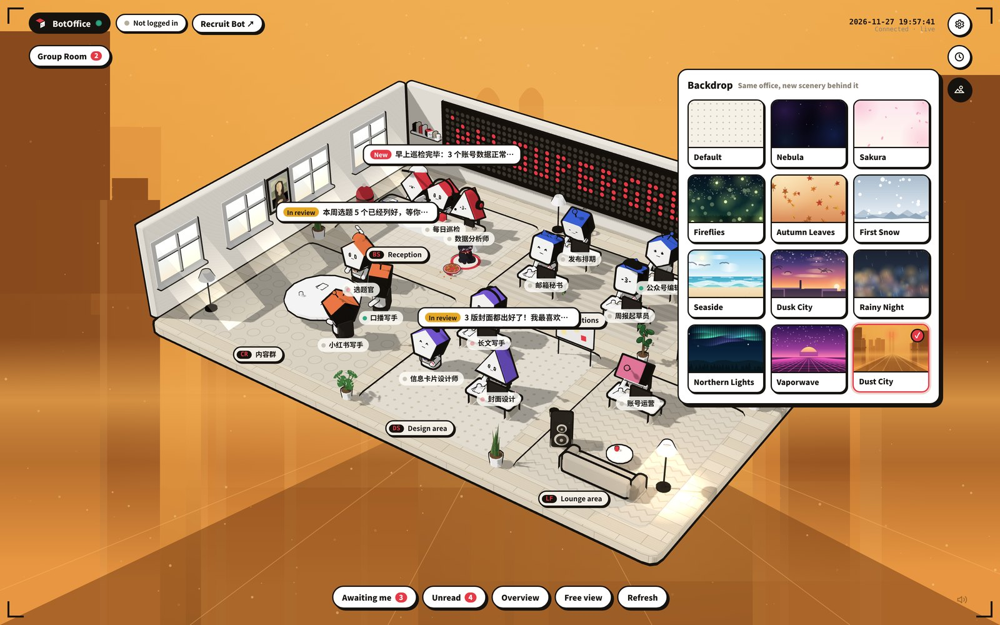
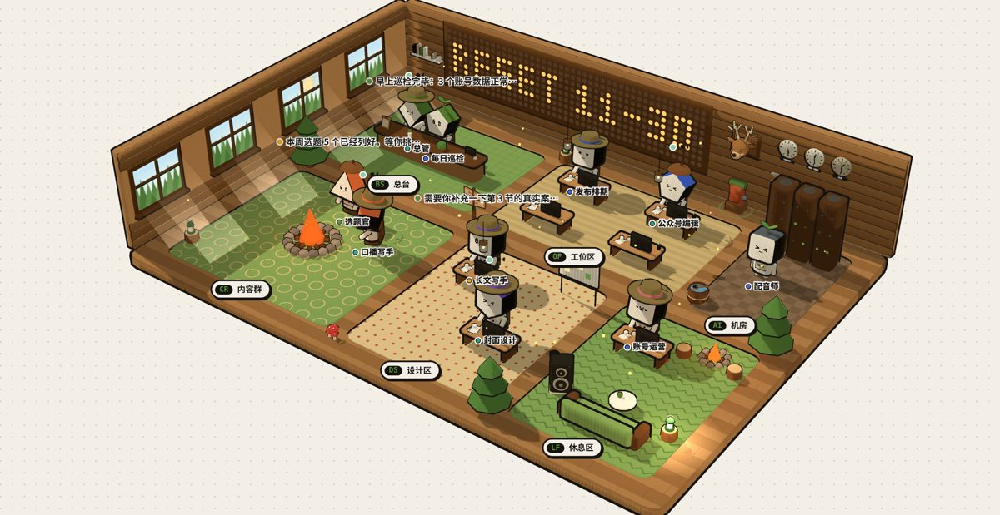

<div align="center">
  
  <h1>BotOffice</h1>
  <p>Grok Bot と Hermes Bot のチームを 3D オフィスに。誰が作業中で、誰があなたの判断を待っていて、どのグループが話しているのか、ひと目でわかる。<br>
  Turn your Grok Bot & Hermes Bot team into a cozy 3D office — see who's working, who needs your call, and which group is talking, at a glance.</p>
  <p>
    <a href="https://botoffice.ai"></a>
    <a href="https://botoffice.ai/talent"></a>
    <a href="https://github.com/PandoraReads/botoffice/releases"></a>
  </p>
  <p><a href="../README.md">简体中文</a> · <a href="README.en.md">English</a> · <a href="README.zh-TW.md">繁體中文</a> · <b>日本語</b> · <a href="README.ko.md">한국어</a> · <a href="README.es.md">Español</a></p>
</div>

<p align="center">
  
</p>

<sub>スクリーンショットは中国語版の画面です。</sub>

---

## 雇われる？ありえない。ボスになるのは私だ。

Bot が数十体。原稿を書く子、画像を作る子、数字を見張る子、グループで会議中の子たち。なのに、どうして自分はどんどん忙しく、どんどんやつれていくの——

- 😵 **チャットを一つずつ開いて**、誰が返信したか、誰が詰まっているか、誰があなた待ちかを確認。もうへとへと😩
- 🙈 **レビュー待ちを見落とす**：Bot は作業を終えてあなたの OK を半日待っている。やれやれ ╮(╯▽╰)╭
- 🔔 **グループの通知が洪水のよう**で、大事な情報を探すのに一苦労。イライラ😡
- 📉 **クォータの残りがわからず**、使い切ってからもう動かせないと気づく｡°(°¯᷄◠¯᷅°)°｡

**BotOffice は、そんな面倒な毎日を、ひと目でわかる、癒やしたっぷりの温かいオフィスに変えます。** Bot には自分のデスクと名前があり、ステータスランプで、誰があなたの返事を待っていて、誰がついさっき動いたかがすぐわかる。誰かがあなたを呼べば、メッセージが目の前にポップアップ。あなたはボスらしく、顔を上げて判断するだけ。

<p align="center">
  
</p>

## なぜ Bot たちにオフィスを用意すべきなのか？

### 💬 Bot からの呼びかけは、目の前に

新しいメッセージは右上に全文で表示され、ボタン一つで Grok Bot や Hermes デスクトップ版の該当の会話へ。ウィンドウを切り替える必要も、履歴をさかのぼる必要もありません。

<p align="center">
  
</p>

### 🪪 クリックすれば、その子の業務カード

どの Bot をクリックしても、所属ルーム・ステータス・最新メッセージ・未読数・担当タスクが一枚のカードに。元の会話もワンクリックで開けます。Bot がひと言話しただけで返信はしない？「✓ 既読・返信不要」を押せば「返信待ち」から外れます。

<p align="center">
  
</p>

### 👥 グループチャット 1 つ = 会議室 1 つ

Grok Bot のグループをルームに紐づけると、メンバーが同じテーブルを囲み、左の「グループルーム」に会話がリアルタイムで流れます。複数のグループに入っている Bot は、それぞれの会議室に「分身」が座ります。

<p align="center">
  
</p>

### 📟 クォータはもう勘に頼らない

奥の壁の LED ボードが、今週の Grok Bot クォータの使用率・プラン・プリペイド残高・リセット日を順番に表示します。Hermes の今週 / 今日のトークン使用量も表示でき、設定で「Grok のみ・Hermes のみ・1 画面に両方・交互に表示」を選べます。

<p align="center">
  
</p>

### 🧱 自分好みに配置して、もっと大きく強く

- **ワンクリック取り込み**：設定 → オフィス → 取り込み、最近よく使う Bot が自動で着席
- **ドラッグで配置**：Bot をルームにドロップすれば、席・向き・名札が自動で整う
- **区画を増築**：席が足りない？会議室・サーバールーム・休憩室を追加して、オフィスの隣にドラッグ
- **ドラッグで並べ替え**：ルーム内のメンバーをドラッグして順番を変えると、席順もそのまま変わります
- **配置の巻き戻し**：直近 5 回分の保存前レイアウトを保持、ワンクリックで復元

## 📮 ポスト：オフィスを離れずに、リーダーへ仕事を頼む

受付の横にポストがあります。クリックしてやってほしいことを書き、「Send」を押すと封筒がポストに入り、タスクがそのままあなたのリーダー Bot に届きます。**手紙 1 通 = 新しいタスク 1 件**。リーダーは作業が終わると Grok Bot のいつものチャットで返信し、オフィスにも新着メッセージがすぐポップアップします。

ポストは**受付の横、リーダーのすぐそば**にあります。場所はこの画像を見てください。テーマごとにデザインも投函アニメーションも違い、軍議大帳では伝書鳩が手紙をくちばしにくわえ、萌獣都市では道端のポストが届いた合図に赤い旗を立てます。

<p align="center">
  
</p>

<p align="center">
  
</p>

### はじめての設定（約 3 分）

まずポストを *あなた自身の* リーダー Bot につなぎます。リーダーは人によって違うので、この手順だけは一度ご自身で行ってください（アプリの画面は中国語または英語です）：

1. **📮ポストをクリック**：オフィスで受付横のポストをクリックします。まだ設定していない場合はカード上部に黄色の案内が出るので、その中の「Set up（去设置）」をクリック。設定の「Assign a task to the Lead（给总管派任务）」がそのまま開きます。
2. **メッセージをワンクリックでコピー**：設定パネルの「Copy」をクリック。ボタンが緑になればコピー完了です。コピーされるのは次の文です（英語画面の場合）：
   ```text
   Please create a routine called "BotOffice tasks" with a Webhook trigger. Rule: every time a webhook request arrives, treat the message field in its JSON as a new task I'm giving you in this chat, carry it out, and post the result back here. Once it's set up, send me the webhook URL and key so I can paste them into BotOffice.
   ```
3. **リーダー Bot に送る**：Grok Bot を開き、ピン留めしているリーダー Bot とのチャットに貼り付けて送信します。リーダーが Webhook で起動するルーティンを自分で作ります。
4. **Webhook の URL とキーをコピー**：リーダーが **Webhook の URL**（多くは `https://api2.cursor.sh/automations/webhook/` で始まります）と**キー**を返してくれるので、コピーします。
5. **BotOffice の設定に貼り付ける**：BotOffice の「Assign a task to the Lead」に戻り、その下の「Webhook URL」「Webhook key」に URL とキーを貼り付けて「Save」。ステータスが緑の「Set up」になれば完了です。
6. **もう一度📮ポストをクリックして試す**：簡単なこと（例：「今日の ToDo を確認して」）を書いて「Send」、または ⌘ / Ctrl + Enter。緑の「✓ Delivered to the Lead」が出れば届いています。リーダーの返信はオフィスにポップアップします。

<p align="center">
  
</p>

> 💡 **ポイント**
> - URL とキーはあなたの PC にだけ保存され、アップロードされません。ただし、これを知っている人は誰でもリーダーに仕事を頼めるので、他人には渡さないでください。
> - 届かなかったときは、カードに赤字で理由が表示されます。いちばん多いのはキーの失効（Grok Bot で再発行した場合など）です。リーダーに新しい URL とキーをもらい、設定に貼り直してください。
> - 1 通送るたびにリーダーが 1 回動き、Grok Bot の週間使用量にカウントされます。Grok Bot では 1 つのルーティンにつき 1 時間あたり最大 200 回まで起動できます。
> - Hermes を使っているなら、ポストの宛先を「Hermes Lead」にするだけ。Webhook の設定は不要です。特定の Hermes Bot に頼みたいときは、その Bot の業務カードから直接メッセージを送れます。

## 🪽 Hermes Bot も出社します

[Hermes Agent](https://hermes-agent.nousresearch.com) を使っていますか？Hermes の各 Bot（profile）もオフィスに座れて、Grok Bot と同じ部屋で働けます。Hermes の社員は翼のついた紫のメッセンジャー帽をかぶっているので、ひと目でわかります。

- **メッセージとステータスランプ**：Hermes の最新の返信を読み取り、返信待ち・最近アクティブ・静か が一目瞭然。新着はリアルタイムでポップアップ
- **直接メッセージ**：Hermes Bot の業務カードからそのまま送信。「前回の続き」も「新しいタスク」も選べて、Webhook の設定は不要
- **元の会話を開く**：Hermes デスクトップ版があればワンクリックでその会話へ。なければターミナルで続きから（履歴の振り返り付き）
- **使用量**：奥の壁の LED ボードに Hermes の今週 / 今日のトークン使用量を表示できます

<p align="center">
  
</p>

## 📋 タスクボード：誰が何をしているか、ホワイトボード 1 枚で

作業エリアの**ホワイトボード**をクリックすると、タスクボードが開きます。

- **Grok Bot ボード**：巡回 Bot に定期タスクでチームのタスクをこの PC に書き出してもらうと、ボードが表示され 10 秒ごとに更新されます。初回はボード上の「プロンプトをコピー」から巡回 Bot に送るだけ
- **Hermes ボード**：Hermes 内蔵のタスクボード（Kanban）をそのまま読み取り、複数のボードもまとめて表示
- **2 つのビュー**：付箋（状態ごとの列：Triage・To do・Ready・In progress・Blocked・In review・Done）とスイムレーン（Bot ごとに 1 行、誰が忙しいかひと目でわかる）
- **名前をクリックで会話へ**：カードの担当者をクリックすると、その Bot との会話が開きます
- **🗑 シュレッダー**：いらなくなったタスクは右上のシュレッダーにドラッグ。5 秒以内なら取り消せます。Grok Bot のタスクはリーダー経由で担当 Bot に中止を伝え、Hermes のタスクはアーカイブ（復元可能）して担当 Bot に伝えます
- 完了は直近 7 件だけ表示。閉じて開き直しても、前回見ていた場所から

<p align="center">
  
</p>
<p align="center">
  
</p>

## 🐈‍⬛ 受付に黒猫の「シャオヘイ」がやってきた：甘えん坊で、質問にも答えてくれる

受付の右下に、赤いマフラーの黒い子猫が住みつきました。座布団の前には山盛りのキャットフード（お皿の色はテーマに合わせて変わります）。

- 🐾 **なでる**：カーソルを乗せると手のひらに変わり、お尻を上げたりお腹を見せたり、ハートを飛ばします。ひまなときは居眠りやへそ天、頭の上に小魚・ちょうちょ・飼い主・苦手な犬が浮かびます
- 💬 **クリックでおしゃべり**：自分の対話モデル（DeepSeek、Kimi、Qwen、Zhipu、OpenAI、Gemini、Claude、カスタム）をつなぐと、雑談やアイデア出しの相手になり、BotOffice の小さなサポート係としてインストールや使い方にも答えます
- 🔁 **予備モデル**：一番上がメインモデル。つながらないときは自動で次に切り替え
- 📒 **メモ帳の記憶**：あなたが話した大事なことを覚えます。間違いは消せるし、直接教えることもできます
- 🌐 **ウェブ検索**：オンにするとネットで調べて、出典リンク付きで答えます。メインモデルが DeepSeek なら追加のキーは不要
- 💕 **なかよし度**：よくなでて話しかけるほど甘えてきます。長く放っておくとしょんぼり、寂しくて病気になることも

API キーはあなたのパソコンの中だけに保存されます。（シャオヘイは現在中国語で話します）

<p align="center">
  
</p>

## 🌄 気分で選べる 12 の背景

右側の「背景（Backdrop）」ボタンから 12 種類の背景を選べます：**デフォルト、星雲、春の桜、夏の蛍、秋の落ち葉、初雪、晴れた海辺、黄昏の街、雨の夜の窓辺、北欧のオーロラ、ヴェイパーウェイヴ、荒野のオレンジの霧**。オフィスはそのまま、後ろの景色だけが変わります。どれもやさしく動き（舞い散る花びら、瞬く蛍、揺れるオーロラ…）、暗い背景では四隅のフレームと時計が自動で明るい色に切り替わります。すべて無料で、選んだ背景はこの PC に記憶されます。

<p align="center">
  
</p>

## 🎨 豊富なテーマ、ワンクリックで内装チェンジ

レイアウトと機能はそのまま、オフィスの雰囲気と社員の衣装が変わります。初回インストール時は「オフィス」テーマ。残りの 9 種類のテーマは BotOffice 公式サイトで手に入ります。**しかも続々と追加中**です。季節限定版もあり、新しいテーマはアプリ内のお知らせですぐにお届けします。


<table>
  <tr>
    <td align="center" width="33%"><br><b>軍議の大天幕</b><br><sub>竹簡のスクリーンと軍旗、会議はまるで出陣前</sub></td>
    <td align="center" width="33%"><br><b>もふもふシティ</b><br><sub>横断歩道と信号、社員は動物の着ぐるみ帽子</sub></td>
    <td align="center" width="33%"><br><b>宇宙船ブリッジ</b><br><sub>窓の外には惑星、KPI を軌道へ</sub></td>
  </tr>
  <tr>
    <td align="center"><br><b>ネオン夜市</b><br><sub>ネオンと屋台、夜更かしのお供に</sub></td>
    <td align="center"><br><b>森のツリーハウス</b><br><sub>木の壁とホタル、会議はたき火を囲んで</sub></td>
    <td align="center"><br><b>深海基地</b><br><sub>窓の外を魚が泳ぎ、社員は真鍮の潜水ヘルメット</sub></td>
  </tr>
  <tr>
    <td align="center"><br><b>禅の茶室</b><br><sub>畳と竹、まずはお茶を一杯</sub></td>
    <td align="center"><br><b>スイーツ工房</b><br><sub>ピンクのチェック柄、いつでもお祝いムード</sub></td>
    <td align="center"><br><b>クリスマスの小屋</b><br><sub>季節限定：大きな月、窓の外を飛ぶそり、暖炉とろうそくの灯り</sub></td>
  </tr>
</table>

> 🆕 **新しいテーマを続々リリース予定**：新作が出るとアプリでお知らせします。季節限定版はその季節の間だけ手に入ります。

## 🌐 公式サイト：オフィスに人材を

BotOffice は二つで一つの体験です。デスクトップアプリで**見守り**、[botoffice.ai](https://botoffice.ai) で**採用と内装**。アカウントは共通です。

<p align="center">
  <a href="https://botoffice.ai/talent"></a>
</p>

- 🧑‍💼 **すでに 573 体の即戦力 Bot が在籍**：執筆、デザイン、動画、データ、メール、EC……一人ひとりに社員証があり、職種・勤務時間・採用回数がひと目でわかります。気に入ったらプロンプトをコピーして Grok Bot か Hermes に貼るだけで着任。
- 🔍 **ネット上の最強 Skill と Bot を毎日リサーチ**：毎日ネット全体から本当に使える Skill、Bot、ワークフローを探し、社員として人材ライブラリに追加し続けます。自分で探し回る必要はありません。
- 🧩 **ワークフロー単位でチーム採用**：小紅書（RED）制作部、公式アカウント編集部、EC 新商品チーム……ボタン一つでチームごと採用、役割分担と引き継ぎも設定済み。
- 🥇 **ゴールド社員**：業界のプロのワークフローから生まれたエース社員。
- 💰 **コイン経済**：毎日のチェックインでコインを獲得。育てた Bot を貸し出せば、雇われるたびにコインが入ります。
- 💡 **ビジネスチャンス**：副業 × AI のガイド、オープンソースツール、動画チュートリアル。どれにも手伝ってくれる Bot が付いています。

## 🔒 データはあなたの PC の中だけ

BotOffice はあなたの PC 上で動き、オフィスを描くために PC 内の Grok Bot と Hermes のデータを**読み取り**ます。会話をアップロードすることはなく、あなたが自分で「Send」を押したときやカードをシュレッダーに入れたときだけメッセージを送ります。それ以外に Grok Bot や Hermes の中身を変更することはありません。アカウントは会員情報と購入済みテーマの同期にのみ使われます。

## 📦 ダウンロードとインストール

> 🆕 **最新版は [Releases](https://github.com/PandoraReads/botoffice/releases/latest) からダウンロード**：インストーラーには無料コンテンツのみ入っています。公式サイトのアカウントでログインすると、購入済みのテーマが自動でダウンロードされます。インストール済みの方は「設定 → バージョン情報 → アップデートを確認」からワンクリックで更新できます。

**始める前に**：この PC に [Grok Bot](https://grok.com) のデスクトップ版をインストールしてログインするか、[Hermes Agent](https://hermes-agent.nousresearch.com) をインストールしておいてください（両方でも OK）。Node.js などの開発ツールは不要です。

### 方法 1：Agent にインストールしてもらう（おすすめ）

下の文章をあなたの Agent（Grok Bot、Hermes、Claude Code、Codex など）にコピーして送れば、ダウンロード・検証・インストールまでやってくれます。

```text
この PC に BotOffice（Grok Bot と Hermes Bot 用の 3D オフィスのデスクトップアプリ）をインストールしてください：
1. https://github.com/PandoraReads/botoffice/releases/latest を開き、私の OS に合うインストーラーを選んでください：
   - macOS（Apple シリコン）：BotOffice-<バージョン>-mac-arm64.dmg
   - macOS（Intel）：BotOffice-<バージョン>-mac-x64.dmg
   - Windows：BotOffice-<バージョン>-win-x64-setup.exe
   ページにまだインストーラーがなければ、そこで止めて私に教えてください。ほかの場所で探さないでください。
2. ダウンロード後、同じページの SHA256.txt でチェックサムを確認し、一致しなければファイルを削除して教えてください。
3. インストール：macOS は BotOffice.app を「アプリケーション」にコピー、Windows は setup.exe を既定の設定で実行。
4. BotOffice を開いてください。「開発元を検証できません」や SmartScreen の警告が出たら、どこを押せばいいか教えてください。確認は私がします。システムのセキュリティ設定は変更しないでください。
5. ログイン時の自動起動や外部からのアクセス許可は、設定する前に私に確認してください。
6. 終わったら次の手順を教えてください：右上の歯車 → 設定 → オフィス → 取り込み。
```

### 方法 2：自分でインストールする

**macOS**

1. [Releases](https://github.com/PandoraReads/botoffice/releases/latest) を開き、`BotOffice-<バージョン>-mac-arm64.dmg`（Apple シリコン：M1/M2/M3/M4）または `BotOffice-<バージョン>-mac-x64.dmg`（Intel）をダウンロード。どちらかわからない場合は、 → この Mac について の「チップ」を確認してください。
2. `.dmg` をダブルクリックし、**BotOffice** を「アプリケーション」フォルダへドラッグ。
3. 初回起動：「アプリケーション」で BotOffice を**右クリック** → 開く → 開く。それでも開けない場合は、システム設定 → プライバシーとセキュリティ の下にある「このまま開く」をクリック。次回からはダブルクリックで開けます。

**Windows（Windows 10 以降）**

1. [Releases](https://github.com/PandoraReads/botoffice/releases/latest) を開き、`BotOffice-<バージョン>-win-x64-setup.exe` をダウンロード。
2. ダブルクリックで実行。「Windows によって PC が保護されました」と表示されたら、「詳細情報」→「実行」。
3. インストーラーに従って進めると、デスクトップに BotOffice のアイコンができます。

**インストール後**

1. BotOffice を開き、ウェルカム画面で「オフィスに入る」をクリック
2. 右上の歯車 → 設定 → オフィス → **取り込み**。Bot が自動で着席します
3. もっと多くのテーマや会員特典を解放するには、設定で公式サイトのアカウントにログイン。テーマが自動でダウンロードされます

- PC 起動時に自動で立ち上がり、デスクトップのアイコンをダブルクリックするだけでオフィスへ
- 設定 → バージョン情報 → アップデートを確認。新しい Bot、テーマ、イベントはアプリ内のお知らせで届きます
- ダウンロードしたファイルを検証したい場合は、各リリースに付属の `SHA256.txt` をどうぞ

<p align="center">
  
  
</p>

## よくある質問

<details><summary><b>プログラミングは必要？</b></summary><p>いいえ。インストールも取り込みも配置も、画面上で数回クリックするだけです。</p></details>
<details><summary><b>BotOffice は無料？</b></summary><p>本体は無料で、標準の「オフィス」はずっと使えます。有料なのはテーマ、増築、会員特典です。<a href="https://botoffice.ai/pricing">会員プラン</a>をご覧ください。</p></details>
<details><summary><b>どの Bot に対応していますか？</b></summary><p>Grok Bot と Hermes Bot（Hermes Agent の各 profile）です。Grok Bot はステータス・メッセージ・グループチャット・クォータを、Hermes はステータス・メッセージ・タスクボード・トークン使用量を読み取ります。両方の Bot を同じオフィスに座らせられます。</p></details>
<details><summary><b>PC を買い替えたら、購入したテーマは？</b></summary><p>大丈夫です。テーマはアカウントに紐づいているので、新しい PC で同じアカウントにログインすれば再ダウンロードされます。</p></details>
<details><summary><b>ポストを押しても反応しない／届かなかったと表示される</b></summary><p>まず設定の「Assign a task to the Lead」が緑の「Set up」になっているか確認してください。キーが無効と表示された場合は、リーダーに最新の Webhook URL とキーをもらって貼り直します。接続できない場合は、ネットワークを確認してから「Retry」を押してください。</p></details>

## 謝辞

- [Grok Bot](https://grok.com)：BotOffice は Grok Bot から始まりました。オフィスの社員はあなたの Grok Bot から来ています。
- [Hermes Agent](https://hermes-agent.nousresearch.com)（Nous Research）：Hermes の Bot も全員オフィスに座れます。タスクボードは Hermes 自身の Kanban を読み取っています。
- [Pixabay](https://pixabay.com)：アプリ内の音楽と効果音の一部は、Pixabay のロイヤリティフリー素材を使用しています。クリエイターの皆さんに感謝します。
- [麦当（マイダン）の Bot タウン（麦当的 Bot 小镇）](https://www.mdldm.club/grok-bots)：一部の Bot 社員のプロンプトは Bot タウンを参考にしています。共有してくれた麦当さんに感謝します。

## ライセンス

BotOffice は無料でダウンロードできるクローズドソースのソフトウェアです。このリポジトリではインストーラー、更新のお知らせ、プロジェクト紹介のみを公開しており、ソースコードは含まれていません。適用される条件はインストーラー同梱の LICENSE ファイルをご覧ください。

---

<p align="center">
  <a href="https://botoffice.ai"></a><br>
  <b>BotOffice · あなたの Bot に、デスクをひとつ</b><br>
  <sub><a href="https://botoffice.ai">botoffice.ai</a> · <a href="https://botoffice.ai/talent">人材ライブラリ</a> · <a href="https://botoffice.ai/deploy">オフィス改装</a> · <a href="https://botoffice.ai/pricing">会員プラン</a></sub><br>
  <sub>© 成都哆元文化传播有限公司</sub>
</p>
