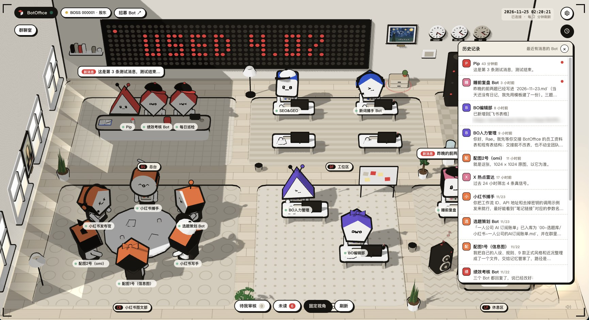
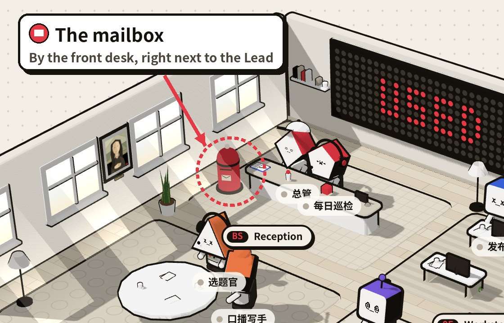
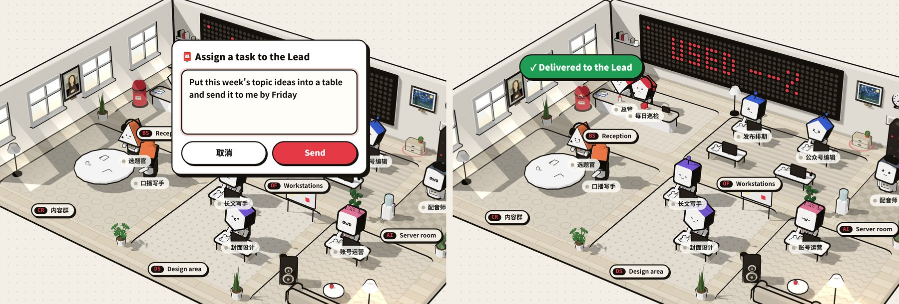
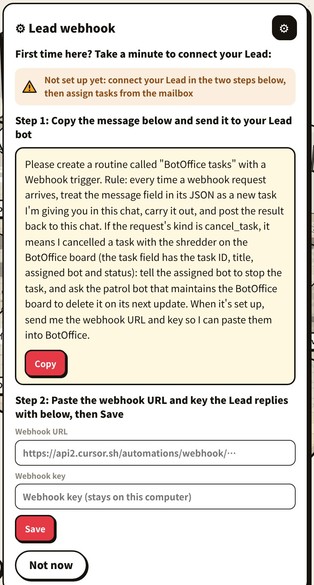
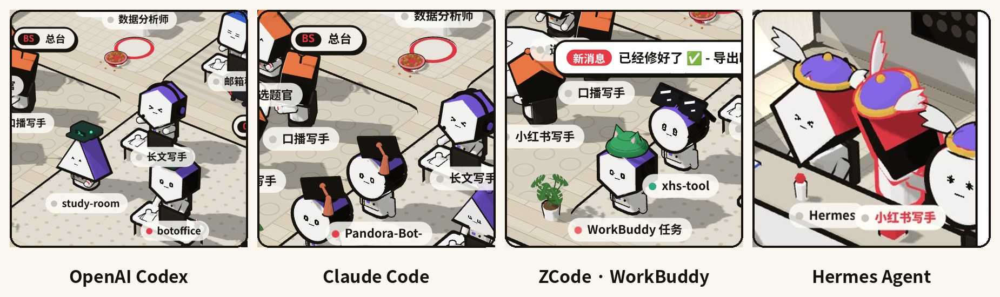
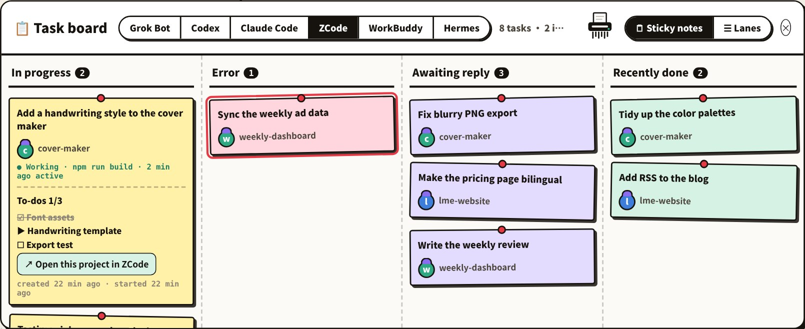
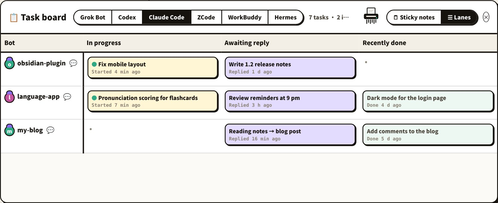
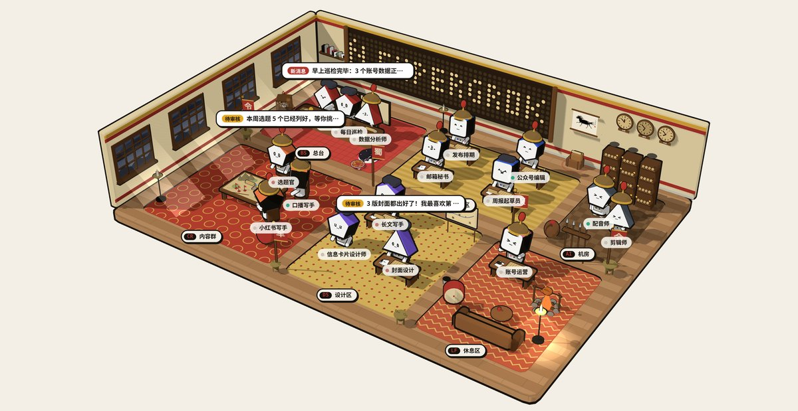

<div align="center">
  
  <h1>BotOffice</h1>
  <p>あなたの AI 社員たちを、あたたかい 3D オフィスに。誰が作業中で、誰があなたの判断を待っていて、どのグループが話しているのか、ひと目でわかります。<br>
  Bring your AI employees into a cozy 3D office — see who's working, who needs your call, and which group is talking, at a glance.</p>
  <p>
    <a href="https://botoffice.ai"></a>
    <a href="https://botoffice.ai/talent"></a>
    <a href="https://github.com/PandoraReads/botoffice/releases"></a>
  </p>
  <p><a href="../README.md">简体中文</a> · <a href="README.en.md">English</a> · <a href="README.zh-TW.md">繁體中文</a> · <b>日本語</b> · <a href="README.ko.md">한국어</a> · <a href="README.es.md">Español</a></p>
</div>

<p align="center">
  
</p>

> 🆕 **BotOffice 2.0 は 6 種類の AI 社員に対応しました**：🤖 **Grok Bot** · `>_` **OpenAI Codex** · 🎓 **Claude Code** · 🕶 **Zhipu ZCode** · 🐱 **Tencent WorkBuddy** · 🪽 **Hermes Agent**。
> 使っているものをつなぐだけ。違うツールの社員も同じオフィスに座れて、状態・メッセージ・タスクボードがひとつの画面で見られます。[対応内容を見る →](#-対応する-ai-社員6-つの出どころがひとつのオフィスに)

> [!IMPORTANT]
> **BotOffice が Token を余分に消費することは一切ありません。**
>
> オフィスにいる Bot 社員は、あなたが自分のパソコンですでに作った Bot や AI プロジェクト（Grok Bot・Codex・Claude Code・ZCode・WorkBuddy・Hermes）です。BotOffice はそれらを同じオフィスに招き入れるだけで、代わりにモデルを呼び出すことはありません。会話はこれまでどおり元のツールで、あなた自身のプランで行われます。
>
> **BotOffice の会員登録をしなくても接続できます。** 会員になると、オフィスのテーマと Bot 作成プロンプトがさらに増えます。
>
> 💬 受付の黒猫「小黒」とのチャットは任意の機能で、あなた自身のモデルと API Key を使います。

<sub>スクリーンショットは中国語版の画面です。</sub>

---

## 雇われる？ありえない。ボスになるのは私だ。

AI 社員はどんどん増えていく。Grok Bot は原稿と画像、Codex と Claude Code はコード、WorkBuddy は雑務、さらに何人かはグループで会議中。それなのに、なぜか自分はどんどん忙しく、疲れていく——

- 😵 **いくつものアプリを行ったり来たり**して会話を一つずつ開き、誰が返信したか、誰が詰まっているか、誰があなたの確認を待っているかを見て回る。疲れる😩
- 🙈 **レビュー待ちを見落とす**：AI が作業を終えてあなたの OK を待ったまま半日。やれやれ ╮(╯▽╰)╭
- 🔔 **グループの通知が洪水のよう**で、大事な情報を探すのに一苦労。イライラ😡
- 📉 **クォータの残りがわからず**、使い切ってからもう動かせないと気づく｡°(°¯᷄◠¯᷅°)°｡

**BotOffice は、そんな面倒な毎日を、ひと目でわかる居心地のいいオフィスに変えます。** AI 社員には一人ひとりデスクと名札があり、ステータスランプで誰が作業中か、誰があなたの返事を待っているか、誰がさっきまで動いていたかがわかります。誰かに呼ばれたら、メッセージが目の前にポップアップ。あなたは社長のように顔を上げて、決めるだけ。

<p align="center">
  
</p>

## なぜ AI 社員たちにオフィスを？

### 💬 社員に呼ばれたら、メッセージが目の前に

新しいメッセージは右上に全文で表示され、ボタンひとつで元の会話へ（Grok Bot・Codex・ZCode・Hermes はデスクトップアプリ、Claude Code はターミナルで続きから）。ウィンドウを切り替えたり履歴を探したりせず、読んだらそのまま返信できます。

<p align="center">
  
</p>

### 🪪 クリックすれば、その子の業務カード

社員をクリックすると業務カードが開きます。どの部屋にいるか、今の状態、最新メッセージ、未読数、担当タスク、そして元の会話を開くボタン。ただの報告で返信するつもりがないなら、「✓ Seen, no reply needed」を押せば「Awaiting me」から外れます。

<p align="center">
  
</p>

### 👥 グループチャット 1 つ = 会議室 1 つ

Grok Bot のグループをルームに紐づけると、メンバーが同じテーブルを囲み、左の「グループルーム」に会話がリアルタイムで流れます。複数のグループに入っている Bot は、それぞれの会議室に「分身」が座ります。

<p align="center">
  
</p>

### 📟 クォータはもう勘に頼らない

奥の壁の LED ボードが、今週の Grok Bot クォータの使用率・プラン・プリペイド残高・リセット日を順番に表示します。Hermes の今週 / 今日のトークン使用量も表示でき、設定で「Grok のみ・Hermes のみ・1 画面に両方・交互に表示」を選べます。

<p align="center">
  
</p>

### 🧱 自分好みに配置して、もっと大きく強く

- **ワンクリック取り込み**：設定 → オフィス → 取り込み で、最近アクティブな社員が自動で着席
- **部屋へドラッグ**：社員を好きな部屋にドロップすると、席・向き・名札が自動で整います。一覧の名前には出どころの小さなアイコンが付き、色でも見分けられます
- **区画を増築**：席が足りない？会議室・サーバールーム・休憩室を追加して、オフィスの隣にドラッグ
- **ドラッグで並べ替え**：ルーム内のメンバーをドラッグして順番を変えると、席順もそのまま変わります
- **配置の巻き戻し**：直近 5 回分の保存前レイアウトを保持、ワンクリックで復元

## 📮 ポスト：オフィスを離れずに、リーダーへ仕事を頼む

受付の横にポストがあります。クリックしてやってほしいことを書き、「Send」を押すと封筒がポストに入り、タスクがそのままあなたのリーダー Bot に届きます。**手紙 1 通 = 新しいタスク 1 件**。リーダーは作業が終わると Grok Bot のいつものチャットで返信し、オフィスにも新着メッセージがすぐポップアップします。

ポストは**受付の横、リーダーのすぐそば**にあります。場所はこの画像を見てください。テーマごとにデザインも投函アニメーションも違い、軍議大帳では伝書鳩が手紙をくちばしにくわえ、萌獣都市では道端のポストが届いた合図に赤い旗を立てます。

<p align="center">
  
</p>

<p align="center">
  
</p>

### はじめての設定（約 3 分）

まずポストを *あなた自身の* リーダー Bot につなぎます。リーダーは人によって違うので、この手順だけは一度ご自身で行ってください（アプリの画面は中国語または英語です）：

1. **📮 ポストをクリック**：オフィスの受付横にあるポストをクリック。初回はカードにそのまま設定手順が表示されます（設定後はカード右上の ⚙ からいつでも変更できます）。
2. **プロンプトをコピー**：カードの「Copy」を押し、ボタンが緑になればコピー完了。コピーされるのはこの文章です：
   ```text
   Please create a routine called "BotOffice tasks" with a Webhook trigger. Rule: every time a webhook request arrives, treat the message field in its JSON as a new task I'm giving you in this chat, carry it out, and post the result back here. Once it's set up, send me the webhook URL and key so I can paste them into BotOffice.
   ```
3. **リーダー Bot に送る**：Grok Bot を開き、ピン留めしているリーダー Bot とのチャットに貼り付けて送信します。リーダーが Webhook で起動するルーティンを自分で作ります。
4. **Webhook の URL とキーをコピー**：リーダーが **Webhook の URL**（多くは `https://api2.cursor.sh/automations/webhook/` で始まります）と**キー**を返してくれるので、コピーします。
5. **ポストのカードに貼り付け**：BotOffice に戻り、URL とキーをポストのカードの「Webhook URL」「Webhook key」に貼り付けて「Save」。カードが投函画面に戻れば設定完了です。
6. **もう一度📮ポストをクリックして試す**：簡単なこと（例：「今日の ToDo を確認して」）を書いて「Send」、または ⌘ / Ctrl + Enter。緑の「✓ Delivered to the Lead」が出れば届いています。リーダーの返信はオフィスにポップアップします。

<p align="center">
  
</p>

> 💡 **ポイント**
> - URL とキーはあなたの PC にだけ保存され、アップロードされません。ただし、これを知っている人は誰でもリーダーに仕事を頼めるので、他人には渡さないでください。
> - 届かなかったときは、カードに赤字で理由が表示されます。よくあるのはキーの失効（Grok Bot で再生成した場合など）：リーダーに新しい URL とキーを送ってもらい、ポストのカード右上の ⚙ から入れ直してください。
> - 1 通送るたびにリーダーが 1 回動き、Grok Bot の週間使用量にカウントされます。Grok Bot では 1 つのルーティンにつき 1 時間あたり最大 200 回まで起動できます。
> - Hermes を使っているなら、ポストの宛先を「Hermes Lead」にするだけ。Webhook の設定は不要です。特定の Hermes Bot に頼みたいときは、その Bot の業務カードから直接メッセージを送れます。

## 🤝 対応する AI 社員：6 つの出どころが、ひとつのオフィスに

BotOffice は、これらの AI ツールが**あなたのパソコンに残すローカル記録を読む**だけで、設定は一切変えません。Codex・Claude Code・ZCode・WorkBuddy は**プロジェクトフォルダ 1 つ = 社員 1 人**で、名前はプロジェクト名そのまま。出どころごとに目印の帽子をかぶっているので、ひと目で見分けられます。

| 社員 | 3D の見た目 | 見られる内容 | 元の会話を開く | メッセージを送る |
|---|---|---|---|---|
| 🤖 **Grok Bot** | テーマごとの帽子 | 状態、メッセージ、グループチャット、利用枠 | Grok Bot デスクトップ | ポスト／業務カード（Webhook 設定） |
| `>_` **OpenAI Codex**（CLI、Codex デスクトップ、ChatGPT デスクトップ） | 深緑のターミナル帽 | 最新の返信、実行中のコマンド、最近の会話 | デスクトップアプリ | ✅ |
| 🎓 **Claude Code**（CLI、Claude デスクトップの Code） | 黒い角帽 | 最新の返信、使用中のツール、会話タイトル | ターミナルで続きから | ✅ |
| 🕶 **Zhipu ZCode** | 頭の上に特大サングラス | タスクの状態、最新の返信、ToDo の進み具合、未読 | ZCode デスクトップ | ✅ |
| 🐱 **Tencent WorkBuddy** | 緑の猫耳ニット帽 | タスクの状態、最新の返信、実行中のツール | WorkBuddy デスクトップ | 未対応（読み取りのみ） |
| 🪽 **Hermes Agent** | 翼つきの紫のメッセンジャー帽 | 状態、メッセージ、タスクボード、token 使用量 | Hermes デスクトップ／ターミナル | ✅（前回の続き or 新しいタスク） |

- **自動検出、手動指定も可能**：設定画面で各ツールの接続状況がわかります。標準以外の場所にある場合は「Choose folder manually」で指定するだけ
- **ステータスランプ**：作業中の社員の頭上には「入力中」の点々、作業を終えてあなたの確認待ちなら「Awaiting reply」が点灯
- **社員カード**：最新の返信、実行中のコマンドや編集中のファイル、そのプロジェクトの最近の会話を 1 枚で

<p align="center">
  
</p>

## 📋 タスクボード：誰が何をしているか、ホワイトボード 1 枚で

オフィスの執務エリアにある**ホワイトボード**をクリックするとタスクボードが開きます。上部で出どころを切り替え：**Grok Bot · Codex · Claude Code · ZCode · WorkBuddy · Hermes**。

- **Codex／Claude Code／ZCode／WorkBuddy**：設定不要。**会話（タスク）1 つが付箋 1 枚**になり、「In progress／Awaiting reply／Recently done」に自動で振り分けられます。ZCode には「Error」列も。カードを開くと、あなたが最後に言ったこと、AI の最新の返信、実行中のコマンドが見え、ZCode のカードには ToDo の進み具合（☑ 完了 ▶ 進行中 ☐ 未着手）も表示されます
- **Grok Bot**：巡回 Bot に定期タスクでチームのタスクをこのパソコンへ書き出してもらうと、ボードが自動で現れ 10 秒ごとに更新されます。初回はボードに「Copy prompt」ボタンがあるので、巡回 Bot に送るだけ
- **Hermes**：Hermes 内蔵のタスクボード（Kanban）をそのまま読み込み、複数のボードもまとめて表示
- **2 つの表示**：付箋（状態ごとの列）とレーン（社員ごとに 1 行。誰が忙しく誰が手すきかひと目でわかる）
- **社員名から会話へ**：カードの社員名をクリックすると、その会話に戻れます
- **🗑 シュレッダー**：要らなくなったタスクは右上のシュレッダーへドラッグ。5 秒以内なら取り消せます。Grok Bot のタスクはリーダー経由で担当 Bot に中止を伝え、Hermes のタスクはアーカイブ（復元可能）。Codex・Claude Code・ZCode・WorkBuddy のカードはボードから外れるだけで、元の会話はそのままです
- 閉じて開き直しても、前回の出どころと表示のまま

<p align="center">
  
</p>
<p align="center">
  
</p>

## 🐈‍⬛ 受付に黒猫の「シャオヘイ」がやってきた：甘えん坊で、質問にも答えてくれる

受付の右下に、赤いマフラーの黒い子猫が住みつきました。座布団の前には山盛りのキャットフード（お皿の色はテーマに合わせて変わります）。

- 🐾 **なでる**：カーソルを乗せると手のひらに変わり、お尻を上げたりお腹を見せたり、ハートを飛ばします。ひまなときは居眠りやへそ天、頭の上に小魚・ちょうちょ・飼い主・苦手な犬が浮かびます
- 💬 **クリックでおしゃべり**：自分の対話モデル（DeepSeek、Kimi、Qwen、Zhipu、OpenAI、Gemini、Claude、カスタム）をつなぐと、雑談やアイデア出しの相手になり、BotOffice の小さなサポート係としてインストールや使い方にも答えます
- 🔁 **予備モデル**：一番上がメインモデル。つながらないときは自動で次に切り替え
- 📒 **メモ帳の記憶**：あなたが話した大事なことを覚えます。間違いは消せるし、直接教えることもできます
- 🌐 **ウェブ検索**：オンにするとネットで調べて、出典リンク付きで答えます。メインモデルが DeepSeek なら追加のキーは不要
- 💕 **なかよし度**：よくなでて話しかけるほど甘えてきます。長く放っておくとしょんぼり、寂しくて病気になることも

API キーはあなたのパソコンの中だけに保存されます。（シャオヘイは現在中国語で話します）

<p align="center">
  
</p>

## 🌄 気分で選べる 12 の背景

右側の「背景（Backdrop）」ボタンから 12 種類の背景を選べます：**デフォルト、星雲、春の桜、夏の蛍、秋の落ち葉、初雪、晴れた海辺、黄昏の街、雨の夜の窓辺、北欧のオーロラ、ヴェイパーウェイヴ、荒野のオレンジの霧**。オフィスはそのまま、後ろの景色だけが変わります。どれもやさしく動き（舞い散る花びら、瞬く蛍、揺れるオーロラ…）、暗い背景では四隅のフレームと時計が自動で明るい色に切り替わります。すべて無料で、選んだ背景はこの PC に記憶されます。

<p align="center">
  
</p>

## 🎨 豊富なテーマ、ワンクリックで内装チェンジ

レイアウトと機能はそのまま、オフィスの雰囲気と社員の衣装が変わります。初回インストール時は「オフィス」テーマ。残りの 9 種類のテーマは BotOffice 公式サイトで手に入ります。**しかも続々と追加中**です。季節限定版もあり、新しいテーマはアプリ内のお知らせですぐにお届けします。


<table>
  <tr>
    <td align="center" width="33%"><br><b>軍議の大天幕</b><br><sub>竹簡のスクリーンと軍旗、会議はまるで出陣前</sub></td>
    <td align="center" width="33%"><br><b>もふもふシティ</b><br><sub>横断歩道と信号、社員は動物の着ぐるみ帽子</sub></td>
    <td align="center" width="33%"><br><b>宇宙船ブリッジ</b><br><sub>窓の外には惑星、KPI を軌道へ</sub></td>
  </tr>
  <tr>
    <td align="center"><br><b>ネオン夜市</b><br><sub>ネオンと屋台、夜更かしのお供に</sub></td>
    <td align="center"><br><b>森のツリーハウス</b><br><sub>木の壁とホタル、会議はたき火を囲んで</sub></td>
    <td align="center"><br><b>深海基地</b><br><sub>窓の外を魚が泳ぎ、社員は真鍮の潜水ヘルメット</sub></td>
  </tr>
  <tr>
    <td align="center"><br><b>禅の茶室</b><br><sub>畳と竹、まずはお茶を一杯</sub></td>
    <td align="center"><br><b>スイーツ工房</b><br><sub>ピンクのチェック柄、いつでもお祝いムード</sub></td>
    <td align="center"><br><b>クリスマスの小屋</b><br><sub>季節限定：大きな月、窓の外を飛ぶそり、暖炉とろうそくの灯り</sub></td>
  </tr>
</table>

> 🆕 **新しいテーマを続々リリース予定**：新作が出るとアプリでお知らせします。季節限定版はその季節の間だけ手に入ります。

## 🌐 公式サイト：オフィスに人材を

BotOffice は二つで一つの体験です。デスクトップアプリで**見守り**、[botoffice.ai](https://botoffice.ai) で**採用と内装**。アカウントは共通です。

<p align="center">
  <a href="https://botoffice.ai/talent"></a>
</p>

- 🧑‍💼 **すぐ使える Bot 社員が 573 名在籍**：執筆、デザイン、動画編集、データ監視、メール管理、EC 運営……一人ひとりに社員証があり、職種・勤務時間・雇用回数がひと目でわかります。気に入ったらプロンプトをコピーしてあなたの Agent に貼るだけで、すぐ働き始めます。
- 🔍 **ネット上の最強 Skill と Bot を毎日リサーチ**：毎日ネット全体から本当に使える Skill、Bot、ワークフローを探し、社員として人材ライブラリに追加し続けます。自分で探し回る必要はありません。
- 🧩 **ワークフロー単位でチーム採用**：小紅書（RED）制作部、公式アカウント編集部、EC 新商品チーム……ボタン一つでチームごと採用、役割分担と引き継ぎも設定済み。
- 🥇 **ゴールド社員**：業界のプロのワークフローから生まれたエース社員。
- 💰 **コイン経済**：毎日のチェックインでコインを獲得。育てた Bot を貸し出せば、雇われるたびにコインが入ります。
- 💡 **ビジネスチャンス**：副業 × AI のガイド、オープンソースツール、動画チュートリアル。どれにも手伝ってくれる Bot が付いています。

## 🔒 データはあなたの PC の中だけ

BotOffice はあなたのパソコン上で動き、Grok Bot・Codex・Claude Code・ZCode・WorkBuddy・Hermes のローカル記録を**読み取って**オフィスを描きます。会話をアップロードすることはなく、あなたが自分で「投函」「送信」を押すかカードをシュレッダーに入れたときだけメッセージを送ります。それ以外にこれらのツールの中身を変更することはありません。アカウントは会員資格と購入済みの内装の同期にだけ使います。

## 📦 ダウンロードとインストール

> 🆕 **最新版は [Releases](https://github.com/PandoraReads/botoffice/releases/latest) からダウンロード**：インストーラーには無料コンテンツのみ入っています。公式サイトのアカウントでログインすると、購入済みのテーマが自動でダウンロードされます。インストール済みの方は「設定 → バージョン情報 → アップデートを確認」からワンクリックで更新できます。

**インストール前に**：このパソコンに AI 社員の出どころを少なくとも一つ入れてください。Grok Bot・OpenAI Codex・Claude Code・Zhipu ZCode・Tencent WorkBuddy・Hermes Agent のどれでも（いくつでも）OK で、一度は会話しておいてください。Node.js などの開発ツールは不要です。

> [!WARNING]
> **Mac で「“BotOffice”は壊れているため開けません」と表示される？**
>
> **おすすめは下の「方法 1」で Agent に任せること**：SHA256 チェックサムを確認してから対処してくれるので、そのまま開けます。自分で入れてこの表示が出た場合は：ファイルは壊れていません。まだ Apple の署名がないアプリを macOS が止めています。BotOffice を「アプリケーション」に入れたあと「ターミナル」を開き、次の 1 行を貼り付けて Return を押し、「アプリケーション」で **BotOffice を右クリック → 開く** を選んでください：
>
> ```bash
> xattr -cr /Applications/BotOffice.app
> ```

### 方法 1：Agent にインストールしてもらう（おすすめ）

下の文章をあなたの Agent（Grok Bot、Hermes、Claude Code、Codex など）にコピーして送れば、ダウンロード・検証・インストールまでやってくれます。

```text
このパソコンに BotOffice（AI 社員のための 3D オフィスのデスクトップアプリ。Grok Bot・Codex・Claude Code・ZCode・WorkBuddy・Hermes に対応）をインストールしてください：
1. https://github.com/PandoraReads/botoffice/releases/latest を開き、私の OS に合うインストーラーを選んでください：
   - macOS（Apple シリコン）：BotOffice-<バージョン>-mac-arm64.dmg
   - macOS（Intel）：BotOffice-<バージョン>-mac-x64.dmg
   - Windows：BotOffice-<バージョン>-win-x64-setup.exe
   ページにまだインストーラーがなければ、そこで止めて私に教えてください。ほかの場所で探さないでください。
2. ダウンロード後、同じページの SHA256.txt でチェックサムを確認し、一致しなければファイルを削除して教えてください。
3. インストール：macOS は BotOffice.app を「アプリケーション」にコピー、Windows は setup.exe を既定の設定で実行。
4. BotOffice を開いてください。macOS で「壊れているため開けません」と出たら、手順 2 のチェックサムが一致した場合に限り `xattr -cr /Applications/BotOffice.app` を実行してダウンロードの隔離フラグを外してください。対象は BotOffice だけにして、システム全体のセキュリティ設定は切らないでください。「開発元を検証できません」や Windows の SmartScreen の警告が出たら、どこを押せばいいか教えてください。確認は私がします。
5. ログイン時の自動起動や外部からのアクセス許可は、設定する前に私に確認してください。
6. 終わったら次の手順を教えてください：右上の歯車 → 設定 → オフィス → 取り込み。
```

### 方法 2：自分でインストールする

**macOS**

1. [Releases](https://github.com/PandoraReads/botoffice/releases/latest) を開き、`BotOffice-<バージョン>-mac-arm64.dmg`（Apple シリコン：M1/M2/M3/M4）または `BotOffice-<バージョン>-mac-x64.dmg`（Intel）をダウンロード。どちらかわからない場合は、 → この Mac について の「チップ」を確認してください。
2. `.dmg` をダブルクリックし、**BotOffice** を「アプリケーション」フォルダへドラッグ。
3. 初回起動：「アプリケーション」で BotOffice を**右クリック** → 開く → 開く。それでも開けない場合は、システム設定 → プライバシーとセキュリティ の下にある「このまま開く」をクリック。次回からはダブルクリックで開けます。 **「壊れているため開けません」と出たら、上の ⚠️ の方法で解決できます。**

**Windows（Windows 10 以降）**

1. [Releases](https://github.com/PandoraReads/botoffice/releases/latest) を開き、`BotOffice-<バージョン>-win-x64-setup.exe` をダウンロード。
2. ダブルクリックで実行。「Windows によって PC が保護されました」と表示されたら、「詳細情報」→「実行」。
3. インストーラーに従って進めると、デスクトップに BotOffice のアイコンができます。

**インストール後**

1. BotOffice を開き、ウェルカム画面で「オフィスに入る」をクリック
2. 右上の歯車 → 設定 → オフィス → **取り込み** で、AI 社員が自動で着席
3. もっと多くのテーマや会員特典を解放するには、設定で公式サイトのアカウントにログイン。テーマが自動でダウンロードされます

- PC 起動時に自動で立ち上がり、デスクトップのアイコンをダブルクリックするだけでオフィスへ
- 設定 → バージョン情報 → アップデートを確認。新しい Bot、テーマ、イベントはアプリ内のお知らせで届きます
- ダウンロードしたファイルを検証したい場合は、各リリースに付属の `SHA256.txt` をどうぞ

<p align="center">
  
  
</p>

## よくある質問

<details open><summary><b>⚠️ Mac で「壊れているため開けません」と出たら？</b></summary><p><b>👍 おすすめは Agent に任せること</b>：上の「方法 1」のプロンプトを自分の Agent（Grok Bot・Hermes・Claude Code・Codex）に送れば、<code>SHA256.txt</code> で確認してから macOS のダウンロード隔離フラグを外してくれます。<br><b>自分で入れた場合は？</b>ファイルは壊れていません。まだ Apple の署名がないアプリを macOS が止めています。BotOffice を「アプリケーション」に入れ、「ターミナル」で <code>xattr -cr /Applications/BotOffice.app</code> を実行してから、BotOffice を右クリック → 開く → 「開く」を押してください。それでも開けないときは、もう一度ダウンロードして Releases ページの <code>SHA256.txt</code> で確認してください。</p></details>
<details><summary><b>プログラミングは必要？</b></summary><p>いいえ。インストールも取り込みも配置も、画面上で数回クリックするだけです。</p></details>
<details><summary><b>BotOffice は無料？</b></summary><p>本体は無料で、標準の「オフィス」はずっと使えます。有料なのはテーマ、増築、会員特典です。<a href="https://botoffice.ai/pricing">会員プラン</a>をご覧ください。</p></details>
<details><summary><b>どの AI 社員に対応していますか？</b></summary><p>Grok Bot・OpenAI Codex・Claude Code・Zhipu ZCode・Tencent WorkBuddy・Hermes Agent です。Codex・Claude Code・ZCode・WorkBuddy はプロジェクトフォルダごとに一人の社員になります。Grok Bot はグループチャットと利用枠も、Hermes は内蔵のタスクボードと token 使用量も見られます。違う出どころの社員も同じオフィスに座れます。Claude デスクトップアプリの通常のチャットと Cowork はクラウドにあるため読み取れません。</p></details>
<details><summary><b>PC を買い替えたら、購入したテーマは？</b></summary><p>大丈夫です。テーマはアカウントに紐づいているので、新しい PC で同じアカウントにログインすれば再ダウンロードされます。</p></details>
<details><summary><b>ポストを押しても反応がない／届かなかったと表示される</b></summary><p>まずポストのカード右上の ⚙ を押し、緑の「Set up」になっているか確認してください。キーの失効と表示されたら、リーダーに最新の Webhook URL とキーを送ってもらい入れ直します。つながらないと表示されたら、ネットワークを確認して「Retry」を押してください。</p></details>

## 謝辞

BotOffice がこれだけの AI 社員をひとつのオフィスに迎えられるのは、すばらしいツールのおかげです（BotOffice はそれらがあなたのパソコンに残すローカル記録を読むだけで、各製品との公式な提携関係はありません。名称と商標は各権利者に帰属します）：

- [Grok Bot](https://grok.com)：BotOffice の出発点。グループルーム、利用枠ボード、ポストはこのために作られました。
- [OpenAI Codex](https://openai.com/codex)：CLI、Codex デスクトップ、ChatGPT デスクトップの Codex の会話がオフィスに座れます。
- [Claude Code](https://claude.com/product/claude-code)（Anthropic）：CLI と Claude デスクトップの Code の会話がオフィスに座れます。
- [Zhipu ZCode](https://github.com/zai-org/ZCode)：オープンソースの AI コーディング環境。タスクの状態と ToDo の進み具合はそのローカル記録から。
- [Tencent WorkBuddy](https://www.workbuddy.ai)：デスクトップの作業 Agent。タスクのひとつひとつがオフィスに表示されます。
- [Hermes Agent](https://hermes-agent.nousresearch.com)（Nous Research）：Hermes の Bot はすべてオフィスに座れ、タスクボードも Hermes 内蔵の Kanban を読み込みます。
- [Pixabay](https://pixabay.com)：アプリの音楽と効果音の一部は Pixabay のロイヤリティフリー素材です。クリエイターの皆さんに感謝します。
- [麦当の Bot タウン](https://www.mdldm.club/grok-bots)：一部の Bot 社員のプロンプトは Bot タウンを参考にしました。共有してくれた麦当さんに感謝します。

## ライセンス

BotOffice は無料でダウンロードできるクローズドソースのソフトウェアです。このリポジトリではインストーラー、更新のお知らせ、プロジェクト紹介のみを公開しており、ソースコードは含まれていません。適用される条件はインストーラー同梱の LICENSE ファイルをご覧ください。

---

<p align="center">
  <a href="https://botoffice.ai"></a><br>
  <b>BotOffice · AI 社員にデスクを</b><br>
  <sub><a href="https://botoffice.ai">botoffice.ai</a> · <a href="https://botoffice.ai/talent">人材ライブラリ</a> · <a href="https://botoffice.ai/deploy">オフィス改装</a> · <a href="https://botoffice.ai/pricing">会員プラン</a></sub><br>
  <sub>© 成都哆元文化传播有限公司</sub>
</p>
