<div align="center">
  
  <h1>BotOffice</h1>
  <p>당신의 AI 직원들을 아늑한 3D 사무실로. 누가 일하는지, 누가 당신의 결정을 기다리는지, 어느 그룹이 대화 중인지 한눈에 보입니다.<br>
  Bring your AI employees into a cozy 3D office — see who's working, who needs your call, and which group is talking, at a glance.</p>
  <p>
    <a href="https://botoffice.ai"></a>
    <a href="https://botoffice.ai/talent"></a>
    <a href="https://github.com/PandoraReads/botoffice/releases"></a>
  </p>
  <p><a href="../README.md">简体中文</a> · <a href="README.en.md">English</a> · <a href="README.zh-TW.md">繁體中文</a> · <a href="README.ja.md">日本語</a> · <b>한국어</b> · <a href="README.es.md">Español</a></p>
</div>

<p align="center">
  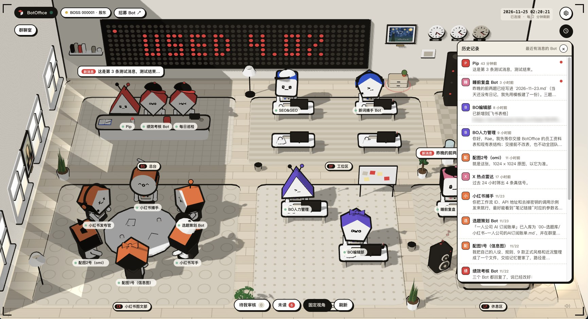
</p>

> [!IMPORTANT]
> **BotOffice는 Token을 전혀 쓰지 않습니다.**
>
> 사무실의 Bot 직원은 여러분이 이미 자기 컴퓨터에서 만든 Bot이나 AI 프로젝트(Grok Bot, Codex, Claude Code, ZCode, WorkBuddy, Hermes)입니다. BotOffice는 이들을 한 사무실로 모아 줄 뿐, 대신 모델을 호출하지 않습니다. 대화는 원래 도구에서, 여러분의 요금제로 이루어집니다.
>
> **BotOffice 회원 가입 없이도 연결할 수 있습니다.** 회원이 되면 더 많은 사무실 테마와 Bot 생성 프롬프트를 쓸 수 있습니다.
>
> <sub>프런트의 검은 고양이 「샤오헤이」와의 채팅은 선택 기능이며, 여러분이 직접 넣은 모델과 API Key를 씁니다.</sub>

> 🆕 **BotOffice 2.0은 이제 6종류의 AI 직원을 연결합니다**: 🤖 **Grok Bot** · `>_` **OpenAI Codex** · 🎓 **Claude Code** · 🕶 **Zhipu ZCode** · 🐱 **Tencent WorkBuddy** · 🪽 **Hermes Agent**.
> 쓰는 것만 연결하면 됩니다. 출처가 다른 직원도 한 사무실에 앉고, 상태·메시지·작업 보드를 한 화면에서 봅니다. [지원 내용 보기 →](#-지원하는-ai-직원-6가지-출처-한-사무실)

<sub>스크린샷은 중국어 화면입니다.</sub>

---

## 남 밑에서 일하라고? 사양합니다. 사장은 내가 할 거니까.

AI 직원은 계속 늘어납니다. Grok Bot은 글과 이미지를, Codex와 Claude Code는 코드를, WorkBuddy는 잡무를 맡고, 몇몇은 그룹에서 회의 중이죠. 그런데 왜 나는 점점 더 바빠지고 지쳐 갈까요——

- 😵 **여러 앱을 오가며** 대화를 하나씩 열어 누가 답했는지, 누가 막혔는지, 누가 확인을 기다리는지 살핀다. 지친다 😩
- 🙈 **검토 대기를 놓친다**: AI가 일을 끝내고 승인을 기다린 지 반나절. 어쩔 수 없지 ╮(╯▽╰)╭
- 🔔 **그룹 메시지가 폭주**해서 중요한 정보를 찾느라 한참. 짜증 나😡
- 📉 **사용량이 얼마나 남았는지 몰라서** 바닥나고 나서야 더는 못 돌린다는 걸 알게 됨｡°(°¯᷄◠¯᷅°)°｡

**BotOffice는 이 번거로운 일상을 한눈에 읽히는 아늑한 사무실로 바꿔 줍니다.** AI 직원마다 자기 자리와 이름표가 있고, 상태등이 누가 일하는지, 누가 당신의 답을 기다리는지, 누가 방금 활동했는지 알려 줍니다. 누가 당신을 찾으면 메시지가 바로 눈앞에 뜹니다. 당신은 사장처럼 고개를 들어 보고 결정만 하면 됩니다.

<p align="center">
  
</p>

## AI 직원들에게 왜 사무실이 필요할까요?

### 💬 직원이 당신을 찾으면, 메시지가 눈앞에

새 메시지가 오른쪽 위에 전문으로 뜨고, 버튼 하나로 원래 대화로 바로 갑니다(Grok Bot·Codex·ZCode·Hermes는 데스크톱 앱, Claude Code는 터미널에서 이어서). 창을 바꾸거나 기록을 뒤질 필요 없이 읽고 바로 답할 수 있습니다.

<p align="center">
  
</p>

### 🪪 클릭 한 번이면 업무 카드

직원을 클릭하면 업무 카드가 열립니다. 어느 방에 있는지, 지금 상태, 최신 메시지, 안 읽은 수, 맡은 작업, 그리고 원래 대화를 여는 버튼까지. 그냥 보고라서 답할 생각이 없다면 「✓ Seen, no reply needed」를 누르면 「Awaiting me」에서 빠집니다.

<p align="center">
  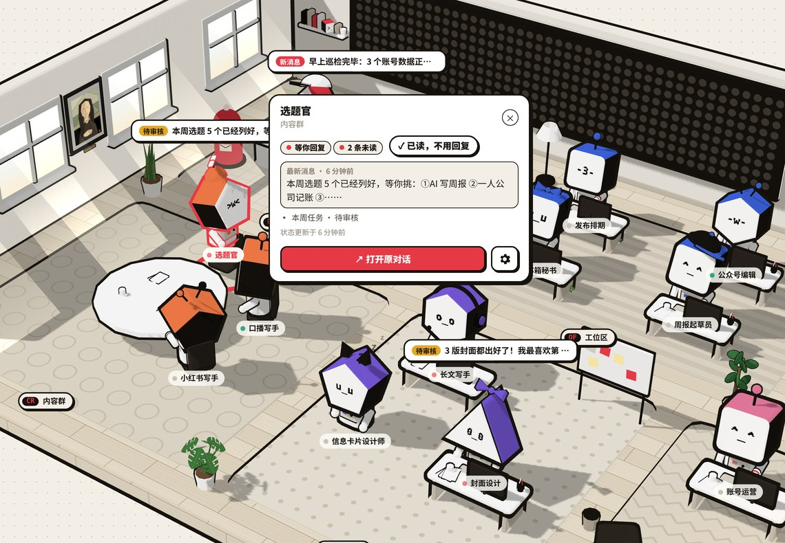
</p>

### 👥 그룹 채팅 하나 = 회의실 하나

Grok Bot 그룹을 방에 연결하면 멤버들이 한 테이블에 둘러앉고, 왼쪽 「그룹 채팅방」에 대화가 실시간으로 흐릅니다. 여러 그룹에 속한 Bot은 그룹마다 「분신」이 하나씩 앉습니다.

<p align="center">
  
</p>

### 📟 사용량은 이제 감으로 하지 마세요

뒷벽의 LED 전광판이 이번 주 Grok Bot 사용률, 요금제, 선불 잔액, 초기화 날짜를 번갈아 보여 줍니다. Hermes의 이번 주 / 오늘 토큰 사용량도 표시할 수 있고, 설정에서 「Grok만 · Hermes만 · 한 화면에 둘 다 · 번갈아 표시」를 고를 수 있어요.

<p align="center">
  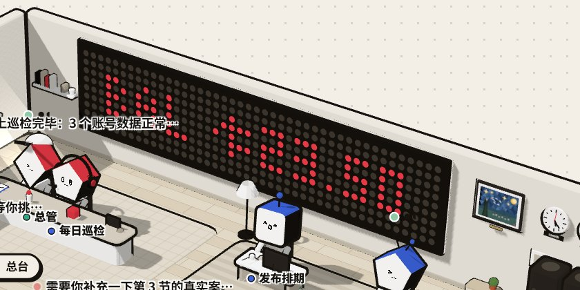
</p>

### 🧱 내 마음대로 배치하고, 더 크고 강하게

- **원클릭 가져오기**: 설정 → 사무실 → 가져오기, 최근 활동한 직원이 자동으로 자리에 앉습니다
- **방으로 드래그**: 직원을 원하는 방에 놓으면 자리·방향·이름표가 알아서 정리됩니다. 목록의 이름마다 출처 아이콘이 붙고, 색으로도 구분됩니다
- **부지 증축**: 자리가 모자라면 회의실, 서버실, 휴게실을 추가해 사무실 옆으로 드래그
- **드래그로 순서 바꾸기**: 방 안의 멤버를 끌어서 순서를 바꾸면 자리도 따라 바뀝니다
- **배치 되돌리기**: 최근 5번의 저장 전 배치를 보관, 클릭 한 번으로 복원

## 📮 우체통: 사무실을 떠나지 않고 리더에게 업무 맡기기

안내 데스크 옆에 우체통이 있어요. 클릭해서 할 일을 적고 「Send」를 누르면 봉투가 우체통에 쏙 들어가고, 업무가 바로 리더 Bot에게 전달됩니다. **편지 한 통 = 새 업무 하나.** 리더가 일을 마치면 Grok Bot의 원래 대화에 답장을 보내고, 사무실에도 새 메시지가 바로 떠요.

우체통은 **안내 데스크 옆, 리더 바로 곁**에 있어요. 위치는 이 그림을 보세요. 테마마다 우체통 모양과 편지 넣는 동작이 달라서, 군의대장(War Tent)에서는 전서구가 편지를 부리에 물고, 맹수도시(Critter City)에서는 길가 우편함이 빨간 깃발을 세웁니다.

<p align="center">
  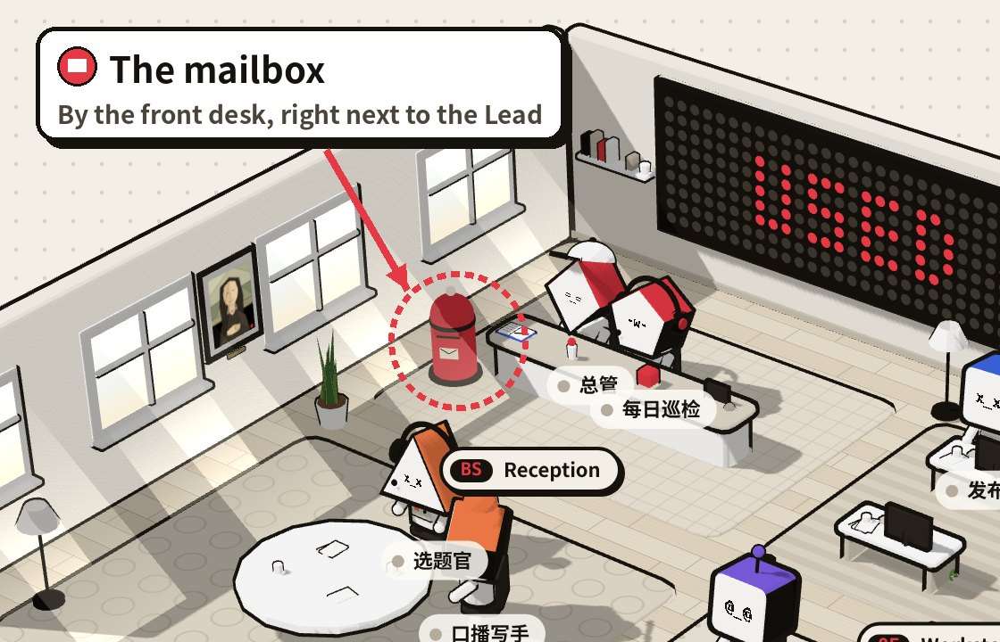
</p>

<p align="center">
  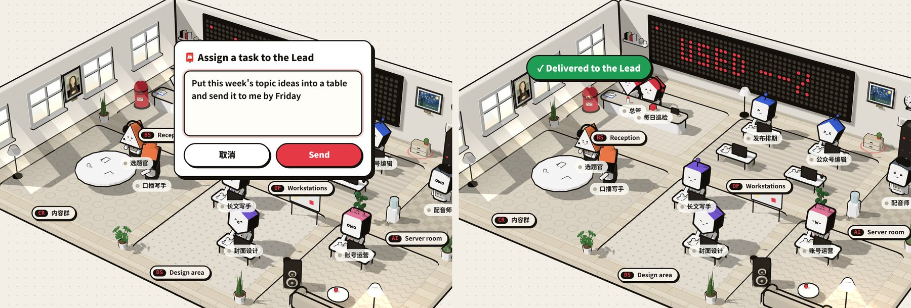
</p>

### 처음 설정하기 (약 3분)

먼저 우체통을 *내* 리더 Bot과 연결해야 해요. 리더는 사람마다 다르니 이 단계는 직접 한 번만 해 주세요 (앱 화면은 중국어 또는 영어입니다):

1. **📮 우체통 클릭**: 사무실 안내 데스크 옆 우체통을 클릭합니다. 처음에는 카드에 설정 방법이 바로 나옵니다(설정 후에는 카드 오른쪽 위 ⚙ 에서 언제든 바꿀 수 있습니다).
2. **프롬프트 복사**: 카드의 「Copy」를 누르고 버튼이 초록색이 되면 복사 완료. 복사되는 내용은 다음과 같습니다:
   ```text
   Please create a routine called "BotOffice tasks" with a Webhook trigger. Rule: every time a webhook request arrives, treat the message field in its JSON as a new task I'm giving you in this chat, carry it out, and post the result back here. Once it's set up, send me the webhook URL and key so I can paste them into BotOffice.
   ```
3. **리더 Bot에게 보내기**: Grok Bot을 열고, 상단에 고정해 둔 리더 Bot과의 대화에 붙여넣어 보내세요. 리더가 Webhook으로 실행되는 루틴을 스스로 만듭니다.
4. **Webhook URL과 키 복사**: 리더가 **Webhook URL**(보통 `https://api2.cursor.sh/automations/webhook/`로 시작)과 **키**를 답장으로 보내 주면 복사해 두세요.
5. **우체통 카드에 붙여넣기**: BotOffice로 돌아와 URL과 키를 우체통 카드의 「Webhook URL」「Webhook key」에 붙여넣고 「Save」을 누릅니다. 카드가 보내기 화면으로 돌아오면 설정 완료입니다.
6. **다시 📮우체통을 눌러 써 보기**: 간단한 일(예: 「오늘 할 일 확인해 줘」)을 적고 「Send」를 누르거나 ⌘ / Ctrl + Enter를 누르세요. 초록색 「✓ Delivered to the Lead」가 보이면 전달된 거예요. 리더의 답장은 사무실에 바로 뜹니다.

<p align="center">
  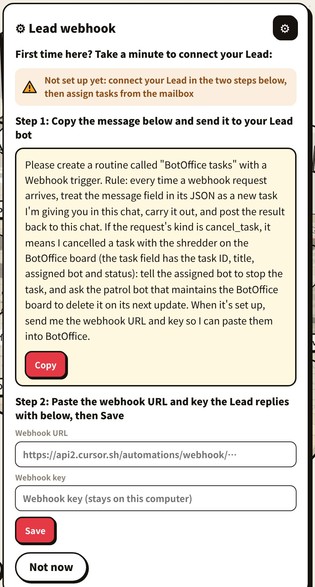
</p>

> 💡 **알아 두면 좋아요**
> - URL과 키는 내 컴퓨터에만 저장되고 업로드되지 않아요. 다만 이걸 가진 사람은 누구나 리더에게 일을 시킬 수 있으니 다른 사람에게 알려 주지 마세요.
> - 전달되지 않으면 카드에 빨간 글씨로 이유가 나옵니다. 가장 흔한 원인은 키 만료(예: Grok Bot에서 다시 생성한 경우)입니다. 리더에게 새 URL과 키를 받아 우체통 카드 오른쪽 위 ⚙ 에서 다시 입력하세요.
> - 편지를 보낼 때마다 리더가 한 번 실행되고 Grok Bot 주간 사용량에 포함돼요. Grok Bot은 루틴 하나당 시간당 최대 200번까지 실행할 수 있어요.
> - Hermes를 쓰고 있다면 우체통 받는 사람을 「Hermes Lead」로 고르기만 하면 돼요. Webhook 설정이 필요 없습니다. 특정 Hermes Bot에게 일을 맡기려면 그 Bot의 업무 카드에서 바로 메시지를 보내세요.

## 🤝 지원하는 AI 직원: 6가지 출처, 한 사무실

BotOffice는 이 AI 도구들이 **당신의 컴퓨터에 남기는 로컬 기록을 읽기만** 하고, 설정은 전혀 바꾸지 않습니다. Codex·Claude Code·ZCode·WorkBuddy는 **프로젝트 폴더 하나 = 직원 한 명**이고, 이름은 프로젝트 이름 그대로입니다. 출처마다 상징하는 모자를 쓰고 있어 한눈에 구분됩니다.

| 직원 | 3D 모습 | 볼 수 있는 것 | 원래 대화 열기 | 메시지 보내기 |
|---|---|---|---|---|
| 🤖 **Grok Bot** | 테마별 모자 | 상태, 메시지, 그룹 채팅, 사용량 | Grok Bot 데스크톱 | 우체통 / 업무 카드(Webhook 설정) |
| `>_` **OpenAI Codex**(CLI, Codex 데스크톱, ChatGPT 데스크톱) | 짙은 초록 터미널 모자 | 최신 답변, 실행 중인 명령, 최근 대화 | 데스크톱 앱 | ✅ |
| 🎓 **Claude Code**(CLI, Claude 데스크톱의 Code) | 검은 학사모 | 최신 답변, 사용 중인 도구, 대화 제목 | 터미널에서 이어서 | ✅ |
| 🕶 **Zhipu ZCode** | 머리 위 초대형 선글라스 | 작업 상태, 최신 답변, 할 일 진행률, 안 읽음 | ZCode 데스크톱 | ✅ |
| 🐱 **Tencent WorkBuddy** | 초록 고양이 귀 비니 | 작업 상태, 최신 답변, 실행 중인 도구 | WorkBuddy 데스크톱 | 아직 미지원(읽기 전용) |
| 🪽 **Hermes Agent** | 날개 달린 보라색 메신저 모자 | 상태, 메시지, 작업 보드, token 사용량 | Hermes 데스크톱 / 터미널 | ✅(지난 대화 이어서 또는 새 작업) |

- **자동 감지, 직접 지정도 가능**: 설정에서 각 출처의 연결 여부를 볼 수 있고, 기본 위치가 아닌 곳에 설치했다면 「Choose folder manually」으로 알려 주면 됩니다
- **상태등**: 일하는 직원 머리 위에 「입력 중」 점이, 일을 마치고 확인을 기다리면 「Awaiting reply」가 켜집니다
- **직원 카드**: 최신 답변, 실행 중인 명령이나 편집 중인 파일, 그 프로젝트의 최근 대화를 카드 한 장에

<p align="center">
  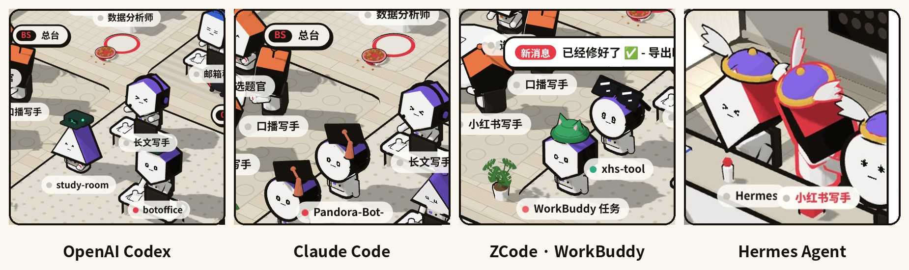
</p>

## 📋 작업 보드: 누가 무엇을 하는지, 화이트보드 한 장으로

사무실 업무 구역의 **화이트보드**를 클릭하면 작업 보드가 열립니다. 위쪽에서 출처를 바꿉니다: **Grok Bot · Codex · Claude Code · ZCode · WorkBuddy · Hermes**.

- **Codex / Claude Code / ZCode / WorkBuddy**: 설정 없이 **대화(작업) 하나가 포스트잇 한 장**이 되어 「In progress / Awaiting reply / Recently done」로 자동 정리됩니다. ZCode에는 「Error」 열도 있습니다. 카드를 열면 당신이 마지막으로 한 말, AI의 최신 답변, 실행 중인 명령이 보이고, ZCode 카드에는 할 일 진행률(☑ 완료 ▶ 진행 중 ☐ 할 일)도 나옵니다
- **Grok Bot**: 순찰 Bot이 예약 작업으로 팀의 작업을 이 컴퓨터에 기록하게 하면 보드가 자동으로 나타나 10초마다 새로고침됩니다. 처음에는 보드에 「Copy prompt」 버튼이 있으니 순찰 Bot에게 보내기만 하면 됩니다
- **Hermes**: Hermes 내장 작업 보드(Kanban)를 그대로 읽고, 여러 보드도 하나로 합쳐 보여 줍니다
- **두 가지 보기**: 포스트잇(상태별 열)과 레인(직원마다 한 줄, 누가 바쁘고 누가 한가한지 한눈에)
- **직원 이름으로 대화 열기**: 카드의 직원 이름을 클릭하면 그 대화로 돌아갑니다
- **🗑 파쇄기**: 필요 없어진 작업은 오른쪽 위 파쇄기로 드래그하세요. 5초 안에는 되돌릴 수 있습니다. Grok Bot 작업은 리더를 통해 담당 Bot에게 중단을 알리고, Hermes 작업은 보관(복구 가능)됩니다. Codex·Claude Code·ZCode·WorkBuddy 카드는 보드에서만 빠지고 원래 대화는 그대로입니다
- 닫았다 다시 열어도 지난번에 보던 출처와 보기 그대로

<p align="center">
  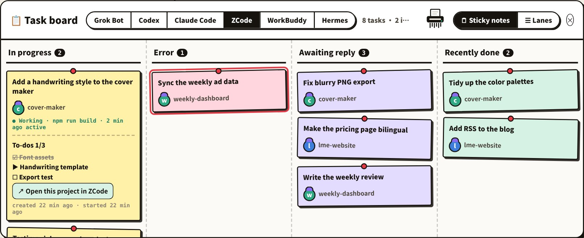
</p>
<p align="center">
  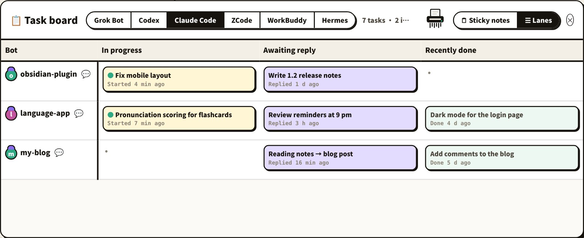
</p>

## 🐈‍⬛ 프런트에 검은 고양이 '샤오헤이'가 왔어요: 애교도 많고 질문에도 답해요

안내 데스크 오른쪽 아래에 빨간 목도리를 두른 검은 아기 고양이가 살아요. 방석 앞에는 넘칠 만큼 수북한 사료 그릇이 있어요(그릇 색은 테마에 맞춰 바뀌어요).

- 🐾 **쓰다듬기**: 마우스를 올리면 손바닥 모양으로 바뀌고, 엉덩이를 들거나 배를 보이며 하트를 날려요. 한가할 땐 졸거나 배를 드러내고 자고, 머리 위로 물고기·나비·주인·싫어하는 강아지가 떠올라요
- 💬 **클릭해서 대화**: 직접 쓰는 대화 모델(DeepSeek, Kimi, Qwen, Zhipu, OpenAI, Gemini, Claude 또는 사용자 지정)을 연결하면 수다 상대, 아이디어 파트너가 되고, BotOffice의 작은 고객센터로서 설치와 사용법도 알려줘요
- 🔁 **예비 모델**: 맨 위가 메인 모델이고, 연결이 안 되면 자동으로 다음 모델로 바꿔요
- 📒 **수첩 기억**: 당신이 말한 중요한 일을 기억해요. 틀린 건 지우고, 직접 알려줄 수도 있어요
- 🌐 **웹 검색**: 켜면 인터넷에서 찾아보고 출처 링크와 함께 답해요. 메인 모델이 DeepSeek이면 따로 키가 필요 없어요
- 💕 **친밀도**: 자주 쓰다듬고 대화할수록 더 달라붙고, 오래 내버려 두면 시무룩해지거나 보고 싶어서 아프기까지 해요

API 키는 당신의 컴퓨터에만 저장돼요. (샤오헤이는 현재 중국어로 말해요)

<p align="center">
  
</p>

## 🌄 기분 따라 고르는 12가지 배경

오른쪽 「배경(Backdrop)」 버튼에 12가지 배경이 있어요: **기본, 성운, 봄 벚꽃, 여름밤 반딧불, 가을 낙엽, 첫눈, 맑은 바닷가, 해 질 녘 도시, 비 오는 밤 창가, 북유럽 오로라, 베이퍼웨이브, 황무지 오렌지 안개**. 사무실은 그대로, 뒤의 풍경만 바뀌어요. 모든 배경에 은은한 움직임(흩날리는 꽃잎, 깜빡이는 반딧불, 일렁이는 오로라…)이 있고, 어두운 배경에서는 모서리 프레임과 시계가 자동으로 밝은 색으로 바뀝니다. 모두 무료이고, 고른 배경은 이 컴퓨터에 기억돼요.

<p align="center">
  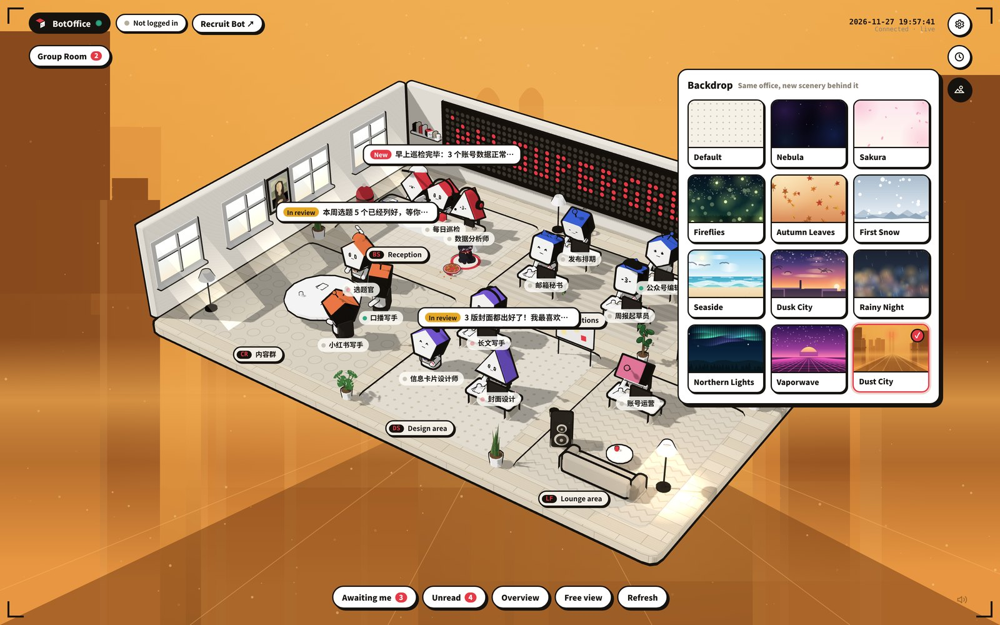
</p>

## 🎨 풍부한 테마, 클릭 한 번으로 인테리어 변신

배치와 기능은 그대로, 사무실 분위기와 직원 복장만 바뀝니다. 처음 설치하면 「사무실」 테마로 시작하고, 나머지 아홉 가지 테마는 BotOffice 공식 사이트에서 마련할 수 있으며, **새 테마가 계속 나옵니다**. 시즌 한정판도 있고, 새 테마가 나오면 앱 안의 공지로 바로 알려 드립니다.


<table>
  <tr>
    <td align="center" width="33%"><br><b>군막 작전실</b><br><sub>죽간 스크린과 군기, 회의는 출정식처럼</sub></td>
    <td align="center" width="33%"><br><b>동물 도시</b><br><sub>횡단보도와 신호등, 직원은 동물 인형 모자</sub></td>
    <td align="center" width="33%"><br><b>우주선 함교</b><br><sub>창밖엔 행성, KPI를 궤도로</sub></td>
  </tr>
  <tr>
    <td align="center"><br><b>네온 야시장</b><br><sub>네온과 포장마차, 야근의 동반자</sub></td>
    <td align="center"><br><b>숲속 오두막</b><br><sub>나무 벽과 반딧불이, 회의는 모닥불 앞에서</sub></td>
    <td align="center">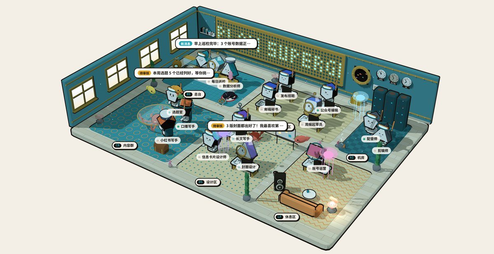<br><b>심해 기지</b><br><sub>창밖엔 물고기, 직원은 황동 잠수 헬멧</sub></td>
  </tr>
  <tr>
    <td align="center"><br><b>선 다실</b><br><sub>다다미와 대나무, 일보다 차 한 잔 먼저</sub></td>
    <td align="center"><br><b>디저트 공방</b><br><sub>분홍 체크 바닥, 언제든 축하할 준비</sub></td>
    <td align="center"><br><b>크리스마스 오두막</b><br><sub>시즌 한정: 커다란 달, 창밖을 나는 썰매, 벽난로와 촛불</sub></td>
  </tr>
</table>

> 🆕 **더 많은 테마가 계속 출시됩니다**: 새 테마가 나오면 앱에서 바로 알려 드리고, 시즌 한정판은 그 시즌에만 소장할 수 있습니다.

## 🌐 공식 사이트: 내 사무실에 사람 뽑기

BotOffice는 두 부분이 하나로 이어진 경험입니다. 데스크톱 앱에서는 **지켜보고**, [botoffice.ai](https://botoffice.ai)에서는 **채용하고 꾸밉니다**. 계정은 하나로 통합니다.

<p align="center">
  <a href="https://botoffice.ai/talent">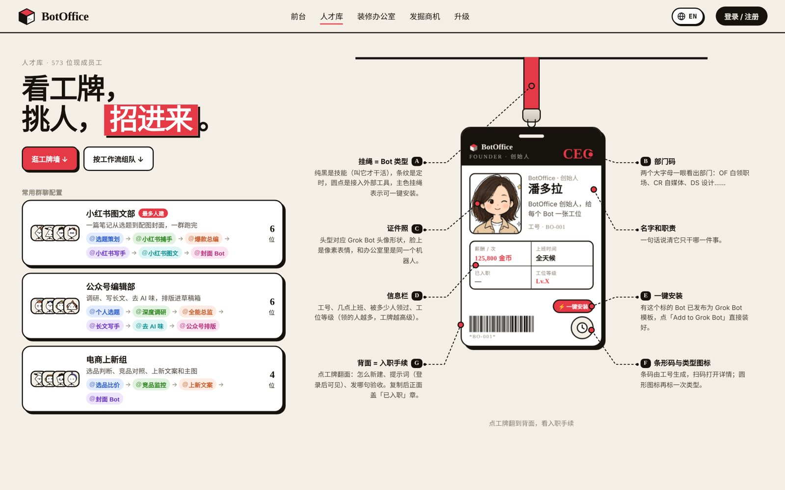</a>
</p>

- 🧑‍💼 **바로 쓸 수 있는 Bot 직원 573명 입주**: 글쓰기, 디자인, 영상 편집, 데이터 모니터링, 메일 관리, 이커머스…… 모두 사원증이 있어 직무·근무 시간·고용 횟수를 한눈에 볼 수 있습니다. 마음에 들면 프롬프트를 복사해 당신의 Agent에 붙여넣기만 하면 바로 출근합니다.
- 🔍 **매일 웹 전체에서 가장 강력한 Skill과 Bot을 발굴**: 매일 웹을 뒤져 가장 쓸모 있는 Skill, Bot, 워크플로를 찾아 직원으로 만들고 인재풀에 계속 추가합니다. 직접 찾아다닐 필요가 없습니다.
- 🧩 **워크플로 단위로 팀 채용**: 샤오훙수 콘텐츠팀, 공식 계정 편집팀, 이커머스 신상품팀… 버튼 하나로 팀 전체를 채용하고, 역할 분담과 인수인계도 이미 설정되어 있습니다.
- 🥇 **골드 직원**: 업계 고수의 워크플로에서 뽑아낸 에이스 직원.
- 💰 **코인 경제**: 매일 출석 체크로 코인을 받고, 직접 길들인 Bot을 임대로 올려 누군가 채용할 때마다 코인을 받습니다.
- 💡 **비즈니스 기회**: 부업 + AI 가이드, 오픈소스 도구, 영상 튜토리얼. 각각에 도와줄 Bot이 짝지어져 있습니다.

## 🔒 데이터는 내 컴퓨터에만

BotOffice는 당신의 컴퓨터에서 실행되며, Grok Bot·Codex·Claude Code·ZCode·WorkBuddy·Hermes의 로컬 기록을 **읽어서** 사무실을 그립니다. 대화를 업로드하지 않으며, 당신이 직접 「보내기」「전송」을 누르거나 카드를 파쇄기에 넣을 때만 메시지를 보냅니다. 그 밖에는 이 도구들의 어떤 것도 바꾸지 않습니다. 계정은 멤버십과 구매한 인테리어를 동기화하는 데만 씁니다.

## 📦 다운로드와 설치

> 🆕 **최신 버전은 [Releases](https://github.com/PandoraReads/botoffice/releases/latest)에서 다운로드**: 설치 파일에는 무료 콘텐츠만 들어 있어요. 공식 사이트 계정으로 로그인하면 구매한 테마가 자동으로 내려받아집니다. 이미 설치했다면 「설정 → 정보 → 업데이트 확인」에서 클릭 한 번으로 업그레이드하세요.

**설치 전에**: 이 컴퓨터에 AI 직원의 출처를 하나 이상 설치하세요. Grok Bot·OpenAI Codex·Claude Code·Zhipu ZCode·Tencent WorkBuddy·Hermes Agent 중 무엇이든(여러 개도 OK), 그리고 한 번 이상 대화해 두세요. Node.js 같은 개발 도구는 필요 없습니다.

> [!WARNING]
> **Mac에서 「“BotOffice”이(가) 손상되었기 때문에 열 수 없습니다」가 뜨나요?**
>
> **아래 「방법 1」로 Agent에게 맡기는 걸 추천해요**: SHA256 체크섬을 먼저 확인한 뒤 처리해 주니 바로 열립니다. 직접 설치하다 이 메시지를 봤다면:파일이 망가진 게 아니라, 아직 Apple 서명이 없는 앱을 macOS가 막은 것입니다. BotOffice를 「응용 프로그램」에 넣은 뒤 「터미널」을 열고 아래 한 줄을 붙여 넣어 Return을 누른 다음, 「응용 프로그램」에서 **BotOffice 우클릭 → 열기**를 누르세요:
>
> ```bash
> xattr -cr /Applications/BotOffice.app
> ```

### 방법 1: Agent에게 설치 맡기기 (추천)

아래 내용을 내 Agent(Grok Bot, Hermes, Claude Code, Codex 등)에게 복사해 보내면 다운로드, 검증, 설치까지 알아서 해 줍니다.

```text
이 컴퓨터에 BotOffice(AI 직원을 위한 3D 사무실 데스크톱 앱. Grok Bot·Codex·Claude Code·ZCode·WorkBuddy·Hermes 지원)를 설치해 주세요:
1. https://github.com/PandoraReads/botoffice/releases/latest 를 열고 내 운영체제에 맞는 설치 파일을 골라 줘:
   - macOS(Apple 실리콘): BotOffice-<버전>-mac-arm64.dmg
   - macOS(Intel): BotOffice-<버전>-mac-x64.dmg
   - Windows: BotOffice-<버전>-win-x64-setup.exe
   페이지에 아직 설치 파일이 없으면 거기서 멈추고 알려 줘. 다른 곳에서 찾지 마.
2. 다운로드한 뒤 같은 페이지의 SHA256.txt로 체크섬을 확인하고, 맞지 않으면 파일을 지우고 알려 줘.
3. 설치: macOS는 BotOffice.app을 「응용 프로그램」에 복사하고, Windows는 setup.exe를 기본 옵션으로 실행해.
4. BotOffice를 열어 줘. macOS가 「손상되었기 때문에 열 수 없습니다」라고 하면, 2단계 체크섬이 맞았을 때만 `xattr -cr /Applications/BotOffice.app` 를 실행해서 다운로드 격리 표시를 지워 줘. BotOffice에만 적용하고 시스템 전체 보안 설정은 끄지 마. 「개발자를 확인할 수 없음」이나 Windows SmartScreen 경고가 뜨면 어디를 눌러야 하는지 알려 주고, 확인은 내가 직접 할게.
5. 로그인 시 자동 실행이나 외부 접속 허용은 설정하기 전에 나한테 먼저 물어봐.
6. 다 되면 다음 단계를 알려 줘: 오른쪽 위 톱니바퀴 → 설정 → 사무실 → 가져오기.
```

### 방법 2: 직접 설치하기

**macOS**

1. [Releases](https://github.com/PandoraReads/botoffice/releases/latest)에서 `BotOffice-<버전>-mac-arm64.dmg`(Apple 실리콘: M1/M2/M3/M4) 또는 `BotOffice-<버전>-mac-x64.dmg`(Intel)를 내려받습니다. 어느 쪽인지 모르겠다면  → 이 Mac에 관하여에서 「칩」 항목을 확인하세요.
2. `.dmg`를 더블클릭하고 **BotOffice**를 「응용 프로그램」 폴더로 드래그합니다.
3. 처음 실행할 때: 「응용 프로그램」에서 BotOffice를 **오른쪽 클릭** → 열기 → 열기. 그래도 열리지 않으면 시스템 설정 → 개인정보 보호 및 보안 아래쪽의 「그래도 열기」를 누르세요. 다음부터는 더블클릭으로 열립니다. **「손상되었기 때문에 열 수 없습니다」가 뜨면 위의 ⚠️ 안내대로 하세요.**

**Windows (Windows 10 이상)**

1. [Releases](https://github.com/PandoraReads/botoffice/releases/latest)에서 `BotOffice-<버전>-win-x64-setup.exe`를 내려받습니다.
2. 더블클릭해 실행합니다. 「Windows의 PC 보호」가 뜨면 「추가 정보」→「실행」을 누르세요.
3. 설치 마법사를 따라가면 바탕화면에 BotOffice 아이콘이 생깁니다.

**설치한 뒤에는**

1. BotOffice를 열고 환영 화면에서 「사무실 입장」을 누릅니다
2. 오른쪽 위 톱니바퀴 → 설정 → 사무실 → **가져오기**, AI 직원이 자동으로 자리에 앉습니다
3. 더 많은 테마와 멤버십 혜택을 열려면 설정에서 공식 사이트 계정으로 로그인하세요. 테마가 자동으로 내려받아집니다

- 컴퓨터를 켜면 자동 실행, 바탕화면 아이콘을 더블클릭하면 바로 사무실로
- 설정 → 정보 → 업데이트 확인. 새 Bot, 테마, 이벤트는 앱 내 공지로 알려 드립니다
- 내려받은 파일을 검증하고 싶다면 릴리스마다 포함된 `SHA256.txt`를 이용하세요

<p align="center">
  
  
</p>

## 자주 묻는 질문

<details open><summary><b>⚠️ Mac에서 「손상되었기 때문에 열 수 없습니다」가 떠요</b></summary><p><b>👍 Agent에게 맡기는 걸 추천해요</b>: 위 「방법 1」 프롬프트를 내 Agent(Grok Bot, Hermes, Claude Code, Codex)에게 보내면 <code>SHA256.txt</code>로 먼저 확인한 뒤 macOS 다운로드 격리 표시를 지워 줍니다.<br><b>직접 설치했다면?</b> 파일이 망가진 게 아니라, 아직 Apple 서명이 없는 앱을 macOS가 막은 것입니다. BotOffice를 「응용 프로그램」에 넣고 「터미널」에서 <code>xattr -cr /Applications/BotOffice.app</code> 를 실행한 뒤, BotOffice 우클릭 → 열기 → 「열기」를 누르세요. 그래도 안 되면 다시 내려받아 Releases 페이지의 <code>SHA256.txt</code>로 확인하세요.</p></details>
<details><summary><b>코딩을 할 줄 알아야 하나요?</b></summary><p>아니요. 설치, 가져오기, 배치 모두 화면에서 몇 번 클릭하면 끝납니다.</p></details>
<details><summary><b>BotOffice는 무료인가요?</b></summary><p>앱은 무료이고 기본 「사무실」 테마는 계속 쓸 수 있습니다. 유료는 테마, 증축, 멤버십 혜택입니다. <a href="https://botoffice.ai/pricing">멤버십</a>을 확인하세요.</p></details>
<details><summary><b>어떤 AI 직원을 지원하나요?</b></summary><p>Grok Bot, OpenAI Codex, Claude Code, Zhipu ZCode, Tencent WorkBuddy, Hermes Agent입니다. Codex·Claude Code·ZCode·WorkBuddy는 프로젝트 폴더마다 직원 한 명이 됩니다. Grok Bot은 그룹 채팅과 사용량도, Hermes는 내장 작업 보드와 token 사용량도 볼 수 있습니다. 출처가 다른 직원도 한 사무실에 앉을 수 있습니다. Claude 데스크톱 앱의 일반 채팅과 Cowork는 클라우드에 있어 읽을 수 없습니다.</p></details>
<details><summary><b>컴퓨터를 바꾸면 산 테마는요?</b></summary><p>그대로 있습니다. 테마는 계정에 귀속되므로 새 컴퓨터에서 같은 계정으로 로그인하면 다시 다운로드됩니다.</p></details>
<details><summary><b>우체통을 눌러도 반응이 없거나 전달 실패라고 나와요</b></summary><p>먼저 우체통 카드 오른쪽 위 ⚙ 를 눌러 초록색 「Set up」인지 확인하세요. 키가 만료되었다고 나오면 리더에게 최신 Webhook URL과 키를 받아 다시 입력하고, 연결할 수 없다고 나오면 네트워크를 확인한 뒤 「Retry」를 누르세요.</p></details>

## 감사의 말

BotOffice가 이렇게 많은 AI 직원을 한 사무실에 모실 수 있는 건 훌륭한 도구들 덕분입니다(BotOffice는 이 도구들이 당신의 컴퓨터에 남기는 로컬 기록만 읽으며, 각 제품과 공식 제휴 관계는 없습니다. 이름과 상표는 각 소유자에게 있습니다):

- [Grok Bot](https://grok.com): BotOffice의 출발점. 그룹 룸, 사용량 보드, 우체통은 Grok Bot을 위해 만들었습니다.
- [OpenAI Codex](https://openai.com/codex): CLI, Codex 데스크톱, ChatGPT 데스크톱의 Codex 대화가 모두 사무실에 앉을 수 있습니다.
- [Claude Code](https://claude.com/product/claude-code)(Anthropic): CLI와 Claude 데스크톱의 Code 대화가 모두 사무실에 앉을 수 있습니다.
- [Zhipu ZCode](https://github.com/zai-org/ZCode): 오픈 소스 AI 코딩 작업 환경. 작업 상태와 할 일 진행률은 그 로컬 기록에서 가져옵니다.
- [Tencent WorkBuddy](https://www.workbuddy.ai): 데스크톱 업무 Agent. 모든 작업이 사무실에 표시됩니다.
- [Hermes Agent](https://hermes-agent.nousresearch.com)(Nous Research): Hermes의 모든 Bot이 사무실에 앉을 수 있고, 작업 보드도 Hermes 내장 Kanban을 읽습니다.
- [Pixabay](https://pixabay.com): 앱의 음악과 효과음 일부는 Pixabay의 로열티 프리 라이브러리에서 왔습니다. 창작자분들께 감사드립니다.
- [마이당의 Bot 타운](https://www.mdldm.club/grok-bots): 일부 Bot 직원의 프롬프트는 Bot 타운을 참고했습니다. 공유해 준 마이당 님께 감사드립니다.

## 라이선스

BotOffice는 무료로 내려받을 수 있는 비공개 소스 소프트웨어입니다. 이 저장소는 설치 파일, 업데이트 공지, 프로젝트 소개만 공개하며 소스 코드는 포함하지 않습니다. 적용되는 조건은 설치 파일에 포함된 LICENSE 파일을 참고하세요.

---

<p align="center">
  <a href="https://botoffice.ai"></a><br>
  <b>BotOffice · AI 직원에게 책상 하나씩</b><br>
  <sub><a href="https://botoffice.ai">botoffice.ai</a> · <a href="https://botoffice.ai/talent">인재풀</a> · <a href="https://botoffice.ai/deploy">사무실 꾸미기</a> · <a href="https://botoffice.ai/pricing">멤버십</a></sub><br>
  <sub>© 成都哆元文化传播有限公司</sub>
</p>
