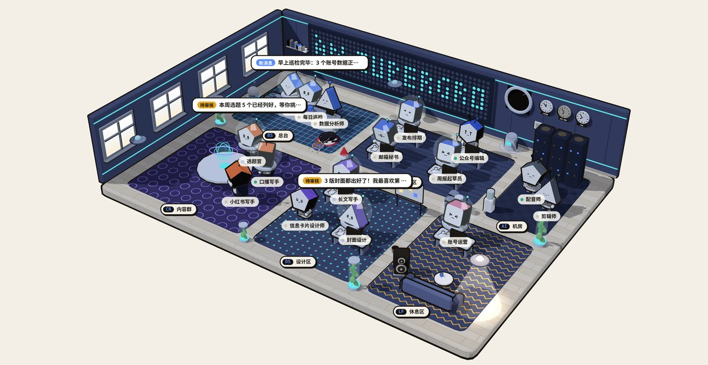

<div align="center">
  
  <h1>BotOffice</h1>
  <p>Grok Bot 팀을 3D 사무실로. 누가 일하는지, 누가 당신의 결정을 기다리는지, 어느 그룹이 대화 중인지 한눈에 보입니다.<br>
  Turn your Grok Bot team into a living 3D office — see who's working, who needs your call, and which group is talking, at a glance.</p>
  <p>
    <a href="https://botoffice.ai"></a>
    <a href="https://botoffice.ai/talent"></a>
    <a href="https://github.com/PandoraReads/botoffice/releases"></a>
  </p>
  <p><a href="../README.md">简体中文</a> · <a href="README.en.md">English</a> · <a href="README.zh-TW.md">繁體中文</a> · <a href="README.ja.md">日本語</a> · <b>한국어</b> · <a href="README.es.md">Español</a></p>
</div>

<p align="center">
  
</p>

<sub>스크린샷은 중국어 화면입니다.</sub>

---

## 남 밑에서 일하라고? 사양합니다. 사장은 내가 할 거니까.

Bot이 수십 명. 글 쓰는 Bot, 그림 그리는 Bot, 숫자 지켜보는 Bot, 그룹에서 회의 중인 Bot들. 그런데 왜 나는 갈수록 바빠지고, 갈수록 초췌해질까요 —

- 😵 **대화를 하나하나 열어 보며** 누가 답했는지, 누가 막혔는지, 누가 나를 기다리는지 확인. 지친다😩
- 🙈 **검토 요청을 놓침**: Bot은 일을 끝내고 내 승인을 반나절째 기다리는 중. 어쩌겠어 ╮(╯▽╰)╭
- 🔔 **그룹 메시지가 폭주**해서 중요한 정보를 찾느라 한참. 짜증 나😡
- 📉 **사용량이 얼마나 남았는지 몰라서** 바닥나고 나서야 더는 못 돌린다는 걸 알게 됨｡°(°¯᷄◠¯᷅°)°｡

**BotOffice는 이 번거로운 일상을 한눈에 읽히는, 감성 가득한 아늑한 사무실로 바꿔 줍니다.** Bot마다 자기 자리와 이름이 있고, 상태 표시등으로 누가 내 답장을 기다리는지, 누가 방금 활동했는지 바로 보입니다. 누군가 당신을 찾으면 메시지가 바로 눈앞에 뜨죠. 당신은 사장답게 고개를 들어 보고, 결정만 하면 됩니다.

<p align="center">
  
</p>

## 왜 Bot들에게 사무실을 줘야 할까요?

### 💬 Bot이 부르면, 메시지가 눈앞으로

새 메시지가 오른쪽 위에 전문으로 뜨고, 버튼 하나로 Grok Bot의 해당 대화로 바로 이동합니다. 창을 오갈 필요도, 기록을 뒤질 필요도 없습니다.

<p align="center">
  
</p>

### 🪪 클릭 한 번이면 업무 카드

어떤 Bot이든 클릭하면 소속 방, 상태, 최신 메시지, 안 읽은 수, 맡은 작업이 카드 한 장에. 원래 대화도 한 번에 열립니다.

<p align="center">
  
</p>

### 👥 그룹 채팅 하나 = 회의실 하나

Grok Bot 그룹을 방에 연결하면 멤버들이 한 테이블에 둘러앉고, 왼쪽 「그룹 채팅방」에 대화가 실시간으로 흐릅니다. 여러 그룹에 속한 Bot은 그룹마다 「분신」이 하나씩 앉습니다.

<p align="center">
  
</p>

### 📟 사용량은 이제 감으로 하지 마세요

뒷벽의 LED 전광판이 이번 주 Grok Bot 사용률, 요금제, 선불 잔액, 초기화 날짜를 번갈아 보여 줍니다.

<p align="center">
  
</p>

### 🧱 내 마음대로 배치하고, 더 크고 강하게

- **원클릭 가져오기**: 설정 → 사무실 → 가져오기, 최근 활동한 Bot이 자동으로 착석
- **방으로 드래그**: Bot을 원하는 방에 놓으면 자리, 방향, 명찰이 자동 정렬
- **부지 증축**: 자리가 모자라면 회의실, 서버실, 휴게실을 추가해 사무실 옆으로 드래그
- **배치 되돌리기**: 최근 5번의 저장 전 배치를 보관, 클릭 한 번으로 복원

## 📮 우체통: 사무실을 떠나지 않고 리더에게 업무 맡기기

안내 데스크 옆에 우체통이 있어요. 클릭해서 할 일을 적고 「Send」를 누르면 봉투가 우체통에 쏙 들어가고, 업무가 바로 리더 Bot에게 전달됩니다. **편지 한 통 = 새 업무 하나.** 리더가 일을 마치면 Grok Bot의 원래 대화에 답장을 보내고, 사무실에도 새 메시지가 바로 떠요.

우체통은 **안내 데스크 옆, 리더 바로 곁**에 있어요. 위치는 이 그림을 보세요. 테마마다 우체통 모양과 편지 넣는 동작이 달라서, 군의대장(War Tent)에서는 전서구가 편지를 부리에 물고, 맹수도시(Critter City)에서는 길가 우편함이 빨간 깃발을 세웁니다.

<p align="center">
  
</p>

<p align="center">
  
</p>

### 처음 설정하기 (약 3분)

먼저 우체통을 *내* 리더 Bot과 연결해야 해요. 리더는 사람마다 다르니 이 단계는 직접 한 번만 해 주세요 (앱 화면은 중국어 또는 영어입니다):

1. **📮우체통 클릭**: 사무실에서 안내 데스크 옆 우체통을 클릭하세요. 아직 설정하지 않았다면 카드 위쪽에 노란 안내가 보여요. 그 안의 「Set up(去设置)」을 누르면 설정의 「Assign a task to the Lead(给总管派任务)」가 바로 열립니다.
2. **메시지 원클릭 복사**: 설정 패널에서 「Copy」를 클릭하세요. 버튼이 초록색으로 바뀌면 복사된 거예요. 복사되는 문장은 다음과 같아요 (영어 화면 기준):
   ```text
   Please create a routine called "BotOffice tasks" with a Webhook trigger. Rule: every time a webhook request arrives, treat the message field in its JSON as a new task I'm giving you in this chat, carry it out, and post the result back here. Once it's set up, send me the webhook URL and key so I can paste them into BotOffice.
   ```
3. **리더 Bot에게 보내기**: Grok Bot을 열고, 상단에 고정해 둔 리더 Bot과의 대화에 붙여넣어 보내세요. 리더가 Webhook으로 실행되는 루틴을 스스로 만듭니다.
4. **Webhook URL과 키 복사**: 리더가 **Webhook URL**(보통 `https://api2.cursor.sh/automations/webhook/`로 시작)과 **키**를 답장으로 보내 주면 복사해 두세요.
5. **BotOffice 설정에 붙여넣기**: BotOffice의 「Assign a task to the Lead」로 돌아가 아래의 「Webhook URL」「Webhook key」에 URL과 키를 붙여넣고 「Save」를 누르세요. 상태가 초록색 「Set up」으로 바뀌면 끝!
6. **다시 📮우체통을 눌러 써 보기**: 간단한 일(예: 「오늘 할 일 확인해 줘」)을 적고 「Send」를 누르거나 ⌘ / Ctrl + Enter를 누르세요. 초록색 「✓ Delivered to the Lead」가 보이면 전달된 거예요. 리더의 답장은 사무실에 바로 뜹니다.

<p align="center">
  
</p>

> 💡 **알아 두면 좋아요**
> - URL과 키는 내 컴퓨터에만 저장되고 업로드되지 않아요. 다만 이걸 가진 사람은 누구나 리더에게 일을 시킬 수 있으니 다른 사람에게 알려 주지 마세요.
> - 편지가 전달되지 않으면 카드에 빨간 글씨로 이유가 표시돼요. 가장 흔한 원인은 키 만료(Grok Bot에서 다시 생성한 경우 등)예요. 리더에게 새 URL과 키를 받아 설정에 다시 붙여넣으세요.
> - 편지를 보낼 때마다 리더가 한 번 실행되고 Grok Bot 주간 사용량에 포함돼요. Grok Bot은 루틴 하나당 시간당 최대 200번까지 실행할 수 있어요.

## 🌄 기분 따라 고르는 12가지 배경

오른쪽 「배경(Backdrop)」 버튼에 12가지 배경이 있어요: **기본, 성운, 봄 벚꽃, 여름밤 반딧불, 가을 낙엽, 첫눈, 맑은 바닷가, 해 질 녘 도시, 비 오는 밤 창가, 북유럽 오로라, 베이퍼웨이브, 황무지 오렌지 안개**. 사무실은 그대로, 뒤의 풍경만 바뀌어요. 모든 배경에 은은한 움직임(흩날리는 꽃잎, 깜빡이는 반딧불, 일렁이는 오로라…)이 있고, 어두운 배경에서는 모서리 프레임과 시계가 자동으로 밝은 색으로 바뀝니다. 모두 무료이고, 고른 배경은 이 컴퓨터에 기억돼요.

<p align="center">
  
</p>

## 🎨 풍부한 테마, 클릭 한 번으로 인테리어 변신

배치와 기능은 그대로, 사무실 분위기와 직원 복장만 바뀝니다. 처음 설치하면 「사무실」 테마로 시작하고, 나머지 아홉 가지 테마는 BotOffice 공식 사이트에서 마련할 수 있으며, **새 테마가 계속 나옵니다**. 시즌 한정판도 있고, 새 테마가 나오면 앱 안의 공지로 바로 알려 드립니다.


<table>
  <tr>
    <td align="center" width="33%"><br><b>군막 작전실</b><br><sub>죽간 스크린과 군기, 회의는 출정식처럼</sub></td>
    <td align="center" width="33%"><br><b>동물 도시</b><br><sub>횡단보도와 신호등, 직원은 동물 인형 모자</sub></td>
    <td align="center" width="33%"><br><b>우주선 함교</b><br><sub>창밖엔 행성, KPI를 궤도로</sub></td>
  </tr>
  <tr>
    <td align="center"><br><b>네온 야시장</b><br><sub>네온과 포장마차, 야근의 동반자</sub></td>
    <td align="center"><br><b>숲속 오두막</b><br><sub>나무 벽과 반딧불이, 회의는 모닥불 앞에서</sub></td>
    <td align="center"><br><b>심해 기지</b><br><sub>창밖엔 물고기, 직원은 황동 잠수 헬멧</sub></td>
  </tr>
  <tr>
    <td align="center"><br><b>선 다실</b><br><sub>다다미와 대나무, 일보다 차 한 잔 먼저</sub></td>
    <td align="center"><br><b>디저트 공방</b><br><sub>분홍 체크 바닥, 언제든 축하할 준비</sub></td>
    <td align="center"><br><b>크리스마스 오두막</b><br><sub>시즌 한정: 벽난로, 눈사람, 산타 모자</sub></td>
  </tr>
</table>

> 🆕 **더 많은 테마가 계속 출시됩니다**: 새 테마가 나오면 앱에서 바로 알려 드리고, 시즌 한정판은 그 시즌에만 소장할 수 있습니다.

## 🌐 공식 사이트: 내 사무실에 사람 뽑기

BotOffice는 두 부분이 하나로 이어진 경험입니다. 데스크톱 앱에서는 **지켜보고**, [botoffice.ai](https://botoffice.ai)에서는 **채용하고 꾸밉니다**. 계정은 하나로 통합니다.

<p align="center">
  <a href="https://botoffice.ai/talent"></a>
</p>

- 🧑‍💼 **이미 573명의 Bot 직원이 입사 완료**: 글쓰기, 디자인, 영상, 데이터, 메일, 이커머스… 모두 자기 사원증이 있어 직무, 근무 시간, 채용 횟수가 한눈에 보입니다. 마음에 들면 프롬프트를 복사해 Grok Bot에 붙여 넣기만 하면 바로 출근.
- 🔍 **매일 웹 전체에서 가장 강력한 Skill과 Bot을 발굴**: 매일 웹을 뒤져 가장 쓸모 있는 Skill, Bot, 워크플로를 찾아 직원으로 만들고 인재풀에 계속 추가합니다. 직접 찾아다닐 필요가 없습니다.
- 🧩 **워크플로 단위로 팀 채용**: 샤오훙수 콘텐츠팀, 공식 계정 편집팀, 이커머스 신상품팀… 버튼 하나로 팀 전체를 채용하고, 역할 분담과 인수인계도 이미 설정되어 있습니다.
- 🥇 **골드 직원**: 업계 고수의 워크플로에서 뽑아낸 에이스 직원.
- 💰 **코인 경제**: 매일 출석 체크로 코인을 받고, 직접 길들인 Bot을 임대로 올려 누군가 채용할 때마다 코인을 받습니다.
- 💡 **비즈니스 기회**: 부업 + AI 가이드, 오픈소스 도구, 영상 튜토리얼. 각각에 도와줄 Bot이 짝지어져 있습니다.

## 🔒 데이터는 내 컴퓨터에만

BotOffice는 내 컴퓨터에서 실행되며, 사무실을 그리기 위해 컴퓨터 속 Grok Bot 데이터를 **읽기만** 합니다. 대화를 업로드하지 않고, 대신 메시지를 보내지 않으며, Grok Bot의 어떤 것도 바꾸지 않습니다. 계정은 멤버십과 구매한 테마를 동기화하는 데만 쓰입니다.

## 📦 다운로드와 설치

> 🆕 **최신 버전은 [Releases](https://github.com/PandoraReads/botoffice/releases/latest)에서 다운로드**: 설치 파일에는 무료 콘텐츠만 들어 있어요. 공식 사이트 계정으로 로그인하면 구매한 테마가 자동으로 내려받아집니다. 이미 설치했다면 「설정 → 정보 → 업데이트 확인」에서 클릭 한 번으로 업그레이드하세요.

**시작하기 전에**: 이 컴퓨터에 [Grok Bot](https://grok.com) 데스크톱 앱을 설치하고 로그인하세요. Node.js 같은 개발 도구는 필요 없습니다.

### 방법 1: Agent에게 설치 맡기기 (추천)

아래 내용을 내 Agent(Grok Bot, Claude Code, Codex 등)에게 복사해 보내면 다운로드, 검증, 설치까지 알아서 해 줍니다.

```text
이 컴퓨터에 BotOffice(Grok Bot용 3D 사무실 데스크톱 앱)를 설치해 줘:
1. https://github.com/PandoraReads/botoffice/releases/latest 를 열고 내 운영체제에 맞는 설치 파일을 골라 줘:
   - macOS(Apple 실리콘): BotOffice-<버전>-mac-arm64.dmg
   - macOS(Intel): BotOffice-<버전>-mac-x64.dmg
   - Windows: BotOffice-<버전>-win-x64-setup.exe
   페이지에 아직 설치 파일이 없으면 거기서 멈추고 알려 줘. 다른 곳에서 찾지 마.
2. 다운로드한 뒤 같은 페이지의 SHA256.txt로 체크섬을 확인하고, 맞지 않으면 파일을 지우고 알려 줘.
3. 설치: macOS는 BotOffice.app을 「응용 프로그램」에 복사하고, Windows는 setup.exe를 기본 옵션으로 실행해.
4. BotOffice를 열어 줘. 「개발자를 확인할 수 없음」이나 SmartScreen 경고가 뜨면 어디를 눌러야 하는지 알려 주고, 확인은 내가 직접 할게. 시스템 보안 설정은 바꾸지 마.
5. 로그인 시 자동 실행이나 외부 접속 허용은 설정하기 전에 나한테 먼저 물어봐.
6. 다 되면 다음 단계를 알려 줘: 오른쪽 위 톱니바퀴 → 설정 → 사무실 → 가져오기.
```

### 방법 2: 직접 설치하기

**macOS**

1. [Releases](https://github.com/PandoraReads/botoffice/releases/latest)에서 `BotOffice-<버전>-mac-arm64.dmg`(Apple 실리콘: M1/M2/M3/M4) 또는 `BotOffice-<버전>-mac-x64.dmg`(Intel)를 내려받습니다. 어느 쪽인지 모르겠다면  → 이 Mac에 관하여에서 「칩」 항목을 확인하세요.
2. `.dmg`를 더블클릭하고 **BotOffice**를 「응용 프로그램」 폴더로 드래그합니다.
3. 처음 실행할 때: 「응용 프로그램」에서 BotOffice를 **오른쪽 클릭** → 열기 → 열기. 그래도 열리지 않으면 시스템 설정 → 개인정보 보호 및 보안 아래쪽의 「그래도 열기」를 누르세요. 다음부터는 더블클릭으로 열립니다.

**Windows (Windows 10 이상)**

1. [Releases](https://github.com/PandoraReads/botoffice/releases/latest)에서 `BotOffice-<버전>-win-x64-setup.exe`를 내려받습니다.
2. 더블클릭해 실행합니다. 「Windows의 PC 보호」가 뜨면 「추가 정보」→「실행」을 누르세요.
3. 설치 마법사를 따라가면 바탕화면에 BotOffice 아이콘이 생깁니다.

**설치한 뒤에는**

1. BotOffice를 열고 환영 화면에서 「사무실 입장」을 누릅니다
2. 오른쪽 위 톱니바퀴 → 설정 → 사무실 → **가져오기**. Bot들이 자동으로 착석합니다
3. 더 많은 테마와 멤버십 혜택을 열려면 설정에서 공식 사이트 계정으로 로그인하세요. 테마가 자동으로 내려받아집니다

- 컴퓨터를 켜면 자동 실행, 바탕화면 아이콘을 더블클릭하면 바로 사무실로
- 설정 → 정보 → 업데이트 확인. 새 Bot, 테마, 이벤트는 앱 내 공지로 알려 드립니다
- 내려받은 파일을 검증하고 싶다면 릴리스마다 포함된 `SHA256.txt`를 이용하세요

<p align="center">
  
  
</p>

## 자주 묻는 질문

<details><summary><b>코딩을 할 줄 알아야 하나요?</b></summary><p>아니요. 설치, 가져오기, 배치 모두 화면에서 몇 번 클릭하면 끝납니다.</p></details>
<details><summary><b>BotOffice는 무료인가요?</b></summary><p>앱은 무료이고 기본 「사무실」 테마는 계속 쓸 수 있습니다. 유료는 테마, 증축, 멤버십 혜택입니다. <a href="https://botoffice.ai/pricing">멤버십</a>을 확인하세요.</p></details>
<details><summary><b>Grok Bot만 지원하나요?</b></summary><p>현재는 그렇습니다. 내 컴퓨터의 Grok Bot에서 상태, 메시지, 그룹 채팅, 사용량을 읽어 옵니다.</p></details>
<details><summary><b>컴퓨터를 바꾸면 산 테마는요?</b></summary><p>그대로 있습니다. 테마는 계정에 귀속되므로 새 컴퓨터에서 같은 계정으로 로그인하면 다시 다운로드됩니다.</p></details>
<details><summary><b>우체통을 눌러도 반응이 없거나, 전달되지 않았다고 나와요</b></summary><p>먼저 설정의 「Assign a task to the Lead」가 초록색 「Set up」인지 확인하세요. 키가 유효하지 않다고 나오면 리더에게 최신 Webhook URL과 키를 받아 다시 붙여넣으세요. 연결할 수 없다고 나오면 네트워크를 확인한 뒤 「Retry」를 누르세요.</p></details>

## 감사의 말

- [Grok Bot](https://grok.com): BotOffice의 모든 것은 Grok Bot 위에 만들어졌어요. 사무실의 직원 한 명 한 명이 모두 여러분의 Grok Bot에서 왔습니다.
- [Pixabay](https://pixabay.com): 앱의 일부 음악과 효과음은 Pixabay의 로열티 프리 라이브러리를 사용했어요. 창작자분들께 감사드립니다.
- [마이당의 Bot 마을(麦当的 Bot 小镇)](https://www.mdldm.club/grok-bots): 일부 Bot 직원의 프롬프트는 Bot 마을을 참고했어요. 공유해 주신 마이당 님께 감사드립니다.

## 라이선스

BotOffice는 무료로 내려받을 수 있는 비공개 소스 소프트웨어입니다. 이 저장소는 설치 파일, 업데이트 공지, 프로젝트 소개만 공개하며 소스 코드는 포함하지 않습니다. 적용되는 조건은 설치 파일에 포함된 LICENSE 파일을 참고하세요.

---

<p align="center">
  <a href="https://botoffice.ai"></a><br>
  <b>BotOffice · 당신의 Bot에게 자리 하나를</b><br>
  <sub><a href="https://botoffice.ai">botoffice.ai</a> · <a href="https://botoffice.ai/talent">인재풀</a> · <a href="https://botoffice.ai/deploy">사무실 꾸미기</a> · <a href="https://botoffice.ai/pricing">멤버십</a></sub><br>
  <sub>© 成都哆元文化传播有限公司</sub>
</p>
