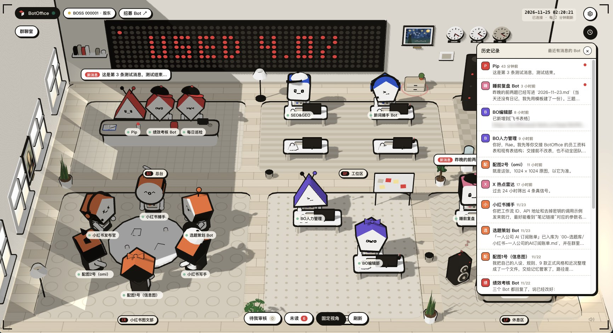
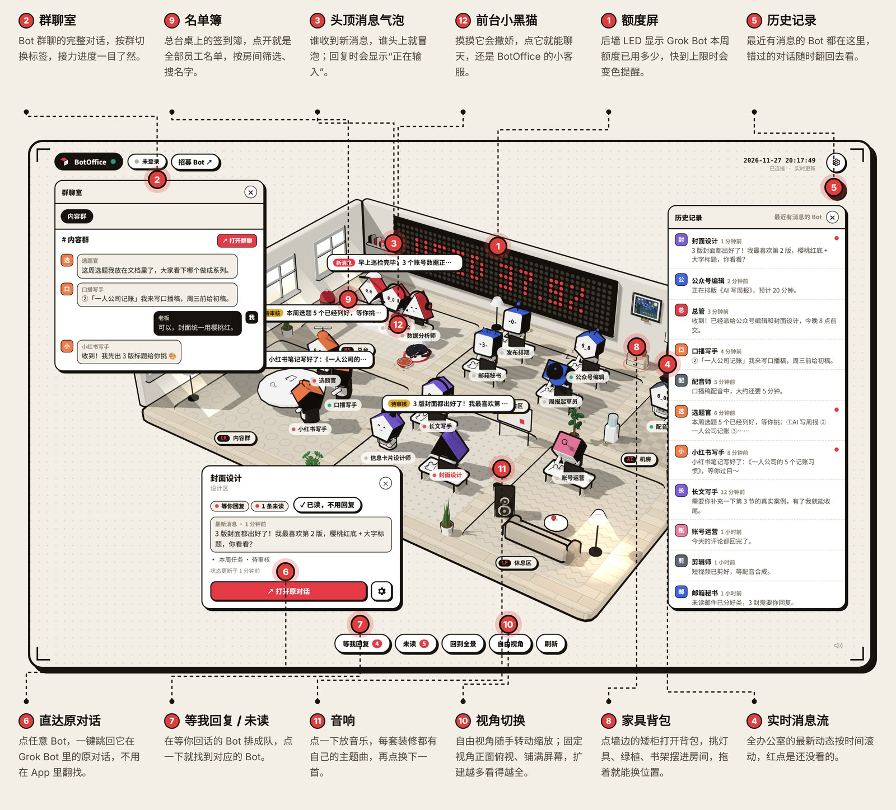
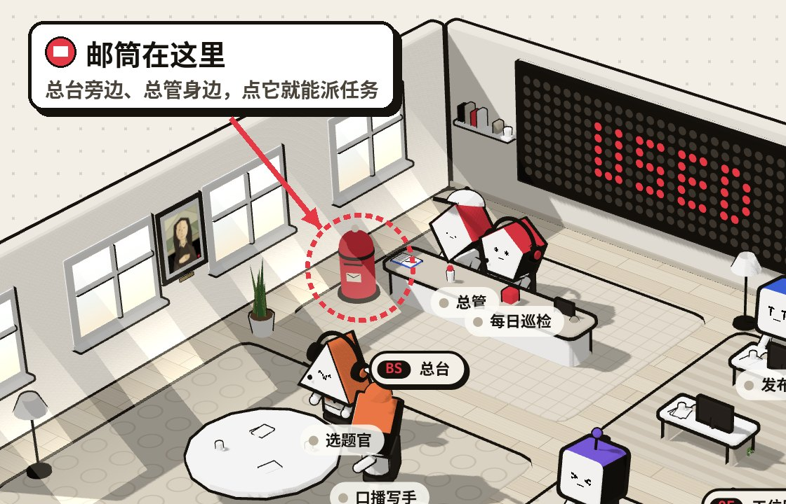
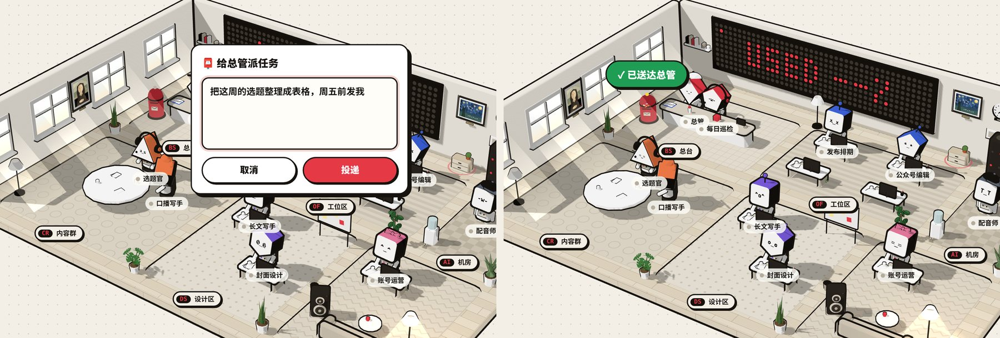
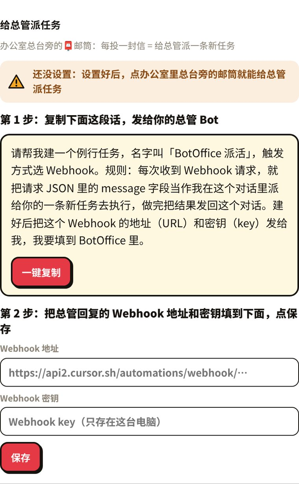
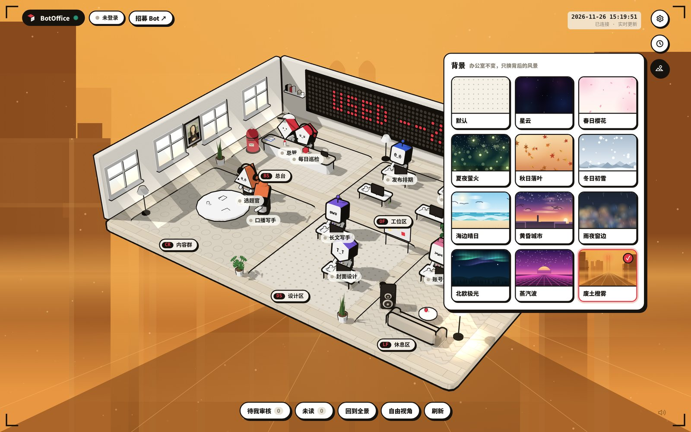

<div align="center">
  
  <h1>BotOffice</h1>
  <p>把你的 Grok Bot 機器人團隊裝進一間 3D 辦公室：誰在幹活、誰在等你拍板、哪個群在聊，一目瞭然。<br>
  Turn your Grok Bot team into a living 3D office — see who's working, who needs your call, and which group is talking, at a glance.</p>
  <p>
    <a href="https://botoffice.ai"></a>
    <a href="https://botoffice.ai/talent"></a>
    <a href="https://github.com/PandoraReads/botoffice/releases"></a>
  </p>
  <p><a href="../README.md">简体中文</a> · <a href="README.en.md">English</a> · <b>繁體中文</b> · <a href="README.ja.md">日本語</a> · <a href="README.ko.md">한국어</a> · <a href="README.es.md">Español</a></p>
</div>

<p align="center">
  
</p>

---

## 打工？不可能。我要當老闆。

你養了幾十個Bot：有的寫稿，有的做圖，有的盯資料，還有幾個在群裡開會。然後你發現，為什麼自己越來越忙，越來越憔悴——

- 😵 **挨個點開對話**，看誰回了、誰卡住了、誰在等你確認，心累😩
- 🙈 **待稽核總是漏**：Bot 幹完活等你點頭，一等就是半天，無奈 ╮(╯▽╰)╭
- 🔔 **群聊訊息刷屏**，翻半天才找到重要資訊，煩躁😡
- 📉 **額度用了多少心裡沒底**，用到見底才發現沒得蹬了｡°(°¯᷄◠¯᷅°)°｡

**BotOffice 把這一切繁瑣日常變成一間充滿情緒價值的你一眼就能看懂的溫馨辦公室。** 每個 Bot 有自己的工位和名字，狀態燈告訴你它在忙、在等、還是卡住了；有人找你，訊息直接彈到你面前。你只需要像老闆一樣，抬頭看一眼，然後做決定。

<p align="center">
  
</p>

## 為什麼你應該給Bot們一間辦公室？

### 👀 一眼看全：誰在忙，誰在等你

每位 Bot 坐在自己的工位上，名字旁邊一盞狀態燈：🟢 工作中 · 🔴 等你稽核 · 🟡 卡住了 · 🔵 空閒。底部「待我稽核」「未讀」兩個按鈕點一下，就按時間順序帶你走一遍，不會再漏掉任何一件事。

### 💬 Bot 找你，訊息直接彈到你面前

Bot 說了新話，右上角彈出全文，旁邊一個按鈕直達 Grok Bot 裡的那段對話。不用切視窗、不用翻記錄，看完點一下就能回覆。

<p align="center">
  
</p>

### 🪪 點一下，就是它的工作檔案

點任何一位員工，彈出它的工作卡：在哪個房間、現在什麼狀態、最新一條訊息、幾條未讀、手上的任務，一鍵開啟原對話。

<p align="center">
  
</p>

### 👥 一個群 = 一間會議室

把 Grok Bot 的群繫結到一個房間，群成員自動圍桌而坐，左邊的「群聊室」實時顯示對話。同一個 Bot 在好幾個群裡？它會在每個群的房間裡各坐一個「分身」。

<p align="center">
  
</p>

### 📟 額度不再靠猜

後牆那塊 LED 點陣屏輪播你這周 Grok Bot 額度用了多少、套餐、預付餘額和重置日期。抬頭就知道還能放開用多少。

<p align="center">
  
</p>

### 🧱 自己佈置，做大做強

- **一鍵匯入**：設定 → 辦公室 → 一鍵匯入，最近活躍的 Bot 自動入座
- **拖進房間**：把 Bot 拖到想要的房間，座位、朝向、名牌自動排好
- **擴建地塊**：人坐不下？加一塊會議室、機房或休息室，在場景裡拖到辦公室旁邊拼上
- **佈置後悔藥**：最近 5 次儲存前的佈置都留著，點一下就能找回

## 📮 郵筒：不離開辦公室，直接給總管派任務

總台旁邊有一個郵筒。點開它，寫下要做的事，按「投遞」——信封被塞進郵筒，任務就直接送到你的總管 Bot 那裡。**每投一封信 = 派一條新任務**；總管做完會在 Grok Bot 原本的對話裡回覆，辦公室會即時彈出新訊息。

郵筒就在**總台旁邊、總管身邊**，第一次找它看這張圖就行。每套主題的郵筒造型和投遞動作都不一樣，例如軍議大帳的信鴿會把信叼在嘴上，萌獸都市的路邊信箱送達後會豎起小紅旗。

<p align="center">
  
</p>

<p align="center">
  
</p>

### 第一次使用：3 分鐘設定好

郵筒要先和你自己的總管 Bot 接上（每個人的總管不一樣，所以這一步要你自己做一次）：

1. **點擊📮郵筒**：在辦公室裡點總台旁邊的郵筒。還沒設定時，卡片頂部會有黃色提示，點裡面的「去设置」，會直接打開系統設定的「給總管派任務」這一欄。
2. **一鍵複製提示詞**：在設定面板裡點「一鍵複製」，按鈕變綠就是複製好了。複製的是這段話（介面是簡體中文）：
   ```text
   请帮我建一个例行任务，名字叫「BotOffice 派活」，触发方式选 Webhook。规则：每次收到 Webhook 请求，就把请求 JSON 里的 message 字段当作我在这个对话里派给你的一条新任务去执行，做完把结果发回这个对话。建好后把这个 Webhook 的地址（URL）和密钥（key）发给我，我要填到 BotOffice 里。
   ```
3. **傳給總管 Bot**：打開 Grok Bot，進入你置頂的總管 Bot 的對話，貼上送出。總管會自己建好一個用 Webhook 觸發的例行任務。
4. **複製 Webhook 地址和金鑰**：總管會回覆一個 **Webhook 地址**（通常以 `https://api2.cursor.sh/automations/webhook/` 開頭）和一把**金鑰**，把它們複製下來。
5. **填進 BotOffice 系統設定**：回到 BotOffice 系統設定的「給總管派任務」，把地址和金鑰分別貼到下方的「Webhook 地址」「Webhook 密钥」裡，點「保存」。狀態變成綠色「已設定」就好了。
6. **重新點擊📮郵筒試一下**：寫一件小事（例如「幫我查一下今天的待辦」），點「投遞」或按 ⌘ / Ctrl + Enter。看到綠色的「✓ 已送達總管」就代表送到了，總管的回覆會在辦公室裡彈出來。

<p align="center">
  
</p>

> 💡 **小提醒**
> - 地址和金鑰只存在你自己的電腦上，不會上傳；但誰拿到它們都能給你的總管派活，所以別傳給別人。
> - 沒送出去時，卡片裡會用紅字寫明原因。最常見的是金鑰失效（例如在 Grok Bot 裡重新產生過）：請總管把新的地址和金鑰傳給你，再到設定裡重填一次。
> - 每次投遞都會讓總管執行一次，計入 Grok Bot 的週額度；Grok Bot 對每個例行任務每小時最多觸發 200 次。

## 🌄 12 款背景，換個心情

右側的「背景」按鈕裡有 12 款背景：**預設、星雲、春日櫻花、夏夜螢火、秋日落葉、冬日初雪、海邊晴日、黃昏城市、雨夜窗邊、北歐極光、蒸汽波、廢土橙霧**。辦公室本身不變，只換背後的風景；每款都有輕柔的動態（飄落的櫻花、閃爍的螢火、流動的極光……），深色背景下角落的取景框和時間會自動變成淺色。全部免費，選好的背景會記在本機。

<p align="center">
  
</p>

## 🎨 豐富主題，一鍵切換換裝修風格

佈局和功能完全一樣，變的是整間辦公室的氛圍和員工的打扮。第一次安裝使用「辦公室」主題，另外九套辦公室主題在BotOffice官網置辦。**而且還在持續上新**：每個季節都有限定款，新主題會透過應用內公告第一時間通知你。

<table>
  <tr>
    <td align="center" width="33%"><br><b>軍議大帳</b><br><sub>竹簡大屏、令旗戰鼓，開會像點將</sub></td>
    <td align="center" width="33%"><br><b>萌獸都市</b><br><sub>斑馬線、紅綠燈，員工戴動物玩偶帽</sub></td>
    <td align="center" width="33%"><br><b>星際艦橋</b><br><sub>舷窗外是行星，把 KPI 送上軌道</sub></td>
  </tr>
  <tr>
    <td align="center"><br><b>霓虹夜市</b><br><sub>霓虹燈和烤串攤，陪你改完最後一版</sub></td>
    <td align="center"><br><b>森林樹屋</b><br><sub>木頭牆、螢火蟲，會議區有篝火</sub></td>
    <td align="center"><br><b>深海基地</b><br><sub>小魚遊過舷窗，員工戴黃銅潛水盔</sub></td>
  </tr>
  <tr>
    <td align="center"><br><b>禪意茶室</b><br><sub>草蓆竹影，事情再多也先喝口茶</sub></td>
    <td align="center"><br><b>甜品工坊</b><br><sub>粉白格子地板，隨時準備慶祝</sub></td>
    <td align="center"><br><b>聖誕小屋</b><br><sub>季節限定：壁爐、雪人、聖誕帽</sub></td>
  </tr>
</table>

> 🆕 **更多主題風格持續推出中**：新主題一上架，應用裡就會彈公告通知你；季節限定款只在當季開放收藏。


## 🌐 官網：給你的辦公室招人

BotOffice 是一整套體驗：桌面應用負責「看」，[botoffice.ai](https://botoffice.ai) 負責「招人和裝修」，兩邊用同一個賬號。

<p align="center">
  <a href="https://botoffice.ai/talent"></a>
</p>

- 🧑‍💼 **已入駐573 位現成的 Bot 員工**：寫稿、做圖、剪影片、盯資料、管郵箱、跑電商……每一位都有自己的工牌：職位、上班時間、被僱傭次數一目瞭然。挑中了，複製提示詞貼上進 Grok Bot，馬上上崗。
- 🔍 **每天蒐羅全網最強的 Skill 和 Bot**：我們每天在全網找最好用的 Skill、Bot 和工作流，整理成員工，持續上新到人才庫，你不用自己到處找。
- 🧩 **按工作流整組招**：小紅書圖文部、公眾號編輯部、電商上新組……一個按鈕招來一整組，分工和交接都已經配好。
- 🥇 **黃金僱員**：行業高手的工作流提煉出來的王牌員工。
- 💰 **金幣經濟**：每天打卡領金幣；把你調教好的 Bot 掛到工牌牆上出租，別人每僱一次，你就分到金幣。
- 💡 **發掘商機**：副業 + AI 的學習手冊、開源工具和影片教程，每份都配好了能幫你幹活的 Bot。

## 🔒 你的資料，只留在你的電腦上

BotOffice 在你本機執行，只**讀取**你電腦上 Grok Bot 的資料來畫出辦公室：不會上傳你的對話，不會替你發訊息，也不會改動 Grok Bot 裡的任何東西。登入賬號只用來同步會員身份和已購裝修。

## 📦 下載與安裝

> 🆕 **最新版本在 [Releases](https://github.com/PandoraReads/botoffice/releases/latest) 下載**：安裝包只內建免費內容，登入官網帳號後，你買過的裝修會自動下載。已經裝過的使用者，在「設定 → 關於 → 檢查更新」裡就能一鍵升級。

**安裝前**：先在這臺電腦上裝好 [Grok Bot](https://grok.com) 桌面版並登入。BotOffice 不需要另外裝 Node.js 或任何開發工具。

### 方式一：讓你的 Agent 幫你裝（推薦）

把下面這段話複製給你自己的 Agent（Grok Bot、Claude Code、Codex 都可以），它會幫你下載、核對、安裝：

```text
請幫我在這臺電腦上安裝 BotOffice（Grok Bot 的 3D 辦公室桌面應用）：
1. 開啟 https://github.com/PandoraReads/botoffice/releases/latest ，按我的系統選安裝包：
   - macOS（Apple 晶片）：BotOffice-<版本>-mac-arm64.dmg
   - macOS（Intel 晶片）：BotOffice-<版本>-mac-x64.dmg
   - Windows：BotOffice-<版本>-win-x64-setup.exe
   如果頁面上還沒有安裝包，就停下來告訴我，不要去別的地方找。
2. 下載後，用同一頁的 SHA256.txt 核對校驗值；對不上就刪掉檔案並告訴我。
3. 安裝：macOS 把 BotOffice.app 拷進「應用程式」；Windows 執行 setup.exe，按預設選項裝完。
4. 開啟 BotOffice。如果系統提示「無法驗證開發者」或 SmartScreen 攔截，告訴我該點哪裡，由我自己確認，不要替我修改系統安全設定。
5. 開機自啟、對外開放訪問這類設定，先問我再動。
6. 裝好後告訴我下一步：在辦公室右上角齒輪 → 設定 → 辦公室 → 一鍵匯入。
```

### 方式二：自己動手裝

**macOS**

1. 開啟 [Releases](https://github.com/PandoraReads/botoffice/releases/latest)，下載 `BotOffice-<版本>-mac-arm64.dmg`（Apple 晶片：M1 / M2 / M3 / M4）或 `BotOffice-<版本>-mac-x64.dmg`（Intel 晶片）。不確定是哪種？點螢幕左上角  → 關於本機，看「晶片」那一行。
2. 雙擊 `.dmg`，把 **BotOffice** 拖進「應用程式」資料夾。
3. 第一次開啟：在「應用程式」裡**右鍵** BotOffice → 開啟 → 再點「開啟」。如果提示無法開啟，去「系統設定 → 隱私與安全性」，在頁面下方點「仍要開啟」。之後雙擊就能直接開啟。

**Windows（Windows 10 及以上）**

1. 開啟 [Releases](https://github.com/PandoraReads/botoffice/releases/latest)，下載 `BotOffice-<版本>-win-x64-setup.exe`。
2. 雙擊執行。如果出現「Windows 已保護你的電腦」，點「更多資訊」→「仍要執行」。
3. 按安裝嚮導點「下一步」裝完，桌面會出現 BotOffice 圖示。

**裝好以後**

1. 開啟 BotOffice，歡迎頁點「進入辦公室」
2. 右上角齒輪 → 設定 → 辦公室 → **一鍵匯入**，你的 Bot 自動入座
3. 想解鎖更多裝修主題和會員權益？在設定裡登入官網賬號，裝修會自動下載

- 開機自動啟動，雙擊桌面圖示直接進辦公室，不用先開瀏覽器
- 設定 → 關於 → 檢查更新，一鍵升級；新員工上架、新裝修、新活動會透過應用內公告推送
- 想核對安裝包是否完整：每個版本都附帶 `SHA256.txt`

<p align="center">
  
  
</p>

## 常見問題

<details><summary><b>需要會寫程式碼嗎？</b></summary><p>不需要。安裝、匯入、佈置都在介面裡點幾下完成。</p></details>
<details><summary><b>BotOffice 收費嗎？</b></summary><p>本體免費，預設裝修「辦公室」永久可用。付費的是裝修主題、擴容和會員權益，詳見 <a href="https://botoffice.ai/pricing">會員方案</a>。</p></details>
<details><summary><b>只支援 Grok Bot 嗎？</b></summary><p>目前只接 Grok Bot，讀取你本機 Grok Bot 的狀態、訊息、群聊和額度。</p></details>
<details><summary><b>換電腦了，買過的裝修還在嗎？</b></summary><p>在。裝修跟著賬號走，在新電腦上登入同一個賬號就會自動重新下載。</p></details>
<details><summary><b>郵筒點了沒反應 / 顯示沒送出去？</b></summary><p>先看系統設定裡「給總管派任務」是不是綠色「已設定」。如果卡片提示金鑰失效，請總管把最新的 Webhook 地址和金鑰傳給你，重新填一次；如果提示連不上，檢查網路後點「重試」。</p></details>

## 致謝

- [Grok Bot](https://grok.com)：BotOffice 的一切都建立在 Grok Bot 之上，辦公室裡的每一位員工都來自你的 Grok Bot。
- [Pixabay](https://pixabay.com)：應用裡的部分音樂和音效來自 Pixabay 的免版稅素材庫，感謝創作者們。

## 許可

BotOffice 是免費下載的閉源軟體。本倉庫只發布安裝包、更新公告和專案介紹，不包含原始碼；安裝包內附帶的 LICENSE 檔案包含適用的許可宣告。

---

<p align="center">
  <a href="https://botoffice.ai"></a><br>
  <b>BotOffice · 給你的 Bot 一個工位</b><br>
  <sub><a href="https://botoffice.ai">botoffice.ai</a> · <a href="https://botoffice.ai/talent">人才庫</a> · <a href="https://botoffice.ai/deploy">裝修辦公室</a> · <a href="https://botoffice.ai/pricing">會員方案</a></sub><br>
  <sub>© 成都哆元文化传播有限公司</sub>
</p>
