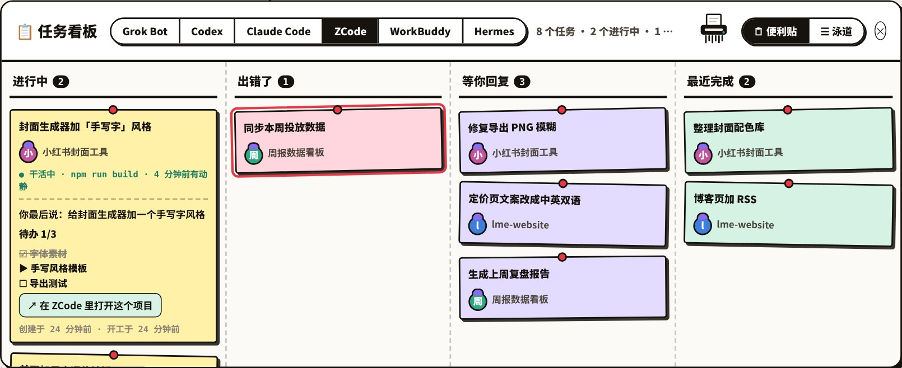
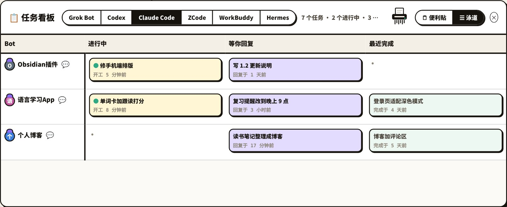

<div align="center">
  
  <h1>BotOffice</h1>
  <p>把你的 AI 員工們裝進一間溫馨的3D辦公室：誰在幹活、誰在等你拍板、哪個群在聊，一目瞭然。<br>
  Bring your AI employees into a cozy 3D office — see who's working, who needs your call, and which group is talking, at a glance.</p>
  <p>
    <a href="https://botoffice.ai"></a>
    <a href="https://botoffice.ai/talent"></a>
    <a href="https://github.com/PandoraReads/botoffice/releases"></a>
  </p>
  <p><a href="../README.md">简体中文</a> · <a href="README.en.md">English</a> · <b>繁體中文</b> · <a href="README.ja.md">日本語</a> · <a href="README.ko.md">한국어</a> · <a href="README.es.md">Español</a></p>
</div>

<p align="center">
  
</p>

> 🆕 **BotOffice 2.0 已支援接入 6 種 AI 員工**：🤖 **Grok Bot** · `>_` **OpenAI Codex** · 🎓 **Claude Code** · 🕶 **智譜 ZCode** · 🐱 **騰訊 WorkBuddy** · 🪽 **Hermes Agent**。
> 裝了哪個就接哪個，不同來源的員工可以坐在同一間辦公室，狀態、訊息、任務看板一屏看完。[看看都支援什麼 →](#-支援的-ai-員工6-種來源坐進同一間辦公室)

---

## 打工？不可能。我要當老闆。

你手下的 AI 員工越來越多：Grok Bot 寫稿做圖、Codex 和 Claude Code 寫程式、WorkBuddy 幫你跑腿，還有幾個在群裡開會。然後你發現，為什麼自己越來越忙，越來越憔悴——

- 😵 **在好幾個應用之間來回切**，挨個點開對話，看誰回了、誰卡住了、誰在等你確認，心累😩
- 🙈 **待審核總是漏**：AI 幹完活等你點頭，一等就是半天，無奈 ╮(╯▽╰)╭
- 🔔 **群聊訊息刷屏**，翻半天才找到重要資訊，煩躁😡
- 📉 **額度用了多少心裡沒底**，用到見底才發現沒得蹬了｡°(°¯᷄◠¯᷅°)°｡

**BotOffice 把這一切繁瑣日常變成一間充滿情緒價值的、你一眼就能看懂的溫馨辦公室。** 每位 AI 員工有自己的工位和名字，狀態燈告訴你誰在幹活、誰在等你回話、誰剛剛活躍；有人找你，訊息直接彈到你面前。你只需要像老闆一樣，抬頭看一眼，然後做決定。

<p align="center">
  
</p>

## 為什麼你應該給 AI 員工們一間辦公室？

### 💬 員工找你，訊息直接彈到你面前

員工說了新話，右上角彈出全文，旁邊一個按鈕直達它原來那段對話（Grok Bot、Codex、ZCode、Hermes 跳到桌面端，Claude Code 在終端機裡接著聊）。不用切視窗、不用翻紀錄，看完點一下就能回覆。

<p align="center">
  
</p>

### 🪪 點一下，就是它的工作檔案

點任何一位員工，彈出它的工作卡：在哪個房間、現在什麼狀態、最新一條訊息、幾條未讀、手上的任務，一鍵打開原對話。員工只是說了句話、你看過不打算回？點「✓ 已讀，不用回覆」，它就不再算在「等我回覆」裡。

<p align="center">
  
</p>

### 👥 一個群 = 一間會議室

把 Grok Bot 的群繫結到一個房間，群成員自動圍桌而坐，左邊的「群聊室」實時顯示對話。同一個 Bot 在好幾個群裡？它會在每個群的房間裡各坐一個「分身」。

<p align="center">
  
</p>

### 📟 額度不再靠猜

後牆那塊 LED 點陣屏輪播你這周 Grok Bot 額度用了多少、套餐、預付餘額和重置日期，也能顯示 Hermes 本週 / 今天用了多少 token（設定裡選只看 Grok、只看 Hermes、一屏都顯示或輪流顯示）。抬頭就知道還能放開用多少。

<p align="center">
  
</p>

### 🧱 自己佈置，做大做強

- **一鍵匯入**：設定 → 辦公室 → 一鍵匯入，最近活躍的員工自動入座
- **拖進房間**：把員工拖到想要的房間，座位、朝向、名牌自動排好。名單裡每個人前面都有來源小圖示，顏色也按來源區分
- **擴建地塊**：人坐不下？加一塊會議室、機房或休息室，在場景裡拖到辦公室旁邊拼上
- **拖動排序**：房間裡的成員拖一拖就能換順序，座位跟著變
- **佈置後悔藥**：最近 5 次儲存前的佈置都留著，點一下就能找回

## 📮 郵筒：不離開辦公室，直接給總管派任務

總台旁邊有一個郵筒。點開它，寫下要做的事，按「投遞」——信封被塞進郵筒，任務就直接送到你的總管 Bot 那裡。**每投一封信 = 派一條新任務**；總管做完會在 Grok Bot 原本的對話裡回覆，辦公室會即時彈出新訊息。

郵筒就在**總台旁邊、總管身邊**，第一次找它看這張圖就行。每套主題的郵筒造型和投遞動作都不一樣，例如軍議大帳的信鴿會把信叼在嘴上，萌獸都市的路邊信箱送達後會豎起小紅旗。

<p align="center">
  
</p>

<p align="center">
  
</p>

### 第一次使用：3 分鐘設定好

郵筒要先和你自己的總管 Bot 接上（每個人的總管不一樣，所以這一步要你自己做一次）：

1. **點擊📮郵筒**：在辦公室裡點總台旁邊的郵筒。第一次點開，卡片裡直接就是設定方法（設定好以後，點卡片右上角的 ⚙ 隨時修改）。
2. **一鍵複製提示詞**：點卡片裡的「一鍵複製」，按鈕變綠就是複製好了。複製的是這段話（介面是簡體中文）：
   ```text
   请帮我建一个例行任务，名字叫「BotOffice 派活」，触发方式选 Webhook。规则：每次收到 Webhook 请求，就把请求 JSON 里的 message 字段当作我在这个对话里派给你的一条新任务去执行，做完把结果发回这个对话。建好后把这个 Webhook 的地址（URL）和密钥（key）发给我，我要填到 BotOffice 里。
   ```
3. **傳給總管 Bot**：打開 Grok Bot，進入你置頂的總管 Bot 的對話，貼上送出。總管會自己建好一個用 Webhook 觸發的例行任務。
4. **複製 Webhook 地址和金鑰**：總管會回覆一個 **Webhook 地址**（通常以 `https://api2.cursor.sh/automations/webhook/` 開頭）和一把**金鑰**，把它們複製下來。
5. **填回郵筒卡片**：回到 BotOffice，把網址和金鑰分別貼到郵筒卡片的「Webhook 網址」「Webhook 金鑰」裡，點「儲存」。卡片會自動切回投遞介面，就設定好了。
6. **重新點擊📮郵筒試一下**：寫一件小事（例如「幫我查一下今天的待辦」），點「投遞」或按 ⌘ / Ctrl + Enter。看到綠色的「✓ 已送達總管」就代表送到了，總管的回覆會在辦公室裡彈出來。

<p align="center">
  
</p>

> 💡 **小提醒**
> - 地址和金鑰只存在你自己的電腦上，不會上傳；但誰拿到它們都能給你的總管派活，所以別傳給別人。
> - 沒送出去時，卡片裡會用紅色寫明原因。最常見的是金鑰失效（比如在 Grok Bot 裡重新產生過）：讓總管把新的網址和金鑰發給你，點郵筒右上角的 ⚙ 重填一次。
> - 每次投遞都會讓總管執行一次，計入 Grok Bot 的週額度；Grok Bot 對每個例行任務每小時最多觸發 200 次。
> - 用 Hermes？郵筒裡把收件人選成「Hermes 總管」就行，不用設定 Webhook；想給某個 Hermes Bot 單獨派活，直接在它的工作卡里發訊息。

## 🤝 支援的 AI 員工：6 種來源，坐進同一間辦公室

BotOffice 只**讀取你電腦上**這些 AI 工具的本機紀錄，不用改它們的任何設定。Codex、Claude Code、ZCode、WorkBuddy 都是**一個專案資料夾 = 一位員工**，名字直接用專案名；每家員工戴著自己的標誌性帽子，一眼就能認出來。

| 員工 | 3D 造型 | 能看到 | 打開原對話 | 給它發訊息 |
|---|---|---|---|---|
| 🤖 **Grok Bot** | 各種主題帽子 | 狀態、訊息、群聊、額度 | Grok Bot 桌面端 | 郵筒 / 工位卡（設定 Webhook） |
| `>_` **OpenAI Codex**（命令列、Codex 桌面版、ChatGPT 桌面版） | 墨綠色終端小帽 | 最新回覆、正在跑的命令、最近對話 | 桌面版 | ✅ |
| 🎓 **Claude Code**（命令列、Claude 桌面版裡的 Code） | 黑色學士帽 | 最新回覆、正在用的工具、對話標題 | 終端機裡接著聊 | ✅ |
| 🕶 **智譜 ZCode** | 頭頂一副超大墨鏡 | 任務狀態、最新回覆、待辦進度、未讀 | ZCode 桌面版 | ✅ |
| 🐱 **騰訊 WorkBuddy** | 綠色貓耳朵毛線帽 | 任務狀態、最新回覆、正在跑的工具 | WorkBuddy 桌面版 | 暫不支援（唯讀） |
| 🪽 **Hermes Agent** | 帶翅膀的紫色信使帽 | 狀態、訊息、任務看板、token 用量 | Hermes 桌面端 / 終端機 | ✅（接著上次聊或開新任務） |

- **自動偵測，也能手動指定**：系統設定裡能看到每一家有沒有連上；裝在非預設位置的，點「手動選擇資料夾」指給 BotOffice 就行
- **狀態燈**：在幹活的員工頭頂冒「正在輸入」的小點點，幹完等你看的亮「等你回覆」
- **員工卡片**：最新回覆、正在跑的命令或在改的檔案、這個專案最近的幾段對話，一張卡片看完

<p align="center">
  
</p>

## 📋 任務看板：誰在做什麼，一塊白板看清

點辦公室工位區的**白板**，打開任務看板。頂部按來源切換：**Grok Bot · Codex · Claude Code · ZCode · WorkBuddy · Hermes**。

- **Codex / Claude Code / ZCode / WorkBuddy**：不用任何設定，**每段對話（任務）就是一張便利貼**，按「進行中 / 等你回覆 / 最近完成」自動歸好，ZCode 還會多一欄「出錯了」。點開卡片能看到你最後說的話、AI 的最新回覆、正在跑的命令，ZCode 的卡片還帶待辦進度（☑ 已完成 ▶ 進行中 ☐ 待做）
- **Grok Bot**：讓你的巡檢 Bot 用排程任務把團隊任務寫到本機，看板就會自動出現、每 10 秒刷新。第一次用，看板裡有「一鍵複製提示詞」，發給巡檢 Bot 就行
- **Hermes**：直接讀取 Hermes 內建的任務看板（Kanban），多個看板合在一起顯示
- **兩種視圖**：便利貼（按狀態分欄）和泳道（每位員工一行，誰忙誰閒一目瞭然）
- **點員工跳對話**：點卡片上的員工名，直接回到和它的對話
- **🗑 碎紙機**：任務不要了？把卡片拖進右上角的碎紙機，5 秒內可以撤銷。Grok Bot 的任務會透過總管通知負責的 Bot 停手；Hermes 的任務會封存（還能找回）；Codex、Claude Code、ZCode、WorkBuddy 的卡片只是從看板上拿掉，原來的對話不受影響
- 關掉再打開，停在你上次看的來源和視圖

<p align="center">
  
</p>
<p align="center">
  
</p>

## 🐈‍⬛ 櫃台多了一隻小黑貓：會撒嬌，也會幫你解答

總台右下角住著「小黑」，一隻戴紅圍巾的黑色小奶貓，坐墊前那碗貓糧堆得冒了尖（碗的顏色會跟著主題變）。

- 🐾 **摸摸牠**：滑鼠移上去變成手掌，小黑會翹屁股、翻肚皮、冒愛心；閒著時打盹、四腳朝天，頭上冒出小魚、蝴蝶、主人和討厭的狗狗
- 💬 **點牠聊天**：接上你自己的對話模型（DeepSeek、Kimi、通義千問、智譜、OpenAI、Gemini、Claude 或自訂），牠就能陪你聊天、出主意，也是 BotOffice 的小客服，怎麼裝、怎麼用都能問
- 🔁 **多個模型互為備援**：排第一的是主模型，連不上時自動換下一個
- 📒 **小本本記憶**：牠會記住你說過的重要事情，記錯了可以劃掉，也能直接告訴牠
- 🌐 **連網搜尋**：開啟後能上網查新鮮事，回答附出處連結。主模型是 DeepSeek 時不用另外填 Key
- 💕 **親密度**：常摸摸、常聊天會越來越黏你；太久不理牠會蔫，甚至想你想到生病

API Key 只存在你自己的電腦上。

<p align="center">
  
</p>

## 🌄 12 款背景，換個心情

右側的「背景」按鈕裡有 12 款背景：**預設、星雲、春日櫻花、夏夜螢火、秋日落葉、冬日初雪、海邊晴日、黃昏城市、雨夜窗邊、北歐極光、蒸汽波、廢土橙霧**。辦公室本身不變，只換背後的風景；每款都有輕柔的動態（飄落的櫻花、閃爍的螢火、流動的極光……），深色背景下角落的取景框和時間會自動變成淺色。全部免費，選好的背景會記在本機。

<p align="center">
  
</p>

## 🎨 豐富主題，一鍵切換換裝修風格

佈局和功能完全一樣，變的是整間辦公室的氛圍和員工的打扮。第一次安裝使用「辦公室」主題，另外九套辦公室主題在BotOffice官網置辦。**而且還在持續上新**：每個季節都有限定款，新主題會透過應用內公告第一時間通知你。

<table>
  <tr>
    <td align="center" width="33%"><br><b>軍議大帳</b><br><sub>竹簡大屏、令旗戰鼓，開會像點將</sub></td>
    <td align="center" width="33%"><br><b>萌獸都市</b><br><sub>斑馬線、紅綠燈，員工戴動物玩偶帽</sub></td>
    <td align="center" width="33%"><br><b>星際艦橋</b><br><sub>舷窗外是行星，把 KPI 送上軌道</sub></td>
  </tr>
  <tr>
    <td align="center"><br><b>霓虹夜市</b><br><sub>霓虹燈和烤串攤，陪你改完最後一版</sub></td>
    <td align="center"><br><b>森林樹屋</b><br><sub>木頭牆、螢火蟲，會議區有篝火</sub></td>
    <td align="center"><br><b>深海基地</b><br><sub>小魚遊過舷窗，員工戴黃銅潛水盔</sub></td>
  </tr>
  <tr>
    <td align="center"><br><b>禪意茶室</b><br><sub>草蓆竹影，事情再多也先喝口茶</sub></td>
    <td align="center"><br><b>甜品工坊</b><br><sub>粉白格子地板，隨時準備慶祝</sub></td>
    <td align="center"><br><b>聖誕小屋</b><br><sub>季節限定：大月亮、雪橇飛過窗前、壁爐燭光</sub></td>
  </tr>
</table>

> 🆕 **更多主題風格持續推出中**：新主題一上架，應用裡就會彈公告通知你；季節限定款只在當季開放收藏。


## 🌐 官網：給你的辦公室招人

BotOffice 是一整套體驗：桌面應用負責「看」，[botoffice.ai](https://botoffice.ai) 負責「招人和裝修」，兩邊用同一個賬號。

<p align="center">
  <a href="https://botoffice.ai/talent"></a>
</p>

- 🧑‍💼 **已入駐 573 位現成的 Bot 員工**：寫稿、做圖、剪影片、盯數據、管信箱、跑電商……每一位都有自己的工牌：職位、上班時間、被雇用次數一目瞭然。挑中了，複製提示詞貼進你的 Agent，馬上上崗。
- 🔍 **每天蒐羅全網最強的 Skill 和 Bot**：我們每天在全網找最好用的 Skill、Bot 和工作流，整理成員工，持續上新到人才庫，你不用自己到處找。
- 🧩 **按工作流整組招**：小紅書圖文部、公眾號編輯部、電商上新組……一個按鈕招來一整組，分工和交接都已經配好。
- 🥇 **黃金僱員**：行業高手的工作流提煉出來的王牌員工。
- 💰 **金幣經濟**：每天打卡領金幣；把你調教好的 Bot 掛到工牌牆上出租，別人每僱一次，你就分到金幣。
- 💡 **發掘商機**：副業 + AI 的學習手冊、開源工具和影片教程，每份都配好了能幫你幹活的 Bot。

## 🔒 你的資料，只留在你的電腦上

BotOffice 在你本機執行，**讀取**你電腦上 Grok Bot、Codex、Claude Code、ZCode、WorkBuddy、Hermes 的本機紀錄來畫出辦公室：不會上傳你的對話；只有你親手點了「投遞」「傳送」或把卡片拖進碎紙機，才會替你發出訊息，其餘時候不會改動這些工具裡的任何東西。登入帳號只用來同步會員身分和已購裝修。

## 📦 下載與安裝

> 🆕 **最新版本在 [Releases](https://github.com/PandoraReads/botoffice/releases/latest) 下載**：安裝包只內建免費內容，登入官網帳號後，你買過的裝修會自動下載。已經裝過的使用者，在「設定 → 關於 → 檢查更新」裡就能一鍵升級。

**安裝前**：這台電腦上至少裝好一個 AI 員工的來源：Grok Bot、OpenAI Codex、Claude Code、智譜 ZCode、騰訊 WorkBuddy 或 Hermes Agent（裝幾個都行），並且用它聊過至少一次。BotOffice 不需要另外裝 Node.js 或任何開發工具。

### 方式一：讓你的 Agent 幫你裝（推薦）

把下面這段話複製給你自己的 Agent（Grok Bot、Hermes、Claude Code、Codex 都可以），它會幫你下載、核對、安裝：

```text
請幫我在這台電腦上安裝 BotOffice（給 AI 員工們的 3D 辦公室桌面應用，支援 Grok Bot、Codex、Claude Code、ZCode、WorkBuddy、Hermes）：
1. 開啟 https://github.com/PandoraReads/botoffice/releases/latest ，按我的系統選安裝包：
   - macOS（Apple 晶片）：BotOffice-<版本>-mac-arm64.dmg
   - macOS（Intel 晶片）：BotOffice-<版本>-mac-x64.dmg
   - Windows：BotOffice-<版本>-win-x64-setup.exe
   如果頁面上還沒有安裝包，就停下來告訴我，不要去別的地方找。
2. 下載後，用同一頁的 SHA256.txt 核對校驗值；對不上就刪掉檔案並告訴我。
3. 安裝：macOS 把 BotOffice.app 拷進「應用程式」；Windows 執行 setup.exe，按預設選項裝完。
4. 開啟 BotOffice。如果系統提示「無法驗證開發者」或 SmartScreen 攔截，告訴我該點哪裡，由我自己確認，不要替我修改系統安全設定。
5. 開機自啟、對外開放訪問這類設定，先問我再動。
6. 裝好後告訴我下一步：在辦公室右上角齒輪 → 設定 → 辦公室 → 一鍵匯入。
```

### 方式二：自己動手裝

**macOS**

1. 開啟 [Releases](https://github.com/PandoraReads/botoffice/releases/latest)，下載 `BotOffice-<版本>-mac-arm64.dmg`（Apple 晶片：M1 / M2 / M3 / M4）或 `BotOffice-<版本>-mac-x64.dmg`（Intel 晶片）。不確定是哪種？點螢幕左上角  → 關於本機，看「晶片」那一行。
2. 雙擊 `.dmg`，把 **BotOffice** 拖進「應用程式」資料夾。
3. 第一次開啟：在「應用程式」裡**右鍵** BotOffice → 開啟 → 再點「開啟」。如果提示無法開啟，去「系統設定 → 隱私與安全性」，在頁面下方點「仍要開啟」。之後雙擊就能直接開啟。

**Windows（Windows 10 及以上）**

1. 開啟 [Releases](https://github.com/PandoraReads/botoffice/releases/latest)，下載 `BotOffice-<版本>-win-x64-setup.exe`。
2. 雙擊執行。如果出現「Windows 已保護你的電腦」，點「更多資訊」→「仍要執行」。
3. 按安裝嚮導點「下一步」裝完，桌面會出現 BotOffice 圖示。

**裝好以後**

1. 開啟 BotOffice，歡迎頁點「進入辦公室」
2. 右上角齒輪 → 設定 → 辦公室 → **一鍵匯入**，你的 AI 員工自動入座
3. 想解鎖更多裝修主題和會員權益？在設定裡登入官網賬號，裝修會自動下載

- 開機自動啟動，雙擊桌面圖示直接進辦公室，不用先開瀏覽器
- 設定 → 關於 → 檢查更新，一鍵升級；新員工上架、新裝修、新活動會透過應用內公告推送
- 想核對安裝包是否完整：每個版本都附帶 `SHA256.txt`

<p align="center">
  
  
</p>

## 常見問題

<details><summary><b>需要會寫程式碼嗎？</b></summary><p>不需要。安裝、匯入、佈置都在介面裡點幾下完成。</p></details>
<details><summary><b>BotOffice 收費嗎？</b></summary><p>本體免費，預設裝修「辦公室」永久可用。付費的是裝修主題、擴容和會員權益，詳見 <a href="https://botoffice.ai/pricing">會員方案</a>。</p></details>
<details><summary><b>支援哪些 AI 員工？</b></summary><p>Grok Bot、OpenAI Codex、Claude Code、智譜 ZCode、騰訊 WorkBuddy、Hermes Agent。Codex、Claude Code、ZCode、WorkBuddy 按專案資料夾分員工；Grok Bot 還能看群聊和額度，Hermes 還能看內建的任務看板和 token 用量。不同來源的員工可以坐在同一間辦公室。Claude 桌面版裡的一般聊天和 Cowork 存在雲端，讀不到。</p></details>
<details><summary><b>換電腦了，買過的裝修還在嗎？</b></summary><p>在。裝修跟著賬號走，在新電腦上登入同一個賬號就會自動重新下載。</p></details>
<details><summary><b>郵筒點了沒反應 / 顯示沒送出去？</b></summary><p>先點郵筒右上角的 ⚙，看是不是綠色「已設定」。如果卡片裡提示金鑰失效，讓總管把最新的 Webhook 網址和金鑰發給你，重新填一次；如果提示連不上，檢查網路後點「重試」。</p></details>

## 致謝

BotOffice 能把這麼多 AI 員工請進同一間辦公室，要感謝這些優秀的工具（BotOffice 只讀取它們留在你電腦上的本機紀錄，和這些產品沒有官方合作關係，名稱和商標歸各自所有者）：

- [Grok Bot](https://grok.com)：BotOffice 從 Grok Bot 起步，群聊室、額度屏和郵筒都是為它打造的。
- [OpenAI Codex](https://openai.com/codex)：命令列、Codex 桌面版和 ChatGPT 桌面版裡的 Codex 對話都能坐進辦公室。
- [Claude Code](https://claude.com/product/claude-code)（Anthropic）：命令列和 Claude 桌面版裡的 Code 對話都能坐進辦公室。
- [智譜 ZCode](https://github.com/zai-org/ZCode)：開源的 AI 程式設計工作台，任務狀態和待辦進度都來自它的本機紀錄。
- [騰訊 WorkBuddy](https://www.workbuddy.ai)：桌面打工 Agent，它的每個任務都能在辦公室裡看到。
- [Hermes Agent](https://hermes-agent.nousresearch.com)（Nous Research）：Hermes 的每個 Bot 都能坐進辦公室，任務看板也來自 Hermes 內建的 Kanban。
- [Pixabay](https://pixabay.com)：應用裡的部分音樂和音效來自 Pixabay 的免版稅素材庫，感謝創作者們。
- [麥當的 Bot 小鎮](https://www.mdldm.club/grok-bots)：部分 Bot 員工的提示詞參考了 Bot 小鎮，感謝麥當的分享。

## 許可

BotOffice 是免費下載的閉源軟體。本倉庫只發布安裝包、更新公告和專案介紹，不包含原始碼；安裝包內附帶的 LICENSE 檔案包含適用的許可宣告。

---

<p align="center">
  <a href="https://botoffice.ai"></a><br>
  <b>BotOffice · 給你的 AI 員工一個工位</b><br>
  <sub><a href="https://botoffice.ai">botoffice.ai</a> · <a href="https://botoffice.ai/talent">人才庫</a> · <a href="https://botoffice.ai/deploy">裝修辦公室</a> · <a href="https://botoffice.ai/pricing">會員方案</a></sub><br>
  <sub>© 成都哆元文化传播有限公司</sub>
</p>
